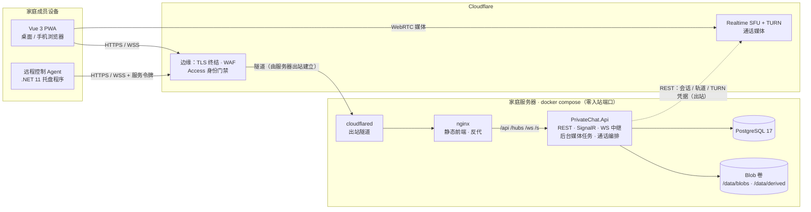

# PrivateChat · 家庭私有通讯平台设计稿

| | |
|---|---|
| 版本 | v0.4 |
| 日期 | 2026-11-11 |
| 状态 | M0–M5 已实现，M6 进行中（搜索已完成）；文档随代码更新 |
| 技术栈 | .NET 11 · ASP.NET Core · SignalR · PostgreSQL 17 · Cloudflare Realtime · Vue 3 · TypeScript · Element Plus · Docker Compose |

---

## 0. 结论先行

1. **后端做成模块化单体**：一个 ASP.NET Core 11 进程承载 REST、SignalR、WebSocket 中继和后台媒体任务；前端静态文件由 nginx 托管。家庭规模不需要微服务，但代码按功能"垂直切片"组织，将来拆得开。
2. **音视频通话/会议用 Cloudflare Realtime SFU + TURN**：媒体 100% 走 Cloudflare，家里不跑媒体服务器、不开任何 UDP 端口；.NET 负责房间编排（调用会话 / 轨道 API）和通话记录。
3. **远程控制必须有原生 Agent**：浏览器只能共享屏幕，无法注入键鼠。用 .NET 写 Windows 被控端 Agent（被控电脑都是 Windows）；传输先走服务器 WebSocket 中继（443 一个端口通吃、不怕 NAT），浏览器用 WebCodecs 解码。Agent 进程内截屏（桌面复制，不能用时 GDI）、用 Media Foundation 的 H.264 编码器编码（显卡的硬件编码器，不能用时 Windows 自带的软件编码器；两样新的都要这台电脑上探测验证过才用），单个 exe，不带外部程序。
4. **存储用本地磁盘卷 + 内容寻址 Blob 表**：聊天附件、网盘文件、动态图片三处引用同一份数据，按 SHA-256 去重；通过 `IBlobStore` 抽象，日后可换 S3。
5. **前端一套 Vue 3 + TS 代码**覆盖桌面浏览器和手机 PWA（可安装、可推送），后期如需后台来电再用 Capacitor 套壳。
6. **入口走 Cloudflare Zero Trust**：服务器不开任何入站端口，cloudflared 建出站隧道，TLS 在 Cloudflare 边缘终结，Cloudflare Access 做身份门禁，应用直接信任 Access 签发的身份、不再维护密码。nginx 托管前端静态文件并反代 API。必需容器 4 个（cloudflared、web、api、postgres），`docker compose up -d` 一键。

---

## 1. 目标与范围

### 1.1 使用场景

- 一个家庭 5–20 人，可能跨城市 / 跨国；设备混杂：iPhone、安卓、Windows、Mac、长辈的平板。
- 多数成员非技术用户，"安装"门槛要尽量低：浏览器打开即用、添加到主屏幕即可。
- 部署在自家 NAS / 小主机 / 一台云服务器上，由家里的"技术担当"维护。

### 1.2 功能范围与优先级

| 优先级 | 功能 | 说明 |
|---|---|---|
| P0 | 账号、家庭、邀请码、角色 | 关闭公开注册 |
| P0 | 文字 / 图片 / 语音 / 视频 / 文件消息，群聊，已读，撤回，表情回应，引用回复 | 核心 |
| P0 | 离线推送（Web Push）、PWA | 收不到消息就没人用 |
| P1 | 云盘：断点续传上传、目录、共享、回收站、相册时间线 | 与聊天共用存储 |
| P1 | 1:1 音视频通话、多人会议、屏幕共享、常驻"客厅"会议室 | Cloudflare Realtime |
| P2 | 动态（SNS）：发动态、评论、点赞、相册、那年今天 | 家庭朋友圈 |
| P2 | 远程控制（被控端为 Windows） | 帮爸妈修电脑 |
| P3 | WebDAV 挂载、搜索、长辈模式、原生 App 壳 | 打磨 |

### 1.3 明确不做

- **端到端加密**：服务器是自家的，且缩略图、转码、搜索都需要明文。后期可为 1:1 对话单独加 MLS，架构不排斥。
- 公开注册、多租户、商业化。
- 自研 SFU、自研 TURN、自研视频编解码。
- 横向扩展：单机即可。SignalR 若将来多实例只需加 Redis backplane，协议不变。

---

## 2. 技术选型

### 2.1 总表

| 层 | 选择 | 理由 | 备选 |
|---|---|---|---|
| 运行时 | .NET 11（STS，支持到 2028-11） | 本机已装 SDK 11.0.100 | .NET 10（LTS） |
| Web 框架 | ASP.NET Core MVC Controller（`[ApiController]` + 特性路由）+ SignalR | 按资源分组清晰，自动模型校验、过滤器做统一异常与审计；实时推送内置 | Minimal API |
| ORM / 数据库 | EF Core 10 + PostgreSQL 17 | JSONB 存消息载荷；`pg_trgm` 做中文子串搜索；只要一个容器 | SQLite（并发写弱）、MySQL |
| 对象存储 | 本地磁盘卷 + 内容寻址 + `IBlobStore` 抽象 | 零额外组件，ffmpeg 直接读，备份就是拷目录 | S3 兼容（Garage / RustFS / 云 OSS） |
| 大文件上传 | tus 协议（`tusdotnet` + `tus-js-client`） | 断点续传，手机弱网必需 | 自研分片 |
| 媒体处理 | ffmpeg（容器内）+ Magick.NET | 视频转码 / 封面；HEIC → JPEG、EXIF 方向 | ImageSharp（商用授权限制） |
| 音视频 | Cloudflare Realtime（SFU + TURN，REST API 编排） | 媒体 100% 走 Cloudflare，家里零媒体端口、零媒体带宽；每月前 1 TB 免费 | LiveKit 自建（需公网端口或 WARP）、RealtimeKit 托管 SDK |
| 远程控制 | 自研 .NET Agent + WebSocket 中继 + 浏览器 WebCodecs 解码 | 全程走 443，无 NAT 问题 | RustDesk 自托管（兜底）、WebRTC P2P（v3） |
| 推送 | Web Push（VAPID） | iOS 16.4+ / Android / 桌面全覆盖，无需厂商通道 | Capacitor 原生推送（后期） |
| 认证 | Cloudflare Access 签发的身份（JWT 头）→ 应用按邮箱自动建号；Agent 用 Access 服务令牌 + 应用设备令牌 | 身份、验证码、多因素都交给 Cloudflare，应用不存密码 | 应用内密码登录（局域网直连备用） |
| API 契约 | 内置 OpenAPI + Scalar → `openapi-typescript` / `openapi-fetch` | 端到端类型安全 | 手写 DTO |
| 前端 | Vue 3.5 + TypeScript 5 + Vite 7 + Pinia + Vue Router + VueUse | 用户指定 | — |
| UI 库 | Element Plus + Tailwind CSS 4 | 组件全、中文文档与社区成熟、unplugin 按需自动导入 | Naive UI |
| 本地缓存 | Dexie（IndexedDB） | 消息离线缓存、冷启动秒开 | — |
| PWA | vite-plugin-pwa | 手机"安装"、推送、Share Target | Capacitor（后期套壳） |
| 入口 | Cloudflare Tunnel（cloudflared）+ Cloudflare Access | 零入站端口、零证书管理、自带 WAF 与身份门禁 | Caddy / Traefik 自签证书直连 |
| 前端托管 / 反代 | nginx | 静态文件 + 反代 API / SignalR；内网明文 HTTP，TLS 在 Cloudflare 边缘 | Caddy |
| 部署 | Docker Compose（4 个必需容器） | 一键 | k3s（过度） |

### 2.2 三个关键决策

#### 决策 A：音视频用 Cloudflare Realtime SFU，不自建

| 方案 | 优点 | 缺点 | 结论 |
|---|---|---|---|
| 浏览器 P2P mesh | 零服务端 | N 人会议每人要上传 N−1 路，手机 4 人就卡；无法录制 | 仅适合 1:1，不选 |
| **Cloudflare Realtime**（SFU + TURN） | 媒体 100% 走 Cloudflare 任播网络，家里零媒体端口、零媒体带宽；与 Tunnel / Access 同一个账号；每月前 1 TB 免费 | 没有"房间"概念，要自己编排会话与轨道；无服务端录制；产品较新 | **选** |
| LiveKit 自建 | 功能最全、SDK 成熟 | 媒体 UDP 过不了 Cloudflare 隧道，必须开公网端口或让家人装 WARP，与"全走 Cloudflare"冲突 | 不选 |
| Jitsi Meet | 功能全 | 5+ 容器，同样要开媒体端口 | 不选 |
| RealtimeKit（Cloudflare 托管 SDK） | 几乎不用写通话代码 | 按分钟计费、UI 难深度定制 | 备选 |

.NET 侧做的事：按参与者创建 Cloudflare 会话、转发 SDP、增删轨道、签发 TURN 凭据、维护房间与参与者状态并经 SignalR 广播。浏览器只用原生 `RTCPeerConnection`，App Secret 永远不下发。

#### 决策 B：存储用本地磁盘 + 内容寻址，不上对象存储

- MinIO 社区版 2025 年起转为仅提供源码、不再发布预编译二进制与镜像，已不是"随手拉一个"的组件；Garage / RustFS / SeaweedFS 可用，但对家庭场景是多余的一层。
- 家庭规模（几百 GB 到几 TB 照片视频）一块盘或 NAS 卷足够，备份就是 rsync / restic 一个目录。
- 代码里定义 `IBlobStore`（Put / OpenRead / Delete / Exists），v1 实现 `FileSystemBlobStore`，路径为 `/data/blobs/{sha256 前 2 位}/{次 2 位}/{sha256}`；将来 `S3BlobStore` 可无痛替换。
- 所有媒体按 SHA-256 去重，形成"**一份存储，三处引用**"：同一张照片在聊天里发过、又放进网盘、又发了动态，磁盘上只有一份。

#### 决策 C：远程控制用"Agent + 服务器中继"，不用 P2P，也不可能纯浏览器

- 浏览器只能 `getDisplayMedia` 共享屏幕，**无法注入键鼠**，所以被控端必须装原生程序。
- WebRTC P2P 需要 STUN / TURN；国内手机网络多为对称 NAT / CGNAT，大概率还是要走 TURN 中继。既然都要中继，不如直接用自家服务器做 WebSocket 中继：**443 一个端口通吃**，穿墙无忧，实现最简单。
- 视频流：Agent 产出 H.264 Annex-B 裸流 → WebSocket → 浏览器 `VideoDecoder`（WebCodecs）→ canvas。局域网延迟 <100 ms，公网 150–300 ms，足够"帮爸妈点鼠标、装软件"。
- 分三步走：v1 进程内 GDI 截屏 + Media Foundation 软件 H.264 编码（Windows 自带，关键帧可按需，单文件 exe），以当前用户运行；v2 桌面复制 + 硬件编码、SYSTEM 服务解决 UAC / 锁屏；v3 可选 WebRTC P2P 再降延迟。
  （桌面复制 + 硬件编码后来提前做了：GDI 截屏一帧就要十几到三十毫秒，是卡的大头。探测验证过才用、出错就退回 GDI / 软件编码器，见 4.8 的"截屏和编码器怎么选"；v2 剩下 SYSTEM 服务。）
  （原计划 v1 用 ffmpeg 子进程；实测 Media Foundation 编码 1080p 每帧 2–3 ms，省掉随包分发 100 MB 的 ffmpeg 和 GPL 的 libx264，就直接做了进程内。）
- RustDesk 自托管作为过渡与兜底（compose 里一个可选 profile），网页里记录成员的 RustDesk ID 一键唤起。
- 入口换成 Cloudflare Tunnel 后这个选择更顺：隧道只代理 HTTP / WebSocket，中继方案原样可用；WebRTC P2P 反而要另开端口。
- 后来（被控端 0.8.0）加了第二条线路：中继方案的画面要在家里的宽带上来回绕，实际用起来慢。画面和声音可以改经 Cloudflare Realtime（通话已经在用的 SFU）从被控端直接到浏览器，走 UDP、不回家里；键鼠等控制帧仍走中继。走哪条线路由用户选（默认新的这条），两条之间不自动互换。服务器照样不用开端口。见 4.8 的"快速线路"。

---

## 3. 总体架构

### 3.1 组件图



### 3.2 运行时组件

| 组件 | 容器 | 职责 |
|---|---|---|
| Cloudflare 边缘 | 无（云端） | TLS 终结、证书、WAF、Access 身份门禁；服务器不需要任何证书 |
| Cloudflare Realtime | 无（云端） | SFU + TURN，通话媒体不进家庭网络；api 通过 REST 创建会话、增删轨道、签发 TURN 凭据 |
| cloudflared | `cloudflared` | 向 Cloudflare 建出站隧道，把 `chat.example.com` 的流量送到 nginx |
| nginx | `web` | 托管 Vue 静态文件；反代 `/api` `/hubs` `/ws` `/s` 到 api |
| PrivateChat.Api | `api` | REST（Controller）、SignalR、远程控制 WebSocket 中继、通话编排、后台媒体任务（同进程 HostedService） |
| PostgreSQL | `postgres` | 全部结构化数据 |
| 数据卷 | `data` | `/data/blobs` 原件、`/data/derived` 缩略图与转码产物、`/data/keys` 自动生成的密钥、`/data/tus` 上传临时区 |
| Agent | 不在容器内 | 安装在家庭成员电脑上的托盘程序，带 Access 服务令牌经隧道连回服务器 |

### 3.3 三条核心数据流

**发一张照片**

1. 前端用 Web Crypto 流式算出 SHA-256，`POST /api/blobs/precheck`；已存在则秒传拿到 blobId。
2. 否则走 tus 协议分片上传到 `/api/uploads`（断网可续），完成后服务端校验哈希、落盘、写 `blobs` 行。
3. 前端通过 SignalR `SendMessage` 发送消息（带 clientMessageId + blobId）；服务端在事务里给会话 seq +1、写 `messages`，向会话成员广播 `MessageReceived`，离线成员入队 Web Push。
4. 后台任务生成 320 / 1280 缩略图（HEIC 转 WebP），完成后广播 `MessageUpdated` 补齐缩略图字段。

**发起视频通话**

1. A 点"视频" → `POST /api/calls` → 创建 `call_sessions`，SignalR `IncomingCall` + Web Push 让其他成员响铃，60 s 无人接听记为未接。
2. 每个加入者先拿到麦克风 / 摄像头，再 `POST /api/calls/{id}/join`：api 登记参与者并返回 ICE 服务器（含 24 h 有效的 TURN 凭据）；第二个人加入的那一刻算接通。媒体直接到 Cloudflare 的任播节点，不经过家里。
3. 发布：浏览器在"发布连接"上生成 offer → `POST /api/calls/{id}/publish` → api（第一次时先 `sessions/new`）调 `tracks/new` 拿到 answer 回传，写 `call_tracks`，广播 `TrackPublished`。
4. 订阅：其他端收到 `TrackPublished` → `POST /api/calls/{id}/pull`（只给参与者 Id + 轨道名）→ api 换成对方的 Cloudflare 会话去 `tracks/new` → 返回带新轨道的 offer → 浏览器在"订阅连接"上回 answer → `POST /api/calls/{id}/renegotiate`。
5. 挂断、关页面（sendBeacon）或 35 s 没有心跳 → api 强制关闭该参与者的轨道、广播 `ParticipantLeft`；单聊里一方离开即结束，群聊等最后一人离开，结束时在会话里插入一条"通话"消息。

**远程控制爸爸的电脑**

1. 爸爸电脑上的 Agent 带 Cloudflare Access 服务令牌穿过门禁，再用设备令牌连接 `/hubs/agent`（与网页的 `/hubs/chat` 分开：Agent 连着不算爸爸"在线"），上报版本、系统、显示器。
2. 我在"设备"页点"远程控制" → `POST /api/remote/sessions`；服务端校验角色与设备策略，经 SignalR 通知 Agent。
3. Agent 弹窗"XX 请求远程控制（30 s）"，爸爸点同意；或者我输入该设备的无人值守 PIN。
4. 双方各自连接 `/ws/remote/{sessionId}/agent` 与 `/controller`，服务端按消息原样转发（只看模式下丢掉控制端发来的输入帧）；Agent 推 H.264 帧，我这边每解出一帧回一个确认、把鼠标 / 键盘事件发回去。
5. 被控端屏幕顶部有红色常驻条"正在被 XX 远程控制 [断开]"；任一方点结束、或断开超过 30 秒即结束，服务端写审计记录（谁、何时、多久、流量、结束原因）。

---

## 4. 后端设计

### 4.1 代码结构

```
PrivateChat/
├─ PrivateChat.slnx
├─ Directory.Build.props / Directory.Packages.props   # 统一包版本（Central Package Management）
├─ src/
│  ├─ PrivateChat.Api/                 # 唯一的服务进程（模块化单体）
│  │  ├─ Program.cs                    # 组装：AddControllers / MapControllers、Access 认证、SignalR、OpenAPI、tus、HostedService
│  │  ├─ Features/                     # 垂直切片：每个功能自带 Controllers / Hub / Service / Dto
│  │  │  ├─ Auth/            Cloudflare Access 身份映射、局域网密码登录、设备码登录
│  │  │  ├─ Family/          家庭、成员、邀请码、角色
│  │  │  ├─ Chat/            会话、消息、ChatHub、已读、撤回、表情回应
│  │  │  ├─ Calls/           Cloudflare Realtime 会话 / 轨道编排、TURN 凭据、通话记录、"客厅"常驻房间
│  │  │  ├─ Drive/           节点、共享、tus 上传、流式下载、回收站、WebDAV（后期）
│  │  │  ├─ Moments/         动态、评论、点赞、相册、那年今天
│  │  │  ├─ Remote/          设备注册、会话协商、同意流程、WebSocket 中继
│  │  │  ├─ Notifications/   Web Push 订阅与发送、站内通知
│  │  │  └─ Search/          pg_trgm 搜索
│  │  ├─ Domain/             实体与值对象（无框架依赖）
│  │  └─ Infrastructure/     AppDbContext、FileSystemBlobStore、FfmpegMediaProcessor、
│  │                         DbJobQueue、WebPushSender、CloudflareRealtimeClient、CloudflareAccessAuthHandler
│  ├─ PrivateChat.Contracts/           # Api 与 Agent 共享的协议（远程控制帧格式等）
│  └─ PrivateChat.Agent/               # 远程控制 Agent（net11.0-windows，仅 Windows；托盘 + 后台 Worker）
├─ web/                                 # Vue 3 + TS
├─ deploy/                              # docker-compose.yml、nginx.conf、Dockerfile.api / .web、init-env.sh
├─ docs/
└─ tests/
   ├─ PrivateChat.Api.Tests/            # xUnit + Testcontainers（真 Postgres）
   └─ web：vitest + playwright
```

约定：

- 一个 Feature 目录 = 按资源划分的若干 `[ApiController]` 控制器（`[Route("api/[controller]")]`，如 `ConversationsController`、`MessagesController`）+ 服务类。控制器只做参数绑定、鉴权特性和调用服务，业务逻辑全在服务类里；统一异常、审计日志用全局过滤器。跨 Feature 只通过服务接口或领域事件调用，不互相翻对方的表。
- 所有主键用 `Guid.CreateVersion7()`：时间有序，B-Tree 索引友好。
- 时间统一 UTC `timestamptz`，前端按用户时区显示。
- 配置走 Options 模式，环境变量用 `App__PublicUrl` 这种双下划线映射，方便 compose 注入。
- 首次启动自动生成设备令牌签名密钥与 VAPID 密钥对，存到 `/data/keys`，`.env` 里不用填。

### 4.2 数据模型

**身份与家庭**

| 表 | 关键字段 |
|---|---|
| `users` | id, email（Access 身份映射键）, username, display_name, avatar_blob_id, password_hash（仅局域网备用登录）, role（Admin / Member / Child）, elder_mode, created_at, disabled_at |
| `families` | id, name。v1 单家庭，表保留给未来 |
| `invites` | email（允许自动建号的家人邮箱）, code（局域网模式用）, created_by, role, expires_at, used_by |
| `devices` | id, user_id, kind（Browser / Agent）, name, platform, push_subscription jsonb, token_hash, last_seen_at, remote_capable, unattended_pin_hash, pin_failures, pin_locked_until, allowed_controllers jsonb, trusted_controllers jsonb（免同意名单）, agent_version, os, revoked_at |
| `refresh_tokens` | id, user_id, device_id, hash, expires_at, revoked_at |

**聊天**

| 表 | 关键字段 |
|---|---|
| `conversations` | id, type（Direct / Group / Family）, title, avatar_blob_id, last_seq, created_at |
| `conversation_members` | conversation_id, user_id, role, last_read_seq, muted_until, joined_at |
| `messages` | id, conversation_id, **seq**, sender_id, client_message_id, type（Text / Image / Video / Audio / File / Sticker / Call / System）, body, payload jsonb, reply_to_id, forwarded_from_id, created_at, edited_at, deleted_at |
| `message_attachments` | message_id, blob_id, kind, meta jsonb（width, height, duration, name, size, thumb / poster 变体） |
| `message_reactions` | message_id, user_id, emoji, created_at |

唯一约束：`(conversation_id, seq)`、`(sender_id, client_message_id)`。索引：`(conversation_id, seq desc)`，`body` 上 `gin_trgm_ops`。

**存储**

| 表 | 关键字段 |
|---|---|
| `blobs` | id, sha256（唯一）, size, mime, storage_key, created_by, created_at |
| `derived_blobs` | blob_id, variant（thumb-320 / thumb-1280 / poster / play-720p / audio-m4a）, storage_key, meta jsonb, status |

**网盘**

| 表 | 关键字段 |
|---|---|
| `spaces` | id, type（Personal / Family）, owner_user_id, quota_bytes |
| `drive_nodes` | id, space_id, parent_id, name, is_folder, blob_id, size, mime, created_by, created_at, updated_at, deleted_at |
| `node_shares` | id, node_id, grantee_user_id（可空）, link_token（可空）, permission（Read / Write）, password_hash, expires_at |

同一目录下文件名唯一（排除已删除）。

**动态**

| 表 | 关键字段 |
|---|---|
| `posts` | id, author_id, text, visibility（Family / Private）, created_at, deleted_at |
| `post_media` | post_id, blob_id, sort, meta jsonb |
| `comments` | id, post_id, author_id, reply_to_comment_id, text, created_at, deleted_at |
| `reactions` | target_type（Post / Comment）, target_id, user_id, emoji |
| `albums` / `album_items` | 相册标题、封面；条目引用 blob，带 taken_at |

**通话与远程**

| 表 | 关键字段 |
|---|---|
| `call_sessions` | id, conversation_id, type（Audio / Video / Meeting）, room_slug（常驻会议室）, started_by, started_at, answered_at, ended_at, end_reason（Completed / Missed / Declined / Cancelled）, scheduled_at, egress_bytes_estimate。同一会话只允许一条未结束的记录（部分唯一索引） |
| `call_participants` | id, call_id, user_id, cf_session_id（发布用的 Cloudflare 会话）, cf_pull_session_id（订阅用的）, mic_on, cam_on, joined_at, last_seen_at（心跳）, left_at |
| `call_tracks` | id, participant_id, track_name, kind（Audio / Video / Screen）, mid（发布会话里的 mid，强制关闭用）, published_at, unpublished_at |
| `remote_sessions` | id, controller_user_id, target_device_id, mode（View / Control）, consent（Prompt 点了同意 / Unattended 输了 PIN / Trusted 在免同意名单里）, state（Pending / Active / Ended）, started_at, expires_at（等同意的截止）, accepted_at, ended_at, end_reason（declined / timeout / controller / agent / stopped / revoked / disconnected / replaced）, bytes_relayed。一台设备只允许一条未结束的记录（部分唯一索引） |
| `device_telemetry` | device_id（主键，外键 → devices，级联删）, reported_at（服务器收到的时间）, agent_version, data jsonb（被控端上报的硬件和能力，清理过）。每台电脑一行，每次上报覆盖；不放在 devices 上，那一行每个设备令牌请求都要整行读 |
| `remote_session_telemetry` | session_id（主键，外键 → remote_sessions，级联删）, device_id, updated_at, agent jsonb（被控端这边的汇总）, viewer jsonb（控制端浏览器这边的汇总）。每次远程一行，两边各自覆盖自己那列（结束汇总不被秒数不比它多的中途汇总覆盖）；updated_at 超过 90 天的删掉。见 4.8"远程协助遥测" |

**通知与任务**

| 表 | 关键字段 |
|---|---|
| `notifications` | id, user_id, type, payload jsonb, created_at, read_at |
| `jobs` | id, type, payload jsonb, status, attempts, run_after, locked_until, last_error |

### 4.3 实时通信（SignalR）

Hub 路径 `/hubs/chat`，浏览器走 Cookie 认证，Agent 走 Bearer。

- 连接建立时服务端把连接加入 `user:{id}` 组和该用户所有 `conv:{id}` 组，并标记在线；客户端随后调用 `Sync` 补拉缺失消息。
- 客户端 → 服务端：`SendMessage(dto)`、`Typing(conversationId)`、`MarkRead(conversationId, seq)`、`Sync(Dictionary<convId, lastSeq>)`。
- 服务端 → 客户端：`MessageReceived`、`MessageUpdated`、`MessageDeleted`、`ReactionChanged`、`ReadReceipt`、`Typing`、`Presence`、`ConversationUpdated`、`IncomingCall`、`CallUpdated`、`CallDeclined`、`ParticipantJoined`、`ParticipantLeft`、`ParticipantUpdated`、`TrackPublished`、`TrackUnpublished`、`DriveChanged`、`PostChanged`、`AlbumChanged`、`Notification`、`RemoteSessionChanged`。

可靠性约定：

- **幂等**：客户端为每条消息生成 `clientMessageId`（GUID v7），重发不会重复入库。
- **顺序**：`conversations.last_seq` 在同一事务里 `UPDATE … RETURNING` 自增，`messages.seq` 严格递增；客户端按 seq 排序、按 seq 补洞。
- **重连**：`withAutomaticReconnect` 后调用 `Sync`，服务端返回每个会话 `since seq` 之后的消息（上限 500 条 / 会话，超过提示整页刷新）。
- **离线推送**：收件人没有活跃连接时入队 Web Push，去抖 3 s，静音会话不推。
- 单实例不需要 Redis backplane。
- Cloudflare 对空闲连接约 100 s 超时，SignalR 默认 15 s 一次 keep-alive 已覆盖；远程控制中继的 WebSocket 也要每 15 s 发一次心跳帧。

### 4.4 文件与媒体管道

上传：

1. 客户端先算 SHA-256 → `POST /api/blobs/precheck {sha256, size}`：已存在则秒传返回 blobId。
2. 否则 tus 上传到 `/api/uploads`（`tusdotnet`，分片 8 MB，元数据带 sha256 / 文件名 / mime / 用途）。Cloudflare 免费版单个请求体上限 100 MB，分片保持 8 MB 即可，大文件靠多次 PATCH。
3. 上传完成回调里校验哈希、移入 `/data/blobs/{ab}/{cd}/{sha256}`、写 `blobs` 行、入队派生任务。

派生产物（后台任务）：

- **图片**：Magick.NET 读取（含 HEIC / HEIF、EXIF 方向；是否去除 GPS 可配置）→ WebP 320 / 1280 两档缩略图，原图保留。
- **视频**：ffprobe 取元数据（宽高按旋转纠正、时长、拍摄时间优先用 `com.apple.quicktime.creationdate`）；ffmpeg 在 1 秒处抽帧生成与图片相同的 320 / 1280 封面缩略图；若不是"MP4 / MOV 容器 + H.264 + 8 bit 4:2:0 + 长边 ≤ 1920"，生成 `play-720p`（长边 1280）H.264 / AAC MP4（`-movflags +faststart`），否则删掉这条登记、直接播原件。iPhone 的 HEVC / HDR 视频靠这一步才能在安卓和桌面浏览器播放。
- **两条队列**：快队列（探测、缩略图、视频封面、音频转码，秒级）与转码队列（视频转 720p），各自串行。快的部分做完先保存并广播（封面、时长马上可见），转码完成再广播一次；一段长视频在转码时，后面的照片和语音消息不用等。ffmpeg 超时按失败记下，不会每次重启重试。只补做了媒体信息（消息里看不到变化）时不广播 MessageUpdated；前端收到 MessageUpdated 只更新本地已有的消息，不插入。
- **媒体信息**：图片读 EXIF 的 DateTimeOriginal（有 OffsetTimeOriginal 就用，否则按家庭时区 `App:TimeZone`，默认 Asia/Shanghai），宽高按 EXIF 方向纠正；写入 `blobs.taken_at / width / height / duration_seconds`。启动时补做存量。
- **语音**：浏览器 MediaRecorder 的产物在 Chrome 是 webm / opus，在 Safari 是 mp4 / aac，统一转为 m4a（AAC）并生成波形峰值 JSON。
- 超大视频可选 HLS 切片（后期）。

下载与访问控制：

- `GET /api/blobs/{id}?v=thumb-320`：同源 Cookie 鉴权，`` / `<video>` 标签直接可用，前端不用管 token。产物未就绪时：图片缩略图、`play-720p`、`audio-m4a` 回退原件（`no-store`，生成后经 MessageUpdated / DriveChanged 让前端重取）；视频缩略图返回 404（不能拿原视频当图片）。已确定不会有这一档时（视频探测过、不需要转码；本来就是 m4a 的音频），回退原件照常长期缓存。
- 权限判定：用户对任意引用该 blob 的消息 / 网盘节点 / 动态有读权限即可读。
- 支持 Range、ETag，`Cache-Control: private, max-age=31536000, immutable`（内容寻址，永不变）。
- 外部分享链接 `/s/{token}` 走 `node_shares` 校验，可带密码与过期时间。

配额与回收：每用户配额可选；回收站保留 30 天；夜间 GC 删除引用数为 0 且创建超过 24 h 的 blob。

限制：nginx `client_max_body_size 64m`，Kestrel `MaxRequestBodySize` 同样放宽到 64 MB，两者都大于分片大小、小于 Cloudflare 的 100 MB 上限。

### 4.5 通话与会议（Cloudflare Realtime）

**模型**：Cloudflare Realtime SFU 没有"房间"概念，只有会话（session，对应一个 PeerConnection）和轨道（track）。房间、成员、谁该拉谁的轨道全部由 api 维护，这正是 `call_sessions` / `call_participants` / `call_tracks` 三张表的用途；状态变化通过 SignalR 广播。

**接入方式**：浏览器永远不拿 App Secret，也不知道任何 Cloudflare 会话 Id；所有 Cloudflare REST 调用由 api（`CallsController` → `CallService` → `CloudflareRealtimeClient`）转发。接口形状按官方 OpenAPI（`realtime-api-2024-05-21.yaml`）核对过（2026-11）：

| api 接口 | Cloudflare 调用 | 说明 |
|---|---|---|
| `POST /api/calls/{id}/join` | `POST turn/keys/{keyId}/credentials/generate-ice-servers` | 登记参与者；返回 ICE 服务器数组（去掉浏览器会拦的 53 端口地址）。没配 TURN 或签发失败时退回公共 STUN。此时**不建** SFU 会话：没用过的会话会过期 |
| `POST /api/calls/{id}/publish` | `POST sessions/new`（首次）+ `POST sessions/{sid}/tracks/new`（location = local，带 offer、mid、trackName） | 轨道名由服务端生成；HTTP 200 里可能带单条轨道的错误，逐条检查，成功的才登记并广播 `TrackPublished`，answer 无论如何交回浏览器 |
| `POST /api/calls/{id}/pull` | `POST sessions/new`（首次）+ `tracks/new`（location = remote，带发布者的 sessionId + trackName） | 客户端只给"参与者 Id + 轨道名"，服务端校验是同一通通话里还在发布的轨道后换成对方的会话；返回 offer + 每条轨道在订阅连接上的 mid；源还没出媒体的那条带错误码，客户端稍后重试 |
| `POST /api/calls/{id}/renegotiate` | `PUT sessions/{sid}/renegotiate` | 订阅连接的 answer；Cloudflare 收下才算这次订阅完成 |
| `POST /api/calls/{id}/unpublish` | `PUT sessions/{sid}/tracks/close`（带 offer，force = false） | 停止共享屏幕等；返回 answer，广播 `TrackUnpublished` |
| `POST /api/calls/{id}/pull/close`、离开 / 结束 / 超时清理 | `PUT sessions/{sid}/tracks/close`（force = true） | 不需要协商；失败无妨，连接关闭 30 s 后 Cloudflare 自行回收 |

**每个参与者两条连接**：一条只发布（浏览器出 offer），一条只订阅（Cloudflare 出 offer），各自一条串行队列——官方 video-room 示例的做法。Cloudflare 要求同一会话上的变更严格串行（上一个 offer 没回 answer 就发新的变更会被 406 拒绝），而"有人加入""有人发布"这些事件随时并发到达；两个方向分开后互不打架。6 人会议每人发布 2–3 条、拉取 5 人的轨道。

**呼叫与状态**：

- `POST /api/calls` 在会话里发起（新建返回 201；会话里已有进行中的通话则返回它，200，部分唯一索引兜底；发起人自己没能进去——没有麦克风、加入失败——时客户端用 `end?ifUnanswered=true` 把这次新建的通话取消，对方不会空响；服务器在通话锁里判断，已经有人接通（群聊里别人先接起来聊上了）或发起人在别的设备上进去了就不结束；拨号按钮在建会话、建通话期间就置灰，防连点）→ 其他成员收到 SignalR `IncomingCall`，并向他们的**所有设备**发 Web Push（不看在线状态：在线只说明某一台设备开着页面，手机照样要响；页面正在前台的那台由 Service Worker 判断，不重复弹通知）。响铃推送 TTL 45 s；Chrome / 安卓带接听 / 拒绝按钮，iOS 点通知打开应用后在页面里接。静音的会话不推送、不响铃。
- 第二个人加入的那一刻记 `answered_at`（接通）。接听者的其它设备收到一条 `call-answered` 推送，把还挂着的响铃通知收掉（只在真的响过铃时：没静音、还在响铃时间内）。
- **响铃通知一定收得掉**：通话以任何原因结束时，响过铃却没进来的人都会收到同 tag 的推送——未接 / 取消换成"未接来电"，接通后结束 / 被拒接则是一条短 TTL 的收尾推送，原地替换后自动关闭；群聊里拒接的人自己其它设备上的响铃也这样收掉。页面里收到通话结束、被接走、拒接时，同时关掉这台设备上的系统通知。
- **每条推送都显示通知**：iOS 上推送事件里没显示过通知会被记为"静默推送"，几次之后整个订阅被收回（之后消息、来电都收不到）；Chrome 则在推送事件结束时数还显示着的通知，没有又没有可见页面就自己弹"网站已在后台更新"。所以页面在前台时显示一下马上关掉；否则显示一条安静的说明（同一个 tag，顺带替换掉响铃），推送事件结束后过几秒再关。判断"应用窗口"时不算同源的 PDF 标签页、外链分享页。
- 点开消息、未接来电、动态的通知时应用已经开着：Service Worker 把地址交给页面用路由跳转，不整页重新加载，正在进行的通话不会断。
- 结束原因：接通后挂断 `Completed`；60 s 无人接听 `Missed`；单聊里对方拒接 `Declined`（群聊里拒接只广播 `CallDeclined`，通话继续）；接通前发起人挂断 `Cancelled`。单聊里一方离开即结束，群聊等最后一人离开；发起人或管理员可以 `end` 整通通话。
- 结束时在会话里插入一条 `Call` 类型消息（幂等键 = 通话 Id，载荷含类型、原因、时长、参加者），按用户组广播；参加了的人不算未读。`Missed` / `Cancelled` 时给没接的人补一条"未接来电"推送，与响铃推送同一个 tag / Topic，原地替换。
- **在场以心跳为准**：客户端每 10 s `POST heartbeat`，35 s 没有心跳按离开处理（`CallMaintenanceWorker` 每 5 s 扫一次，同时负责响铃超时）；关页面时用 `sendBeacon` 立即离开（网盘还有没传完的文件、会弹"确定离开？"时只靠 pagehide，免得点了"留下"通话却已挂断）。没有用 SignalR 连接状态判断在场：手机切后台时 SignalR 常断而通话还在。api 刚启动、刚从数据库故障或主机休眠里恢复时，停机期间心跳本来就送不进来：恢复满 35 s 之后才按心跳判掉线，免得把媒体其实一直好好的通话挂断。
- **按设备，不按人**：加入返回的参与者 Id 是这台设备的身份，之后的心跳、发布、订阅、协商、离开、状态都带上它（查询参数 `participantId`，sendBeacon 也能带），服务器只对这一份操作——同一个人换了设备后，旧设备迟到的请求不会落到新设备的 Cloudflare 会话上，关掉旧设备页面也不会把新设备上的通话挂断。
- **同一个人只有一份在场**：再次 `join`（换设备接听、断线重进）会把旧的那份顶掉（`ParticipantLeft` reason = replaced），旧设备本地收场。旧设备如果睡着了没收到这个事件：醒来后心跳返回 410 且 detail = `replaced`，或者对账时发现自己不在、别的设备上的自己在，就地收场；重连时 `join` 带上原来的参与者 Id（`replacing`）：这个人别的设备还在通话里、或在这一份掉线之后进来过（换到那台设备上、又在那边挂了），就返回 410 replaced，而不是反过来把那台设备顶掉、或者带着麦克风自己回到通话里；这台设备上一次重连响应丢了留下的那一份（记着它顶替的是谁）不算别的设备。只有一台设备、被按掉线清理的，410 不带 replaced，客户端重新加入。
- 离开（含被顶掉、超时、结束）时，除了强制关闭这份发布的轨道，也关闭它订阅会话里正在接收的轨道（服务器记下每次拉到的 mid）：Cloudflare 不会因为应用状态里删了就停止转发，被顶掉的设备如果还连着，会一直收到大家的音视频。
- 这些强制关闭不在通话锁里、也不在 HTTP 请求里等：入队后由后台任务执行（4 路并发、每条 5 s 超时，慢的记 Information 日志）。实测 Cloudflare 关闭"浏览器刚关掉的连接上的轨道"时一直不返回，同步等会把同一通通话里别人的加入、离开拖住十秒；连接已经没了的轨道 Cloudflare 本来也会自己回收。浏览器自己要求不再接收的那几条仍同步关（订阅会话还在用，要和之后的订阅变更保持先后），但不在锁里。
- 客厅永不结束，每次进出都留一行参与者：离开超过一小时的由清理任务删掉，免得每次进出都加载几个月的历史。
- **重连**：ICE 失败、对端关闭传输、协商结果不明（Cloudflare 报错 / 超时）时，客户端重新 `join` 换一对新会话，本地采集的轨道接着用，重新发布、重新订阅；别人看到的是短暂离开又回来。切到后台超过 25 s 回来、而且确实被暂停过（采集被系统静音，或页面被冻结——心跳定时器停过，占位画面也跟着停），发布的轨道多半已被 Cloudflare 回收，也走一次重连重新发布；桌面切到别的标签页时采集和心跳都照常，只对账不重连。麦克风换新的失败后再点开麦，会重新拿麦克风并重新发布。加入 / 重连的快照可能比这期间经 SignalR 收到的事件旧，进入后再对一次账；对账也负责补上漏掉的"已接通"。
- **设备变化**：麦克风被拔掉（AirPods 收进盒子、USB 耳机拔了）时轨道会 ended，客户端换一个麦克风接着发，拿不到就标记为静音并提示；摄像头被拔掉则换成黑画面占位、标记为关闭。开关 / 切换摄像头期间按钮置灰，连点不会多开一个摄像头；换源排在发布队列里，首次发布没完成时点了关摄像头也不会落空。拉不到的轨道（对方还没开始发媒体）先快速重试 8 次，之后每 10 s 再试，不放弃。
- 流量估算：一条轨道下线时，同一次操作里一起离开的人也算接收方（一方挂断导致通话结束时，另一方的轨道不再被记成零接收）。
- 常驻会议室"客厅"是一条 `room_slug = living-room`、永不结束的 `call_sessions` 记录，第一次访问时创建；全家可进，不响铃、不产生通话记录，进出事件广播给全家（通话页实时显示谁在里面）。管理员可以清场。
- 同一通通话的状态变更（加入、离开、结束、清理）用进程内分段锁串行化（单实例部署）。孩子账号也可以打电话（因此允许孩子发起单聊，但不能建群）。

**媒体细节**：

- 静音 = `track.enabled = false`（仍在发静音帧，轨道不会被回收）；关摄像头 = 真的停掉摄像头（指示灯熄灭），把发布的轨道 `replaceTrack` 成每秒两帧的黑画面占位——不能换成 null，Cloudflare 30 s 收不到包会回收这条轨道。开关都不重新协商；别人看到的图标来自 `POST state` → `ParticipantUpdated`。
- 屏幕共享是同一条发布连接上的第三条轨道，停止时协商式关闭。iOS Safari 没有 `getDisplayMedia`，按钮不显示。
- 观看共享屏幕（`CallOverlay` + `ScreenStage`，摆法在 `stageLayout.ts`）：画面按真实比例尽量大，宽的窗口人像让到右边一列、窄的放到下面（看哪种画面更大）；"谁在共享"按人算、以服务器说的轨道为准：自己重连时画面位置不消失，只显示"正在接收…"；共享的人重连（换了新身份、要过一会儿才重新发布）时位置也留着，最多等 10 秒，看的人不会被踢出全屏。点画面或"全屏"进入大图：整页全屏（`document.documentElement`，来电窗和提示照样看得见），安卓顺带锁横屏，iPhone 没有网页全屏就在页面里铺满；手机横过来自动进大图。只有大图里能放大（放大 / 缩小 / 还原大小按钮，也可以双击、双指、Ctrl + 滚轮）和拖动，退出就还原；按钮放在画面用不上的那一边，一直显示。大图里摄像头变成浮在画面上的小窗（`FloatingCams`），能拖到四个角、收成圆形浮动图标。浏览器支持画中画的话还有"小窗"按钮，把共享的画面放进系统小窗（切到别的应用也浮在最上面）。共享的人看到一条提示，旁边就是"停止共享"；不显示自己屏幕的预览（会套娃）。
- 最小化后是一个能拖到四个角的浮窗：有人共享就放共享的画面，不然放对方的摄像头，下面是计时和挂断；点画面回到通话。浮窗停在哪个角记在这台设备上。
- 上行：摄像头 720p、最高 30 帧、最高 1.2 Mbps；屏幕最高 30 帧、2.5 Mbps、`contentHint = detail`（带宽 / CPU 不够时先降帧率、不降分辨率，文字保持清楚）。约束写 `frameRate: { ideal: 30, max: 30 }`：Chrome / Edge 按 ideal 定实际帧率（以前摄像头写 24 就丢帧到 24、屏幕写 15 就按 15 帧采）；不写 min / exact（暗处摄像头会自己降帧，写死了打不开；共享屏幕不接受）。全项目的帧率上限都是 30。**不开 simulcast（分层发送）**，2026-11-22 在真实 Cloudflare 上实测后决定的：
  - 能用：发布端三层（`sendEncodings` rid f / h / q = 原尺寸 / 一半 / 四分之一，VP8）Cloudflare 都接受；订阅时带 `simulcast { preferredRid, priorityOrdering: asciibetical, ridNotAvailable: asciibetical }` 0.1 秒出第一帧；`PUT tracks/update` 换层不用协商、换的过程中不卡；再发共享屏幕、摄像头关着时的占位画面都不影响。
  - 不能接受的：换层要等 Cloudflare 向发布端要那一层的关键帧，`tracks/update` 之后 4–10 秒才发（重复发也一样）；更要紧的是发的人上行不够、浏览器自己停掉最上面一层时，正看着那一层的人画面停 6–12 秒才被退到下一层。现在只发一层时，这种情况只是画质慢慢降。家里的通话大多是一对一、常有人用手机流量，所以不开。
  - 怎么测的（临时脚本，没进仓库）：两个浏览器页面，接口经服务器转发给 Cloudflare；发布三层、订阅一条，反复 `tracks/update`，按订阅端每一帧的尺寸（`requestVideoFrameCallback`）量多久换过去、发布端各层什么时候收到 FIR；再让发布端用 `setParameters` 停掉 f，量订阅端停了多久。Cloudflare 换层变快了可以照这个再测。
- 通话需要安全上下文：局域网 8080 明文直连时没有通话（界面有说明）。

**没有的东西**：服务端录制（Realtime SFU 不提供，RealtimeKit 才有）、webhook（参与者状态靠 api 自己维护）。

**成本**：媒体出站每月前 1 TB 免费，之后 0.05 美元 / GB。6 人 720p 会议约 13 GB / 小时，1 TB 够每月 70 多小时。api 在每条轨道下线时按"时长 × 码率 × 当时在场的其他人数"累加估算值（`egress_bytes_estimate`），`GET /api/calls/usage` 给管理员看当月合计（通话页底部），实际以 Cloudflare 控制台为准。

**测试**：后端集成测试用一个按官方形状应答的假 Cloudflare（HttpMessageHandler）+ 真实 SignalR 连接；端到端测试用 `web/e2e/fake-sfu.cjs`——一个 headless Chromium 页面充当 SFU、真实转发媒体，接口与约束（串行、406）同官方。真实 Cloudflare 上的通话需要填好凭据后实测。

`web/e2e/calls.cjs` 支持 `E2E_REAL_CF=1`：使用本地 compose api 已加载的真实 SFU / TURN 配置，不启动假 SFU、不重建 api；保留双向音视频、共享屏幕、来电和客厅等流程，只将七项依赖假 SFU 观测 / 强制断线的断言明确计为跳过。两种模式均限本地测试库，有活动通话时退出；真实模式缺配置时在产生测试数据前退出。CLI 配置检查用 `npm run test:e2e-cli` 验证并纳入 CI；运行步骤见 README。真实 Cloudflare 和手机真机仍须实测。

### 4.6 网盘与共享

- 两类空间：个人空间（每人一个）与家庭共享空间（全员可写，Child 可配置为只读）。首次访问网盘时自动创建。
- 节点树用 `parent_id` 邻接表，路径由服务端拼；移动 / 重命名只改一行（跨空间移动时整棵子树换 `space_id`）。同一目录（含空间根目录）下名称唯一，新建 / 上传重名自动编号"照片 (1).jpg"，改名重名返回 409。
- **权限**：空间级——个人空间主人 Owner、家庭空间成员 Write（孩子在只读设置下 Read）；节点级——共享给某人的节点及其整棵子树 Read / Write。修改一个文件夹的内容要对**这个文件夹**有写权限，所以被共享的人能改共享文件夹里面的东西，但不能删除 / 改名 / 移走共享文件夹本身；管理共享、跨空间移动需要空间级写权限（被共享的人不能转共享）。
- 共享三种方式：对成员共享（Read / Write）、生成链接（256 bit token，可密码 / 1–365 天过期，只读，孩子不能建）、"发送到聊天"（创建引用同一 blob 的消息，零拷贝）；反过来聊天里的附件也能"保存到网盘"。
- 外链页 `/s/{token}` 由 api 直接渲染极简 HTML，不依赖前端应用：密码解锁后发 12 小时、路径限定的加密 Cookie，密码错误 15 分钟超过 10 次锁定；只能访问共享节点及其子树；严格 CSP、noindex、no-referrer。
- 回收站：删除时整棵子树标记 `deleted_at` 与 `trash_root_id`（这次删除的根），回收站只列根；还原回原位置（原文件夹已不在则回到空间根目录，重名自动编号）；30 天后整批彻底删除。同名覆盖（Replace）时旧文件进回收站。管理回收站项目要对所在空间有空间级写权限；自己删的，也要现在对原来所在的文件夹仍有写权限（共享收回后就不能再还原 / 清除）。跨空间移动文件夹时，里面已经删进回收站的东西留在原空间。
- **并发**：同一空间的目录树修改（新建、上传登记、改名移动、删除、还原、彻底删除）在事务里先拿该空间的 advisory lock，再做存在性、权限、配额检查；跨空间移动按 id 顺序拿两把锁。不会出现挂在已删除文件夹下的活节点，配额也不会被并发上传绕过。
- 配额：空间可设 `quota_bytes`（管理员），回收站里的也计入，超出返回 413。
- **内容持有凭证**（`blob_claims`）：内容去重后 blob 只有一个创建者；后来上传同一文件（或秒传命中）的人登记凭证，才能在消息 / 网盘里引用它。凭证也是垃圾回收"7 天内还有人要"的依据。
- 垃圾回收：每小时一次，删除没有任何消息 / 网盘节点（含回收站）/ 动态 / 相册 / 头像引用、创建超过 7 天且 7 天内无人登记凭证的 blob 及其派生产物（宽限期留给离线发件箱里传完还没发出的消息）；删除语句内再判断一次引用，避免与并发引用竞争。
- **相册时间线**：按拍摄时间（EXIF / 视频元数据）聚合所有图片与视频 blob，不区分来源。聊天里发的照片也出现在时间线上，这是家庭用户最想要的功能。
- WebDAV（后期，`NWebDav`）：Windows 资源管理器 / Finder / 手机文件 App 直接挂载。
- 聊天文件传输统一走"上传到服务器 → 消息引用"，不做 P2P。局域网大文件直传可后期用 WebRTC DataChannel 实现。

### 4.7 动态（SNS）

- 动态 = 文本（≤ 5000 字）+ 至多 9 张照片 / 视频 + 可见范围："家人"（全家可见、可评论点赞，孩子也一样）或"仅自己"（私密日记，只有作者能看到它和里面的照片）。照片 / 视频必须是发布人本来就持有或能看到的（不能借动态转发自己看不到的文件）。
- 评论支持回复（显示"X 回复 Y"，被回复的评论删了也保留是谁）；动态和评论都能表情点赞（同一表情再点取消，规则与消息表情回应相同）。
- 删除：动态由作者或管理员删，媒体引用一并去掉（别处没人用的内容由垃圾回收清理）；评论由评论者、动态作者或管理员删。
- 时间线按 (created_at, id) 游标分页；每次评论 / 点赞 / 删除后接口直接返回整条动态，前端替换。实时：SignalR `PostChanged`（家人可见的发给所有人，私密的只发给作者），前端 300 ms 内合并后重新取那一条；重连后合并最新一页。
- 那年今天：往年同月同日（家庭时区）的照片 / 视频（复用相册时间线的"我能看到的"集合，每年最多 9 张另给总数）和动态，按年从近到远。家庭规模的数据量实时计算即可，没有做凌晨预计算。
- 相册：手动相册全家共享——每个人都能看、都能往里加自己能看到的照片（加进来就等于分享给了全家）；改名、设封面、删相册由创建人或管理员，移出某一项由加它的人、创建人或管理员。没指定封面时用最近加入的一项。删相册不删照片。自动按月相册不落库，就是时间线按月份（家庭时区）分组。
- 相册时间线的来源加上了动态（家人可见的 + 自己私密的）和相册。
- 推送：有人评论、回复、点赞你的动态或评论时推给当事人；只推给当前不在线的人（在线的页面会实时刷新），同一条动态的通知互相替换。
- 不做算法推荐流、公开页、关注关系，家庭不需要。

### 4.8 远程控制

**组成**

- Agent（被控端）：.NET 11 WinForms 托盘程序（`net11.0-windows`），Windows 10 / 11，随用户登录自启（`HKCU\…\Run`，不需要管理员权限）。被控电脑全部是 Windows，不做 Linux / macOS。
- 控制端：浏览器页面（Vue，`/remote/:id`），无需安装；手机上也能用（触摸当鼠标，中文用"输入文字"框）。
- 服务端 `Remote` 模块：设备与策略、会话状态机、Agent 的 SignalR 通道 `/hubs/agent`、数据面中继（原生 WebSocket `/ws/remote/{sessionId}/{agent|controller}`）。

**设备注册（设备码登录）**

1. 在网页"设备 → 添加电脑"里下载 Agent（web 镜像构建时交叉编译的单文件 exe，`/downloads/PrivateChat.Agent.exe`），复制"配置串"（`PCA1.` + base64url JSON：服务器地址，以及 .env 里配了的话 Access 服务令牌）。
2. Agent 第一次运行要配置串，然后带上计算机名申请 8 位设备码（`POST /api/auth/device/code`，10 分钟有效，过期自动换新），每 2 秒轮询 `/poll`。匿名接口防刷：同一来源最多同时 5 个码，全局 200 个，满了挤掉最早的未确认码（被挤掉的 Agent 轮询拿到 404 自动换新码）。
3. 网页输入设备码，先查到电脑名核对（`/lookup`），再确认（`/confirm`）；管理员可以替家人添加（设备归家人）。默认远程名单是除主人外的所有管理员。
4. Agent 拿到长期设备令牌，与 Access 服务令牌密钥一起用 DPAPI（当前用户）加密保存在 `%LOCALAPPDATA%\PrivateChat\Agent`。
5. 设备令牌只能用于远程相关的接口（`/hubs/agent`、`/ws/remote`、`/api/remote/sessions`、`/api/remote/agent`）：被控电脑上的令牌万一泄露，也拿不到主人的聊天和网盘。请求同时带 Access 头和 Bearer 时优先认设备令牌（Access 服务令牌的 JWT 没有邮箱）。设备令牌认出来的身份带着**主人的用户 Id 和角色**，所以这些前缀下面给人用的接口都要自己拒绝设备（`User.DeviceId()` 不为空，如发起远程、审计列表、控制端的遥测）；`/api/devices`（改名、名单、PIN、吊销都没有拦设备）和管理员看的接口（如 `/api/telemetry`）不能放进这个名单。`/api/remote/agent` 下面只放被控端自己用的接口（遥测上报）。

**会话建立**

1. 控制端 `POST /api/remote/sessions {targetDeviceId, mode, pin?}`。服务端校验：请求者是 Admin / Member（孩子不行），是设备主人或在白名单里，设备在线；锁住设备行后检查没有别人的未结束会话（同一个人再点一次就顶掉自己之前那次）。
2. 没带 PIN：会话 Pending（30 秒），经 `/hubs/agent` 通知 Agent 弹窗"XX 想远程控制这台电脑"（默认焦点在"拒绝"上，回车不会误同意）；Agent 回 `/consent`。带了 PIN（设备主人设置的无人值守 PIN，6–12 位数字，PBKDF2 哈希）：在设备行锁里校验，直接 Active；连错 5 次锁 15 分钟。请求的人在这台电脑的**免同意名单**里（`trusted_controllers`，按锁里读到的为准）：不带 PIN 也直接 Active，`consent = Trusted`。发给 Agent 时 Trusted 按 Unattended 说——已经装出去的 Agent 不认识新值，而它只看 `active` 决定要不要弹窗，所以加这个模式不用重装 Agent。
3. Active 后双方各自连接 `/ws/remote/{sessionId}/agent` 与 `/controller`；控制的人和设备主人都收到 SignalR `RemoteSessionChanged`（主人的网页会弹提醒）。
4. 被控端顶部常驻红色条"正在被 XX 远程控制 [断开]"，本地按 Ctrl+Alt+Shift+Q 立即断开；托盘图标变红。
5. 状态迁移都是带条件的 UPDATE（WHERE 还在等同意 / 还没结束），同意、超时、挂断同时发生也只有一个生效。维护任务每 5 秒：等同意超时的结束（timeout），进行中但任一端断开超过 30 秒的结束（disconnected）。服务重启后两端各自重连，会话照常继续。
6. 主人或管理员可以在网页上替电脑挂断（stopped）、移除电脑（吊销令牌，先通知 Agent 再作废，在设备行锁里改，Agent 回到设备码登记）。
7. 权限一变就生效：把人移出名单、移出免同意名单（凭名单进来的会话）、改 / 清 PIN（凭旧 PIN 进来的无人值守会话）、成员被降为孩子或停用，正在进行的会话立即结束（stopped）；中继每次接受连接都按当时的权限再查一遍。
8. Agent 每次连上 `/hubs/agent` 都补发这台设备未结束的会话（等同意的再弹窗，进行中的直接连数据面），请求恰好发到旧连接上也不会丢；倒计时用服务器给的相对秒数，被控电脑的时钟不准也不影响。
9. Agent 处理通知不排队：同意窗口开着的时候，照样马上处理后面的通知——对方取消了就收起窗口，对方改用 PIN / 免同意名单直接开始的，也把还挂着的旧同意窗口收起来。（0.6.0 及更早的版本里，SignalR 的处理函数把整个"等同意"的 Task 交了回去，后面的通知要等窗口被点掉或 30 秒超时才轮到：误点后取消窗口不关，再用 PIN 连也要干等。）

**数据面**（帧格式定义在 `PrivateChat.Contracts`，浏览器那份在 `web/src/features/remote/protocol.ts`，详见附录 C）

- WebSocket 二进制消息，一条一帧：1 字节类型 + 载荷。中继按消息转发、不解码不落盘，只看第一个字节：只看模式下丢掉控制端的输入帧（Agent 也再丢一遍）。对端连上 / 断开时中继给另一端发一条文本消息 `{"type":"peer","connected":…}`，Agent 据此开始 / 暂停采集。服务端 15 秒发一次 ping、30 秒收不到 pong 就断开（手机掉线、笔记本合盖没有 FIN，不设超时的话会话会一直挂着）。
- **弱网流控**。控制端解出画面后用 `FrameAck` 回传该帧的时间戳，收到 Agent 的 `Ping` 就立即回 `Pong`。Agent 分别估计线路往返时间和画面解码确认耗时，遇到持续排队就降低目标码率，线路恢复且画面需要时再逐步上调。"持续"按时间算（被控端 0.8.4 起）：确认至少连着两次、而且持续 100 ms 以上都比基准晚过阈值才降——以前按"连着两次"算，30 fps 时两次确认只隔 33 ms，控制端处理一帧偶尔慢一下就会连成两次，码率被一次次冤枉地往下压（模拟里同一台偶尔卡 100 ms 的控制端，十组随机数里码率最低点的中位数：以前 20 fps 时 272 kbps、30 fps 时 140；按时间算以后分别是 340 和 618）。画面和声音共用发送预算，预算用尽或有太多画面在途时暂停采集新画面。工具栏显示实际码率和往返时间；自动档因为网络慢降了分辨率，或者目标码率低于上限的四成而且不到 2 Mbps 时提示“网络较慢”（上限调高以后，5 Mbps 不算慢）。
- **系统声音**。控制端从 `VideoConfig` 得知 Agent 支持声音，当浏览器能解码 Opus 且声音开关打开时发送 `SetAudio`。Agent 通过 WASAPI 环回采集 Windows 默认播放设备，以 48 kHz 双声道、每包 20 ms 编码 Opus，和画面走同一条 WebSocket。音频目标码率随网络调整为 32 或 64 kbps。持续静音时停止发包，关掉声音或控制端离线会释放采集设备。控制端用 `AudioDecoder` 解码、用 Web Audio 播放。开关默认打开，选择保存在本机浏览器里。浏览器限制自动播放时，点击声音按钮即可开始播放。
- 控制端用 `VideoDecoder`（H.264，Annex B，codec 字符串取自关键帧里的 SPS，`optimizeForLatency`）解码到 canvas（object-fit: contain）；解码出错就丢掉解码器、请求关键帧。键盘按物理键位（`e.code` → 扫描码集合 1，0xE0xx 为扩展键；SendInput 按扫描码注入时 NumLock 是不带扩展的 0x45，Pause 发不了）发送，与两边的输入法、布局无关；中文等文字用"输入文字"框发 `Text` 帧（Agent 用 `KEYEVENTF_UNICODE`）。Mac 的 ⌘ 当 Ctrl 发。
- 剪贴板：只在控制模式下同步，单次最多 1 MB（浏览器发送前截断在字符边界上）。控制端 Ctrl+V 时先把本机剪贴板的文字发过去再发按键，Agent 写好剪贴板之后才处理后面的键鼠（不然会粘出旧内容）；被控端会话开始后新复制的文字发回控制端（会话前剪贴板里已有的不发，可能是密码）。
- 失焦、切到后台时控制端发 `ReleaseAll`；Agent 记住按下没松开的键和鼠标键，控制端断开、会话结束时全部松开。鼠标键按 `PointerEvent.buttons` 位图同步（同时按两个键也不会卡住一个）；点在画面外的黑边上不发点击；Mac 上按住 ⌘ 时的键浏览器不发 keyup，按下后立刻补松开。
- 同一个人在别的窗口 / 设备上打开同一次远程会顶掉这边的连接（4000）：这边显示"已在别处打开"，可以点"在这里继续"抢回来，离开页面时不结束会话。
- 解码器报错后等关键帧期间丢掉的帧也回确认，Agent 收到请求关键帧时清空在途窗口，画面恢复只要一个往返。
- 控制端跟不上时请被控端少发（被控端 0.8.4 起）：中继上 Agent 靠"画出来才确认"控制发多快。控制端解码、画画慢（旧手机、旧平板）时确认越来越晚，Agent 看着和网络堵了一样，会把码率越压越低——可帧变小了控制端照样解不过来，画面只会越来越糊。所以由控制端自己看（`FrameRateGovernor`），只看本机的两样东西，网络慢不算在里面：每 100 ms 往自己的消息队列里投一条，看主线程排了多久才轮到它（解出来的帧、收到的消息都在这条队里排）；解码器里压着几帧。这一秒里"最好的时候"主线程也排着 50 ms 以上的队（不随帧率放宽：Agent 看到确认晚 60 ms 以上就当网络堵），或者解码器里一直压着 2 帧以上，连续 1 秒、而且这一秒里确实在出画面，就发 `MaxFps` 请 Agent 每秒最多发它这一秒实际解出来的八五成。看"最好的时候"是为了不把网络抖一下、一次送来一批帧当成跟不上。改了之后等排着的帧消下去（最多 10 秒）再看要不要接着降。之后连续 15 秒都很轻松（主线程几乎不排队、解码器里最多一帧；画面不动时也算）就放开两成；放开前看一眼量到的解一帧要多久，按新的帧率解不过来（超过帧间隔的八成）就不放。在哪个帧率上跟不上过记 2 分钟，往上放开时不再试到那么高；一帧解得比半个帧间隔还快时这个记录作废。Agent 收到更低的上限时，把最近 5 秒里因为确认晚降的码率补回来（那是控制端在排队，不是网络），之后 3 秒里确认晚也不降、也不往上加，让排着的帧消下去。页面刚回到前台、刚建解码器时先缓 2 秒；换到快速线路、对面换了连接时上限作废。
  - 新网页一连上就发一个 `MaxFps(0)`，意思是"我跟不上时会说"。Agent 收到过它才按画质设置的帧率（最高 30）发；没收到过（还没更新的旧网页，PWA 要用户点了更新才换）就照旧按以前的帧率发：画面长边不超过 1280 时 20 帧、再大 15 帧（就是以前流畅 / 清晰两档的）——旧网页在慢设备上跟不上 30 帧又说不出来。老版本 Agent 不认识 `MaxFps`，直接忽略。

**Agent v1 实现**

- 截屏：桌面复制（DXGI Desktop Duplication，显卡上缩放并转成 NV12）或 GDI（`BitBlt` / `StretchBlt` 把屏幕按物理像素采到 32 位 DIB，使用 HALFTONE 缩放并画入鼠标指针），怎么选见下面"截屏和编码器怎么选"。Agent 将画面分块比较（桌面复制会说哪些区域变了，只比那几块），根据变化面积、最近几帧的实际大小和剩余预算选择编码质量。大面积变化先发出操作结果，画面停下后再用空闲带宽逐步补清文字。
- 编码：显卡的硬件 H.264 编码器（异步 MFT）或 Media Foundation 软件 H.264 编码器（`CLSID_CMSH264EncoderMFT`，同步 MFT），都接收系统内存里的 NV12（BT.709、16–235），使用 Main profile、低延迟、无 B 帧。优先按质量编码（硬件编码器不能按质量的，在固定 QP 下逐帧给 QP），都不支持时退回固定码率。控制端连上、请求刷新或切换显示器 / 画质时发送关键帧，关键帧前带 SPS / PPS。
- **截屏和编码器怎么选**：
  - 为什么：GDI 截屏在开发用的笔记本上一帧 17–33 ms（30 帧时一帧的时间全花在这上面），桌面复制 1–2 ms；软件编码器整屏在动时弱一点的电脑赶不上 30 帧，Intel Quick Sync 编 1080p 一帧约 4.5 ms。只要 Windows 10 起；硬件编码要支持到 NVIDIA Pascal（GTX 1050 Ti / 1080）、AMD Polaris（RX 580）、Ryzen 7840HS（Radeon 780M）和 Intel 核显。全是手写的互操作（D3D11 / DXGI / 视频处理器、Media Foundation），不加 NuGet 包。
  - 桌面复制（`Video/Dxgi/`）：在这块显示器所在的那张卡上建 D3D11 设备（双显卡笔记本上必须是那张卡），`IDXGIOutput5.DuplicateOutput1` 只要 8 位 BGRA（没有就 `IDXGIOutput1.DuplicateOutput`）。每次采集 `AcquireNextFrame(0)`：有新画面就拷进自己留着的纹理，`ID3D11VideoProcessor` 一步缩放 + 转成 NV12（BT.709、16–235，和编码器的输入类型一样；屏幕旋转也在这里转回来），读回系统内存。画面里没有鼠标指针：按 `GetFramePointerShape` 的形状（单色、彩色、带掩码的彩色）在 CPU 上按原始大小画进 NV12（和 GDI 的 `DrawIconEx` 一样大），只动了鼠标时不用新画面也重画。变化区域、移动区域（源和目标都算）缩到编码尺寸、四边多扩 2 个源像素（缩放会渗一点），加上鼠标的新旧位置，换算成 64×64 的块交给采集循环（`CapturedFrame.ChangedHint`），没标的块不比、算没变；没有上一帧时整幅都比。没有新画面（`WAIT_TIMEOUT`）返回留着的那一帧；`ACCESS_LOST`（切桌面、改分辨率、全屏程序）下一次重建复制；`E_ACCESSDENIED`（锁屏、UAC）记成在安全桌面上；设备被移除 / 重置重建一次，再来、`UNSUPPORTED`、`NOT_CURRENTLY_AVAILABLE`（同时复制桌面的程序超过 4 个）、视频处理器建不起来、别的意外错误码，这次远程都退回 GDI。都不抛到采集循环里（那里的异常会结束远程）。列显示器还是 `Screen.AllScreens`（编号、坐标和 GDI 一样，多了 `\\.\DISPLAYn` 的名字，桌面复制靠它找对应的输出），每帧都调、不碰 DXGI；构造很便宜（第一次采集才建设备），列显示器上报时也用它。
  - 硬件编码器（`HardwareH264Encoder`）：设置和软件编码器一样（低延迟、无 B 帧、GOP 很长、Main profile——快速线路的 SDP 写死了 4d001f），系统内存里的 NV12 进（零拷贝的显存纹理以后再做）。`Encode` 提交这一帧，等到这一帧的输出（按时间戳对，最多 max(100 ms, 3 帧的时间)）才返回，晚到的前几帧的输出扔掉：采集循环按"这一帧的输出"记账（画质规划学到的大小、控制端确认用的时间戳）。连着 3 次等不到、或者 MF 报错就抛 `EncoderFailedException`。等不到的那一帧（返回 null）采集循环当没发出去：下一轮整幅编一个关键帧重发——那一帧已经记成了"上一帧"，不重发的话画面不动、画质也补到顶了时，中继上这次的变化一直到不了控制端。逐帧质量：能按质量编（Quality + `AVEncCommonQuality`）就照软件编码器那样；不能就看在固定 QP 下能不能逐帧改 `CODECAPI_AVEncVideoEncodeQP`，质量换成 QP：qp = 44 − 质量 ÷ 3.5，夹在 10–51（和软件编码器的"0 ≈ QP 44、70 ≈ QP 24、100 ≈ QP 16"对得上）；都不行用固定码率。建好后先编一帧，500 ms 内没有输出算起不来，接着试下一个。
  - **探测在前**（最要紧的一条）：新的原生路径（D3D11 / DXGI / 视频处理器的 vtable、异步硬件 MFT）写错一个槽位、碰上驱动的毛病就能把进程带崩，而被控端是帮家里人的那个程序。所以每条新路径先在探测子进程（`--probe-hardware`，见下面"远程协助遥测"）里用远程时的同一个类走一遍：每块显示器用桌面复制按原始尺寸采 10 帧、1280×720 采 10 帧，全都尺寸对、没出错才算 `Duplication.Ok`；每个硬件编码器经 `HardwareH264Encoder` 试编 30 帧，每帧都出来了才算。默认（`auto`）时远程只在验证过的显示器上用桌面复制（`ScreenCaptures`），只用验证过、而且能按质量或逐帧 QP 编的硬件编码器（`VideoEncoders`：和抓屏的显示器同一张卡上的优先，挑不上就用软件编码器；编码器按名字挑，同厂商的两张卡——核显加独显——各列一个同名的，所以同名的每一个都试编通过才算，按质量 / 逐帧 QP 也取它们都行的）；别的照旧 GDI + 软件编码器。验证结果是 `HardwareTelemetry.ValidatedOutputs` / `ValidatedEncoders`（内存里，跟着最新的快照，每次建编码器时现问）：
    - 还没探测完（刚装好、换了版本 / 驱动 / 显示器、还在等那 30 秒）、探测没做完（超时、崩溃、退出码不是 0）：什么都不算验证过。没做完的结果也存盘沿用，所以驱动在探测里出过事的电脑，换版本 / 驱动之前一直是 GDI + 软件编码器。
    - 指纹不只在连上服务器时对：每次远程开始前（建截屏、问编码器之前）和显示设置变了时也现算一遍（注册表 + 显示器列表，很便宜），和验证结果所属的那次探测的不一样——连着服务器的这几天里 Windows 更新装了新显卡驱动（不用重启、连接也不断）、插拔了显示器——就当场作废：这次远程用 GDI + 软件编码器，没有远程的时候重探（`HardwareTelemetry.Recheck`）。远程中途作废的，之后重建编码器时就用软件的；已经在用的桌面复制这次远程不换。
    - 锁着屏时的临时结果：编码器算（编码不受锁屏影响），显示器不算（桌面复制被拒）。
    - 探测的做法也算进指纹（`HardwareTelemetry.ProbeMethod`）：做法变了，同一个版本号下存着的老结果作废、重探一次，老做法验证的不能拿来放行。
    - 0.8.11 起，按二维 NV12 的行距逐行读取亮度、色度两个平面并跳过填充。部分 Radeon 驱动返回的 `DepthPitch` 等于亮度平面的跨度，以前据此判定整帧空间不足会错误地回退到 GDI。升级后会重新探测，用诊断里的显示器验证结果和采集耗时确认实际效果。
    - 关了遥测（`PRIVATECHAT_AGENT_TELEMETRY=off`）就不探测，也就一律 GDI + 软件编码器。
  - 远程中途出错不结束远程：桌面复制出错，这次远程退回 GDI（日志"截屏改用 GDI（桌面复制不能用：…）"，遥测里记一条出错、截屏方式跟着改；第一次采集、刚换了显示器时就建不起来的——同时复制桌面的程序太多之类——也记一条，同一个原因只记一次）；硬件编码器出错（`Encode` 抛出，别的异常也一样对待）记一条，`VideoEncoders.MarkFailed` 之后这个进程里不再选它，这次远程之后都用软件编码器，下一轮马上重建、从关键帧开始。出错的那个放到线程池上关（连着超时多半是它卡在驱动里，关它也可能卡住；在采集线程上关就建不了软件编码器、画面停住），5 秒还没关完记一笔。锁屏期间快速线路保活时出错，当场换上同样大小的软件编码器接着保活。
  - 先采这一帧、再（需要时）重建编码器、再比较变化：桌面复制第一次采集才知道这块显示器接在哪张卡上（编码器挑同一张卡上的），日志里写的也是这一帧实际怎么截的。建编码器那一行日志的最后写着编码器和截屏方式，比如 `编码 1280x720 30 fps，码率上限 8000 kbps，显示器 0，画质 自动，编码器 Intel® Quick Sync Video H.264 Encoder MFT（硬件），截屏 桌面复制（Intel(R) UHD Graphics）`（e2e 按前面那一截认这一行，所以只往最后加）。没用上硬件编码器的原因记一行"编码器：…"；探测验证过的硬件编码器这次起不来，也记进遥测的出错。
  - 统计里的两个数现在量的是：采集 = `Capture`（GDI：截屏、缩放、画鼠标、拷出像素；桌面复制：取帧、显卡上缩放转 NV12、读回、画鼠标）+ 比较变化；编码 = 转 NV12（只有 BGRA 的来源要转）+ `Encode`（硬件编码器包括等它出这一帧）。建编码器的时间（硬件的要几十到几百毫秒）不算在里面。
  - 环境变量（排查、测试用；强制的照样出错就退回）：`PRIVATECHAT_AGENT_CAPTURE=auto|dxgi|gdi`（dxgi = 没验证过也用桌面复制）、`PRIVATECHAT_AGENT_ENCODER=auto|hardware|software`（hardware = 没验证过也用硬件编码器：一个都没验证过时把 `MFTEnumEx` 列出的硬件 H.264 编码器挨个试）。
  - 测试：单元测试（纯计算）覆盖变化区域换成块（缩放、边上取整、1366×768 这种尺寸）、只比候选块和 NV12 的比较、挑编码器的顺序和跳过出过错的、质量换 QP；`--selftest --capture dxgi|gdi|pattern --encoder auto|hardware|software` 打出选了哪个编码器、哪种截屏和每帧耗时（桌面复制要解了锁跑）；`web/e2e/remote.cjs --encoder hardware` 用硬件编码器把整套远程用例再跑一遍，并断言"编码 …"那一行写的是（硬件）编码器、中途没换回软件的；`E2E_REAL_SCREEN=1` 那一段打出用的是哪种截屏，`PRIVATECHAT_AGENT_CAPTURE=dxgi` 时断言用上了桌面复制；`remote-lines.cjs` 把这两个环境变量交给被控端，每一段打出编码器和截屏方式。
- **画质**（被控端 0.8.6 起）：工具栏一个"画质"菜单，控制端选了就发 `SetVideo`（档位 + 最大宽高 + 帧率 + 码率上限），选择记在本机浏览器里（`remote.video`）。数以网页发的为准，被控端只夹到范围内（宽 320–3840、高 240–2400、1–30 fps、500–20000 kbps）。分辨率都是等比缩、不放大：
  - 自动（默认，控制端什么都没说时也是它）：最大 1920×1200、30 fps、码率上限 8 Mbps、补清晰补到质量 85，分辨率随网速和这台电脑的性能自动降（见下）。
  - 流畅：最大 1280×800、30 fps、4 Mbps、70；清晰：最大 1920×1200、30 fps、8 Mbps、85；原画：原始分辨率（最大 3840×2400）、30 fps、16 Mbps、90。
  - 自定义：分辨率 原始 / 2560×1600 / 1920×1200 / 1600×1000 / 1280×800 / 960×600，帧率 30 / 24 / 20 / 15 / 10 / 5，码率上限 1 / 2 / 4 / 8 / 12 / 16 / 20 Mbps，补清晰到 85；第一次打开是 1920×1200、30 帧、8 Mbps。不给 60 帧（全项目的帧率上限都是 30）。
  - 码率上限是天花板：网络不好时实际码率照样往下调（上面的弱网流控），只是不超过它。为什么调高：家里到 Cloudflare（大阪）只有几毫秒、不丢包，卡和糊是因为以前的上限太低（流畅 2.5 Mbps、清晰 6 Mbps），翻页、拖窗口这种大变化一来码率预算就花光，只能少发几帧、每帧再糊一点。
  - 只有自动档改分辨率（`AutoResolution`）：在设置的框、1280×800、960×600 三级里选（按屏幕等比缩，不比上一级小的不要：1280×720 的屏幕只有 1280×720、960×540 两级）。网络：目标码率连续 5 秒低于 400 kbps × 这一级像素 ÷ 1280×800 的像素就降一级，连续 10 秒高于 900 kbps × 上一级像素 ÷ 1280×800 的像素升一级（1280×800 上就是以前流畅档的 400 / 900，1920×1200 上是 900 / 2025）；降只在画面在动时算（上一次采集画面变了，或者最近 300 ms 里变过）：画面不动时码率控制没有大帧可看、目标码率不往上涨，刚连上时还停在起步的 600 kbps，比 1920 宽的屏上第 0 级的门槛（810–900）还低，不动的桌面不能因此降；升不管画面动不动。换线路（中继 ↔ 快速线路）时因为网络慢降的退回去重新判断。电脑：用 Windows 自带的软件 H.264 编码器、GDI 截屏时（没有验证过的硬件编码器、桌面复制的电脑上），弱一点的机器整屏在动时赶不上 30 帧——画面持续在动时，采集加编码一帧的时间（指数平均）连续 3 秒占了一帧时间的八成五以上就降一级（量的两帧之间隔了半秒以上说明中间画面停过，从头数；只看在这一级上真量到的帧，换了一级就从头量——从小的一级按像素折算上来的估计，在截屏占大头的电脑上偏高很多，会把不忙的电脑也算成忙；换级后的头两帧不算，头一帧是关键帧、偏重，看降得有没有用时也一样），60 秒内不升回那一级之上；之后往上升（不管为什么升）都要先估：按像素数折算，上一级每帧要用的时间得在一帧时间的六成以内（最近 10 秒画面没动、量不到就先升，真忙不过来会再降）。降了之后在新的一级上量够 2 秒（画面在动的时间，至少 10 帧），每帧没比降之前（忙的那 3 秒里量到的平均；某一刻的指数平均抖得够把结论翻过来）快 15 % 以上就退回去，换屏幕或画质设置之前不再因为电脑忙降：用 GDI 截屏时是按原始尺寸截、缩小时还要 HALFTONE 缩放，这一块不随输出分辨率变小（桌面复制在显卡上缩放，一帧一两毫秒，不会慢在这里），慢在它上面的电脑降了只会更糊、照样卡（控制端照样显示"对方电脑忙不过来"和采集、编码各多少毫秒，看得出慢在截屏）。还没下结论就因为网络换了一级，这次降不算（不留"60 秒不升""升之前先估"）。设置的值或屏幕变了才从最大的一级重新开始：网页每次重连都重发同一份设置，那不算变（之前因为电脑忙降的、"60 秒不升"都留着）；切到别的档再切回自动档算变。
  - 流畅 / 清晰 / 原画 / 自定义的分辨率是固定的，弱网时也不降（以前流畅档弱网降到 960×600 的做法挪进了自动档）。
  - 每秒的 `Stats` 多带三样：平均每编一帧采集（含比较变化）、编码（含转 NV12）各用了多久（桌面复制、硬件编码器时各量的是什么见上面"截屏和编码器怎么选"），和标志（自动档因为网络 / 电脑降了分辨率；这一秒编了至少 5 帧、采集加编码平均占了一帧时间的八成五以上，就是这台电脑忙不过来）。以前看不出卡是网络还是对方电脑，现在控制端据此显示"对方电脑忙不过来"，鼠标放上去看得到每帧多少毫秒，提示调低分辨率或帧率；自动档已经降了的写"已自动降低分辨率"。
  - 和老版本：新网页每次应用设置（用户改了、被控端重连）都先发 `SetVideo` 再发 `SetQuality`（自动、流畅 → 流畅；清晰、原画 → 清晰；自定义的框是原始分辨率或宽于 1280 → 清晰，否则流畅）。0.8.6 起的被控端从现在这个控制端收到过 `SetVideo` 就不再理 `SetQuality`；换了控制端（重连、被别处顶掉）重新看，因为顶掉它的可能是还没更新的旧网页，只会发 `SetQuality`（画质设置本身不变，和以前一样）。中继先通知被控端对端已连上、再转发新控制端的帧，所以新网页的 `SetVideo` 总在重新看之后到。老被控端不认识 `SetVideo`，按 `SetQuality` 换到最接近的档。旧网页按"目标码率低于上限的四成"提示网络较慢，上限 8 Mbps 时 3.2 Mbps 以下都算慢；没发过 `SetVideo` 的控制端在 `Stats` 里看到的上限最多 5000，门槛就和新网页一样是 2 Mbps。`VideoConfig` 里没有"认得 SetVideo"那一位（被控端 ≤ 0.8.5）时，网页照旧显示流畅 / 清晰两个按钮。网页收到 `VideoConfig` 时什么都不回：老被控端每次 `SetQuality` 之后都会重发 `VideoConfig`，回了会来回打转。
  - 测试：`VideoSettingsTests`（档位表、夹范围、老两档的对应）、`AutoResolutionTests`（时间都是传进去的）；被控端的两个钩子（只在测试模式下生效）装成两种慢电脑：`PRIVATECHAT_AGENT_TEST_ENCODE_DELAY_MS=毫秒` 每编一帧多等这么久 × 像素数 ÷ 1280×720（编码慢，降分辨率有用），`PRIVATECHAT_AGENT_TEST_CAPTURE_DELAY_MS=毫秒` 每截一次屏多等这么久、不管截多大（截屏慢，降了没用，自动档应该退回去）。测试画面（`--source pattern` / `busy`）不变的部分按尺寸画一次存着，每帧只改会变的几块：e2e 跑的是 Debug 版，以前逐像素画整屏一帧要 60 多毫秒（1920×1080 一百多），没加钩子自动档也会认定测试的电脑忙不过来；现在 Debug 版 1280×720 采集到编完一帧约 10 ms。
- 30 fps 是上限，而且要网页说过"跟不上时会说"才用（见上面的 MaxFps；旧网页仍是 20 / 15）：画面不动时不发；大面积变化（翻页、拖窗口、视频）时码率预算不够，帧率会自己低于 30；控制端跟不上时按它要的降。（被控端 0.8.4 起；以前是 20 / 15 fps。）采集按小数毫秒排时间（33.3 ms 一帧），不会因为取整跑到 30.3。换显示器用 `SelectMonitor`，输入坐标按所选屏幕换算。
- 注入：`SendInput`（鼠标绝对坐标按虚拟桌面 0..65535 归一化，键盘用扫描码 + 扩展键标志，滚轮 120 一格）。
- 锁屏 / UAC 提示在安全桌面上：每秒检查一次，输入桌面不是普通桌面、这个会话锁着屏（WTS 的会话标志：Windows 11 的锁屏有时输入桌面还是 Default）、或者桌面复制自己说被拒，就发 `Status(SecureDesktop)`，控制端显示原因，不推黑屏，也不采集。系统解了锁、桌面复制还说被拒时，每秒替它采一次让它重试；系统没锁屏、它却一直被拒超过 10 秒，日志和遥测里记一笔。回到普通桌面后整幅重新比较、发关键帧。锁屏期间快速线路保活重编的是锁屏前的最后一帧（桌面复制给的 NV12 在进锁屏时拷一份）。
- 网络：.NET 的 HttpClient / SignalR / ClientWebSocket，跟随系统代理。TLS 默认用 Windows 自带的 Schannel，但 **Windows 10 及更早没有 TLS 1.3**（Windows 11 / Server 2022 才有）：Cloudflare 区域的"最低 TLS 版本"设成 1.3 时，这些电脑用系统 TLS 在申请设备码这一步就连不上（浏览器自带 TLS，网页照常能开）。
- 所以系统没有 TLS 1.3 时，Agent 改用**程序自带的 TLS 1.3**（`AgentTransport`，BouncyCastle），不要求服务器降到 TLS 1.2；Windows 11 照旧用系统的。环境变量 `PRIVATECHAT_AGENT_TLS=bundled|system` 可以强制（排查、测试用）。
  - 只做最少的事：只说 TLS 1.3（服务器不收就连不上，不回退到 1.2）、不带客户端证书；**证书链和域名仍然交给 Windows / .NET 校验**（`X509Chain` + 系统受信任根证书、必须是服务器身份验证用途、`MatchesHostname`），和系统 TLS 同一套规则。
  - 接法：.NET 对 `https://` 一定会自己套一层系统 TLS，所以这一路把地址改写成 `http://` / `ws://`，在 `SocketsHttpHandler.ConnectCallback` 里自己建连接（直连，或经系统代理 `CONNECT`）并握手，再把加密流交给 .NET；每个处理器只给一台服务器用，不跟随重定向。REST、SignalR（协商请求 + 自建 WebSocket）、远程画面的 WebSocket 三条连接都走它。BouncyCastle 的流是阻塞式的，包了一层让读和写各走各的（WebSocket 要一边等着读一边写）。
  - 为什么选 BouncyCastle：纯托管代码（没有内存破坏这一类漏洞，也不用自己写原生互操作），官方 NuGet 包、MIT 许可、一直在维护；2.x 系列的已知漏洞只有 2024 年的 3 个中危（证书解析耗 CPU、Ed25519 死循环、TLS 1.2 RSA 密钥交换的计时侧信道），都在 2.3.1 修复，其中没有影响 TLS 1.3 客户端握手的。备选的 rustls 核心更受推崇，但要随程序带原生 DLL、自己写一层非托管互操作——它 2026-10 的安全公告正是这一层的内存生命周期问题；OpenSSL 没有官方的 Windows 二进制。版本在 `Directory.Packages.props` 里固定，升级前看发布说明和安全公告。
  - 测试：`web/e2e/remote.cjs --agent-tls13` 让 Agent 经本机一个只收 TLS 1.3 的入口（`e2e/tls13-proxy.cjs`，临时自签证书，Agent 靠只在测试模式生效的 `PRIVATECHAT_AGENT_TEST_CA` 信任它）把整套远程用例再跑一遍，并断言三条连接都是 TLS 1.3。
- 自动升级（`Updater`，0.6.2 起）：web 镜像构建时在安装包旁边生成一份清单 `/downloads/PrivateChat.Agent.json`（版本、大小、SHA-256）。Agent 启动后约 10 秒检查一次，成功建立新的服务器连接可提前触发；SignalR 短暂断线后的自动重连只刷新设备状态。平时每 6 小时检查，发现高版本便下载安装包、核对大小和 SHA-256，替换原程序并重启。
  - 手动更新（Windows 托盘，0.8.10 起）：右键托盘图标选择「检查更新…」，可查看当前版本。发现新版时，窗口显示版本号和下载大小，点「立即升级」后才开始本次下载。选「稍后」会让当前进程将该服务器的这个版本暂缓自动安装 30 分钟；再次手动检查可以立即升级。手动和自动更新共用文件校验、会话保护与失败回滚。关闭自动检查的用户仍可手动升级发布版。
  - 0.8.11 的托盘窗口显示首字节等待、下载字节数、近期速度、校验和安装阶段。本机日志区分网络下载与完整缓存命中，并记录网络与校验耗时。
  - 管理员可以在设备的「诊断」里查看最近一次自动或手动检查的时间、受检版本、目标版本、阶段、耗时和失败类别。设备每次检查只上报阶段变化，服务端每台保留一条；设备报告已开始重启后，目标版本重新上线才会确认升级成功。旧设备没有报告时显示未上报。启用遥测的 Agent 会暂存在本机的最后一条待送状态，恢复连接后向原登记站点重试。
  - 信任谁：只信自己配置里的那台服务器，走的是和平时一样的连接（证书照常校验、带 Access 通行令牌）。服务器本来就能让 Agent 不经同意开始远程（PIN、免同意名单都是它说了算），升级没有给它更多的权力；SHA-256 防的是下载坏了、截断了、半路被改了，不是防服务器本身。
  - 怎么换：正在运行的 exe 在 Windows 上可以改名，所以先把自己改名成 `.old`，把新文件放到原来的位置（开机自启登记的就是这个路径，不用动），按原来的启动参数启动新版本，等它置位一个命名事件报"我起来了"才退出；新版本等旧进程让出单实例互斥量后接手，用原来的设备令牌重新上线，再把 `.old` 和下载目录清掉。新版本启动不了 / 一启动就退出 / 30 秒没就绪：换回原来的文件接着跑，半小时后再试。
  - 不升的情况：只往高版本升（不降级、认不出的版本号不升）；正在被远程时不换，结束后再换（下好核对过的文件留着直接用）；清单或文件对不上就不动，绝不留下没核对过的文件；开发时直接运行的版本（不是发布的单文件程序）不升；环境变量 `PRIVATECHAT_AGENT_AUTOUPDATE=off` 关闭。程序所在的文件夹不可写时升不了，日志里会说。
  - 0.6.1 及更早的版本没有这个功能，要最后手动装一次 0.6.2 以后的版本。
  - `AgentUpdateManifestTests` 覆盖清单解析、版本比较、文件核对和重启参数。`web/e2e/agent-update.cjs` 用发布安装包验证缓存复用、清单校验失败、启动失败回滚，以及升级后使用原令牌重新上线。
- 连不上时说人话（`ConnectionDiagnosis`）：.NET 对握手失败只在最外层说一句"The SSL connection could not be established"，原因在异常链里层。Agent 把整条链认一遍，给出一句原因 + 该怎么办：系统不支持 TLS 1.3（强制用系统 TLS 时）、服务器不接受 TLS 1.3（用自带 TLS 时）、证书是别的网站的（要先登录的 Wi-Fi）、证书不受信任（HTTPS 扫描，带颁发者）、电脑时间不对、域名解析失败、系统代理没放行、服务令牌失效（403 / 回来的是登录页）等。添加到家庭时连不上会弹出说明窗口（可复制给管理员的详细信息：异常链、系统版本、是否走代理、证书），已添加的电脑只把原因写在托盘上；同一个原因在日志里只记一次全的，之后约 5 分钟一次。
- 自动化测试使用 `--headless --source pattern --dry-input FILE --consent accept`（测试画面、440 Hz 测试音、键鼠写日志，accept 需要 `PRIVATECHAT_AGENT_TEST=1`）。`web/e2e/remote.cjs` 检查浏览器解出的音频及开关效果。弱网测试 `web/e2e/remote-weak.cjs` 使用带采集时间码的画面，在 300 kbps、1 Mbps 及单程延迟 150 ms 的 8 Mbps 线路上统计实际帧率、端到端延迟和最长停顿。
- Agent 的 `--selftest` 编 60 帧并写出 Annex B 文件供 ffprobe 检查，另外打印编码器逐帧调整质量和本机播放设备环回采集的探测结果；`--capture dxgi|gdi|pattern`、`--encoder auto|hardware|software` 选截屏和编码器，打出选中的名字和每帧耗时。
- 当前限制包括 UAC 提示、锁屏、Ctrl+Alt+Del 和管理员权限窗口的输入。Windows N 版需要安装媒体功能包。
- v2：SYSTEM 服务 + 用户会话助手进程解决 UAC / 锁屏 / Ctrl+Alt+Del。桌面复制 + 硬件编码已经先做了（见上面"截屏和编码器怎么选"）；以后可以再做零拷贝：桌面复制转好的 NV12 纹理直接交给同一张卡上的硬件编码器，不读回系统内存。
- **快速线路**（0.8.0 起，服务器配了 Cloudflare Realtime 才有）：画面和声音不经我们的中继，经 Cloudflare Realtime 的 SFU 从被控端到浏览器。
  - 为什么：中继这条路是 被控端 → Cloudflare → 隧道 → 小主机 → 隧道 → Cloudflare → 浏览器，全程 TCP，画面在家里的宽带上来回各跑一遍。快速线路是 被控端 → Cloudflare 最近的节点 → 浏览器，走 UDP（SRTP），丢一个包只重发那一个包，不会把后面的都堵住。
  - 只搬画面和声音。键鼠、剪贴板、显示器、统计、会话的开始结束仍走 `/ws/remote`：只看模式的输入过滤、缺席清理、审计都不用改，切到标准线路也只是把画面切回去。
  - 信令和通话一样：两边都不直接碰 Cloudflare 的接口，SDP 经我们的接口转手（`/api/remote/sessions/{id}/realtime`、`…/publish`、`…/pull`、`…/renegotiate`，见 `RemoteRealtimeService`），App Secret 和 Cloudflare 的会话 ID 不出服务器。Cloudflare 那边的状态只放内存（`RemoteRealtimeStore`），会话结束时关掉。
  - 被控端用 SIPSorcery（纯 C# 的 WebRTC，DTLS / SRTP 用的就是那份 BouncyCastle；许可证是 BSD-3 加一条地域限制）。编码器、画质规划照旧，只是编好的帧不包成 `VideoFrame` 而是拆成 RTP 包（`H264Rtp`，RFC 6184 的单 NAL / FU-A，自己拆是为了自己编序号）交给 `RealtimePublisher`。SFU 转达的 PLI / FIR → 出关键帧；NACK → 库重发留着的包，库不留的从发布器自己留的最近 4096 个里补（0.8.6 起；以前 1024 个，码率上限调高以后 16 Mbps 时只够 0.6 秒）。Cloudflare 不支持 trickle，offer 等候选收集完才发。
  - 版本：SIPSorcery 用的是预发布版 10.0.19-pre。稳定版 10.0.17 接不住 SFU 的反馈（只带 PLI 的 RTCP 包被丢、一个复合包只留一条反馈），中途加入的浏览器一帧都解不出来；等 10.0.18 以后的稳定版出来就换。
  - 接通：控制端发 `SetTransport` → 被控端发布、连上后回 `Transport`（带第几次发布）→ 控制端拉流。控制端在快速线路上出了第一帧就开始每秒发 `ReceiverReport`；被控端收到第一份之前两条线路都发画面（中继上的码率估计照常有确认可用），之后只走快速线路，声音也从这时起改走这边。
  - **线路不自动换**（0.8.2 起）：选哪条就只用哪条，默认快速。选了快速线路的控制端从头到尾只解、只画这条线路上的画面和声音——接上之前没有画面，不先拿中继的顶上；中继上这期间来的帧只确认、不解。被控端的第一份 `VideoConfig` 会等问到服务器有没有快速线路再发（`GET …/realtime?ice=false`，只问有没有、不签发 TURN 凭据；最多等 2 秒），所以控制端一开始就知道该等哪条线路。
  - 被控端申请发布后先与 Cloudflare 建立 ICE 和 DTLS 连接，成功后才通知浏览器拉流。如果在 ICE 检查阶段超时，且服务端提供了 TURN，被控端在下一次重试中单独尝试一次 TURN 中转，随后恢复普通候选策略。这仍属于用户选择的快速线路。
  - 浏览器从第一次等待时就提供“切到标准线路”。快速线路失败后的自动重试间隔依次为 0.3、2、5、10、15 秒；等待期间可手动立即重试。页面在后台时暂停发起连接，尝试用尽后等待用户操作。画面传输中仍按原有条件检测失联，包括被控端等控制端接入 12 秒、等接收汇报 10 秒，浏览器等首帧 10 秒、已有画面后 7 秒无新帧或 4.5 秒无包。
  - 补不回来的包：H.264 的一帧缺一个包就解不出来，后面的帧也跟着解不了。丢的包浏览器会向 SFU 要重发，绝大多数 0.1 秒内补到；但真实的 Cloudflare 上每几分钟会有一个它补不出来的包（包到了它那里，被控端收不到任何重发请求），这时 Chromium 固定等满 3 秒才向发送方要关键帧，画面停 3 秒。所以控制端自己盯着接收统计（`StuckWatch`，0.2 秒看一次）：要了 3 次以上重发、0.4 秒（往返慢时是 3 个往返）里既没补到包也没解出新的一帧，或者一秒没解出新的一帧而一直在要重发，就经控制通道发 `RequestKeyFrame`（和中继上解码出错时用的是同一个帧，老版本被控端也认），之后至少隔 1.5 秒才再要。屏幕不动、一大帧还在路上都不算。实测停顿从 3.0–3.1 秒降到 0.8 秒左右。被控端（0.8.3 起）的 `PRIVATECHAT_AGENT_TEST_RTP_LOSE_EVERY=秒数`（只在测试模式下生效）每隔这么久丢一个不补发的包，用来在真实 Cloudflare 上复现；假 SFU 是解出来重新编码的，复现不了。
  - 排查（被控端 0.8.3 起）：`PRIVATECHAT_AGENT_REALTIME=verbose` 时日志里多记控制端每秒的汇报、SFU 的接收报告、收到的重发请求和关键帧请求、发出的关键帧、现在走的是哪一对地址；再加 `PRIVATECHAT_AGENT_REALTIME_FRAMES=1` 逐帧记发了哪些包，`PRIVATECHAT_AGENT_REALTIME_LIBLOG=debug` 把 SIPSorcery 自己的日志也写进来。平时都不开。
  - 接通约 35 秒后断流（原因 2026-11-22 查清，被控端 0.8.5 修掉）：Cloudflare 的 SFU 是 ICE-lite，按**最后收到的 USE-CANDIDATE** 决定走被控端的哪条路（直连那对还是 TURN 中转那对），选定的那条路上什么都收不到时，35–36 秒后把整条连接拆掉（两头都还显示连着，画面和声音同时停，也不再给被控端发接收报告）。SIPSorcery 只在提名时发一次 USE-CANDIDATE、之后的保活检查都不带，而接通那一下直连、中转两对的回话在两个线程上处理、提名不是原子的，中转那对的检查偶尔晚到，Cloudflare 就改认中转那条路，可画面、声音、保活都还走直连。实测（被控端临时加的测试开关，没进仓库）：故意在接通时 / 接通 5 秒后往中转那对补一个 USE-CANDIDATE，12 次全部照线上的样子断，断的时刻和线上那三次对得上（提名后 36.2 秒）；不带 USE-CANDIDATE 的检查不会让它改路；停掉所有 STUN 检查不会断（只要画面在走）；补完再往直连那对发一个 USE-CANDIDATE，一秒内认回直连、不断。修法（`IcePathKeeper`）：接通 1 秒后起每 2.5 秒左右（±0.5 秒）在选定的那对上发一个带 USE-CANDIDATE 的检查（Chrome 对 ICE-lite 的对端本来就每次都带），选错路最多几秒就认回来，远不到 35 秒。
  - 什么都收不到（兜底）：SFU 不再转发这路流、两头连接却都还显示连着时，"7 秒没有新帧"不能再短（屏幕不动时本来就两秒才有一帧），所以控制端另外盯着收到的包数（`SilenceWatch`，和 `StuckWatch` 共用那个 0.2 秒一次的统计）：画面和声音加起来 4.5 秒一个包都没到就判定断了——被控端每 2 秒至少各发一轮，连丢两轮才会到这个数。加上第一次重接不再等 2 秒，实测从断流到恢复由 11.5 秒降到 7 秒左右。
  - 保活：Cloudflare 会回收 30 秒没有数据的轨道，而屏幕不动时本来一帧都不编。快速线路上每 2 秒至少发一帧（内容没变，很小），没开声音或没声音时每 2 秒发一个 Opus 静音包。
  - 码率：这条线路上没有逐帧确认，SFU 也不替我们限速。靠控制端每秒汇报的丢包、收到的码率、浏览器里的缓冲深度，加上 SFU 的 RTCP 接收报告（`RealtimeRateController`）：丢包超过一成按比例降，连续两次收到的明显少于发出的就降到收到的九成，连续两次缓冲很深降一成半；没有这些迹象且画面在动时逐步升到档位上限。记账和一帧能花多少与中继共用一套算法（`IRateController`）。比浏览器自己的拥塞控制粗，所以保留手动切到标准线路的开关。
  - 浏览器这边：用一个不挂到页面上的 `<video>` 解码，每出一帧（`requestVideoFrameCallback`）画到和中继共用的那块 canvas 上——布局、键鼠坐标、全屏都不用管画面从哪条线路来；`jitterBufferTarget = 0`。声音用单独的 `<audio>` 放。
  - 开关：工具栏"快速线路 / 标准线路"，默认快速，记在本机浏览器里（`remote.transport`）；只有用户点它（或者点出问题时画面上的"切到标准线路"）才换线路。被控端用环境变量 `PRIVATECHAT_AGENT_REALTIME=off` 可以关掉。
  - 测试：`H264RtpTests`、`RealtimeRateControlTests`、`RemoteTests` 里的 Fast_line_*（接口、权限、清理，用 `FakeRealtime`）；`web/e2e/remote.cjs --realtime` 用假 SFU（`fake-sfu.cjs`，Edge）跑完整流程：切过去后的画面 / 声音 / 键鼠、中继上不再有画面帧、故意丢 2% 的包靠重发补上、掐断后不换线路而是自己重新接上、接不上时提示并手动切到标准线路。
  - 没做：键鼠改走 Realtime 的数据通道（SIPSorcery 的数据通道只有可靠有序而且慢）；UDP 弱网的自动化测试（`slow-link.cjs` 只能限 TCP）。
- v3（可选）：WebRTC P2P + Cloudflare TURN，两边在同一个局域网时画面不出家门。

**远程协助遥测**（被控端 0.8.6 起）

0.8.9 在管理员的“设备 → 诊断 → 最近的远程”详情中增加两组数据：

- **连接慢**：控制端记录从发起请求、从打开数据通道到第一帧实际画出的时间。前者包括等待同意；通过链接直接进入会话时，这一项可能缺失。被控端最近 8 次快速线路尝试分别记录取 ICE 配置、收集候选、向 SFU 发布和 ICE/DTLS 握手耗时；浏览器独立记录等被控端就绪、拉流到首帧的耗时。两端使用各自的单调时钟，尝试序号只在本端有效。成功时记录选定的候选类型，包括是否经 TURN。
- **卡顿和掉帧**：结合已上报的发送帧率、捕获及编码耗时、丢包、抖动缓冲和卡顿时长，查看 WebRTC 接收端实际解码帧、丢弃帧、NACK 请求、收到的重传包和每帧解码耗时；标准线路记录前台每秒采样的解码队列深度和等待关键帧而丢弃的帧。浏览器丢弃帧与网络丢包是不同指标。旧报告或浏览器未提供的值显示为缺失，实测的零值保留。新增字段仅含数值和固定类别，不保存原始 SDP、候选地址、凭据或画面。

为什么：家里的电脑上"远程卡、画面停住、糊"以前只能让人发日志来查；桌面复制 + 硬件编码也得先知道每台电脑能做什么——远程只用这里探测验证过的（见"截屏和编码器怎么选"；要支持的：NVIDIA Pascal 起如 GTX 1050 Ti、AMD Polaris 如 RX 580、Ryzen 7840HS / Radeon 780M、Intel 核显，只要 Windows 10 起）。所以被控端和控制端的浏览器自动把必要的数字报到我们自己的服务器上，管理员在设备页的"诊断"里看。记录的格式在 `PrivateChat.Contracts/RemoteTelemetry.cs`，浏览器那份照着手写在 `web/src/features/remote/telemetry.ts`（JSON 是 camelCase、枚举按字符串）。

- 收什么：
  - 这台电脑的硬件和能力（`AgentTelemetrySnapshot`，被控端每次连上服务器后报一次，`PUT /api/remote/agent/telemetry`）：系统名称 / 版本 / 内部版本号 / 版本类型，CPU 型号、核数、线程数、主频，内存；显卡（名字、厂商和设备 Id、驱动版本、显存、是不是软件适配器、接着哪几块显示器）；显示器（分辨率、刷新率、缩放、是不是主显示器、接在哪张卡上）；是不是在远程桌面（RDP）会话里；H.264 编码器（Media Foundation 的软件编码器和各家显卡的硬件编码器：能不能激活、同步 / 异步、接受哪些码率控制方式、能不能按质量编 / 逐帧给 QP / 低延迟、收不收 1080p / 4K，以及在系统内存里的 NV12 上实际编 30 帧 1920×1080：首帧、平均、p90 每帧多少毫秒，编出多少字节；硬件编码器经远程用的 `HardwareH264Encoder` 编，逐帧改质量 / QP 真起作用才算能按质量 / 逐帧 QP）；截屏（每块显示器上桌面复制整条流程——远程用的那个类——能不能用、第一帧多久，以及画面在动时每幅新画面多久（被控端 0.8.7 起：把留着的桌面画面按自动档最大的尺寸连转 20 次 NV12 再读回，取平均和 p90——不靠真等新画面，桌面静止时也量得出来；不用人手动跑什么，诊断里直接看），GDI 按原尺寸截主显示器 / 缩到 1280×720 各一帧多久）；探测时出的问题。
  - 每次远程被控端这边的汇总（`AgentSessionTelemetry`，中途每 60 秒一次、结束时一次，`PUT /api/remote/sessions/{id}/telemetry`）：中继 / 快速线路上各多少秒；用的编码器、是不是按质量编、怎么截屏；每档画质设置、每种编码尺寸各用了多少秒；每秒一个样本的发出帧率、码率、目标码率、采集耗时、编码耗时、CPU、往返时间的统计（样本数、平均、最小、p10 / p50 / p90、最大）；电脑忙不过来、在安全桌面上的秒数；自动档因为网络 / 电脑降级和退回的次数、关键帧请求、停顿、中继发送队列丢掉的帧、`MaxFps` 的次数和最低值；快速线路接通 / 失败的次数和原因；快速线路上控制端每秒回报的丢包、收到的码率、缓冲深度、它解出来的帧率；出的错。
  - 每次远程控制端浏览器这边的汇总（`ViewerSessionTelemetry`，每 60 秒一次，结束 / 关页面时用 `sendBeacon` 再发一次，`POST /api/remote/sessions/{id}/viewer-telemetry`）：浏览器的牌子和版本、系统、屏幕大小和像素比、CPU 线程数；中继 / 快速线路上各多少秒；解出来的帧率；卡住（该有画面、页面在前台，却超过 500 ms 没出新帧）的次数、最长一次、加起来多久；请求关键帧、`MaxFps` 的次数和最低值；快速线路重接的次数和问题；缓冲深度和丢包；出的错。用户觉得卡不卡，要看的是这一份。
- 不收什么：屏幕内容、键盘输入、剪贴板、窗口标题、文件名、用户名一律不报；浏览器只报牌子和版本（从 `navigator.userAgentData` 或 UA 里取），不报整串 UA（服务器也只留前 64 个字）。数据只在我们自己的服务器上，不发给任何第三方。
- 被控端（`src/PrivateChat.Agent/Telemetry/`，只在 Windows 上）：
  - 探测在**子进程**里跑：`PrivateChat.Agent.exe --probe-hardware <输出文件>`（`Program.cs` 一开头就处理，不开界面、不占单实例互斥量，做完就退出），显卡驱动崩了、卡死了也带不走被控端。父进程用低优先级（BelowNormal）启动它，并把它放进一个作业对象（`JOB_OBJECT_LIMIT_KILL_ON_JOB_CLOSE`）：被控端被结束任务、崩了，子进程跟着没，不会自己接着跑、和重启后的那次探测抢编码器。60 秒没完就杀掉（快照里记"探测超时"），退出码不是 0 也记一条。子进程每做完一步就把到这一步为止的结果写一次文件，超时、崩溃时前面探到的还在。
  - 什么时候跑：启动后自动更新的第一次检查做完了（已是最新、推迟了、检查失败、没开自动更新都算），而且连上服务器满 30 秒，才开始——免得刚启动就要换新版本时，探测的子进程（和被控端是同一个程序）还在跑。换新版本（`SwapAndRelaunch`）之前、要重启、退出时，先杀掉正在跑的子进程、删掉它的输出文件；启动时也清掉以前的进程留下的 `telemetry-probe-*.json` / `.json.tmp`。只在没有远程的时候跑；跑着的时候有人连进来就杀掉，这次远程结束后再跑。
  - 全是手写的互操作（和 `Video/MediaFoundation.cs` 一个写法），不加 NuGet 包、不用 WMI：系统和 CPU 读注册表（`CurrentVersion`、`CentralProcessor\0`），核数线程数 `GetLogicalProcessorInformationEx`，内存 `GlobalMemoryStatusEx`，远程桌面 `GetSystemMetrics(SM_REMOTESESSION)`；显卡和"显示器接在哪张卡上"走 DXGI（`EnumAdapters1`、`CheckInterfaceSupport` 拿驱动版本、`EnumOutputs`），刷新率 `EnumDisplaySettings`，缩放 `GetDpiForMonitor`；编码器 `MFTEnumEx`（硬件、同步、异步，NV12 → H.264）加上软件编码器，能力用 `ICodecAPI` 问。硬件编码器的测试编码用远程时的 `HardwareH264Encoder`（建在按它自己的事件 `METransformNeedInput` / `METransformHaveOutput` 驱动的异步 MFT 类上）。截屏：每块显示器用远程时的桌面复制那个类按原始尺寸采 10 帧、1280×720 采 10 帧，用完全部释放；GDI 用现成的 `GdiScreenSource` 各截 10 次取平均。远程只用这样验证过的（见"截屏和编码器怎么选"）。
  - 上次探测的结果存在 `<数据目录>/telemetry.json`，带着一个指纹：程序版本、注册表里装着的显卡驱动（名字和版本）、显示器的名字和哪块是主的、是不是远程桌面会话，再加上探测做法的版本，算 SHA-256。故意不含分辨率：全屏游戏改个分辨率不该重新探测（分辨率、刷新率、缩放每次上报前都重新读）。每次要上报时先算一遍指纹（都是便宜的读取），没变就沿用上次的显卡 / 编码器 / 截屏结果，只刷新系统、内存、显示器这些，不再起子进程；探测失败（超时、崩溃）的结果也一样沿用，免得每次连上都去碰一个会卡死的驱动。
  - 锁着屏时探到的结果不准（桌面复制被拒、GDI 截的是锁屏画面），只算临时的：照报，但不存盘（被控端重启后重来）。有临时结果时每分钟看一次，探测满 10 分钟而且已经解锁就重新探一次，不用等重连。每份临时结果只重探这一次：解了锁桌面复制还是被拒（`E_ACCESSDENIED`），就当作最终结果存下来（带着问题说明），不再每 10 分钟探一遍。
  - 每次连上服务器（和重新探测之后）用 REST 报，**不走 `/hubs/agent`**：SignalR 一条消息默认最多 32 KB，而且 `Report` 会让所有网页重新拉设备列表。老服务器回 404 / 405 时，这次连接里就不再试，也不报错。
  - 会话汇总（`Session/SessionTelemetry.cs`，纯计算，不碰 Windows 接口，测试项目直接把源文件编进来测）：`SessionRunner` 每秒喂一个样本（就是发 `Stats` 的那一处），关键帧请求、停顿、换线路、改 `MaxFps`、自动档降级 / 退回、编码 / 截屏出错这些在发生的地方记次数。样本最多留 2 小时，再多就抽稀。每 60 秒报一次，会话结束时报最后一次（`Final`）：尽力而为、失败重试一次，不让会话和退出因此多等 3 秒以上。编码器和截屏方式按现在实际用的填（"Microsoft H.264（软件）" / "<MFT 友好名>（硬件）"，"GDI" / "桌面复制（显卡名）" / "GDI（桌面复制不能用：…）"），每次重建编码器、截屏方式中途变了都更新；硬件编码器出错换回软件、桌面复制退回 GDI 都记一条出错。
- 控制端（`web/src/features/remote/viewerTelemetry.ts`，纯模块，有单元测试）：每秒喂一次 `RemoteClient` / `RemoteView` 本来就知道的东西（解出来的帧率、每帧画出来的时间用来判断卡住、发出的关键帧请求、`FrameRateGovernor` 的 `MaxFps`、现在的线路、快速线路重接和问题、`RemoteRealtime` 从 getStats 拿的缓冲和丢包），每 60 秒发一次；结束和 `pagehide` 时用 `navigator.sendBeacon` 发一个 JSON Blob（发不出去就 `fetch(…, { keepalive: true })`）。同源请求，带的就是平常的 Cookie / Access 登录。
  - 卡住怎么算：相邻两帧隔了 500 ms 以上，而且这段时间本来该有新帧，才算一次——要么按被控端那边记的帧时间，这一帧是晚到的（这边多等了 250 ms 以上：网络堵、解码跟不上），要么这期间这个控制端不得不请求关键帧（丢了帧、解码出错、卡在补不回来的包上）。对方屏幕不动时本来就没有新帧（中继上一帧不发，快速线路上 2 秒一个保活帧），这样的空档不算；页面在后台、断线、换线路时也不看。卡了多久从"可能开始卡"的时候算，不从上一帧算：晚到的不算上一帧之后对方停着的那段，请求过关键帧的最早从第一次请求之前 1 秒算起（`StuckWatch` 最少等 1 秒才去要）——不然屏幕静止一分钟后，动起来的第一帧稍晚一点就会算成卡了一分钟。
  - `final`：会话真的结束了（`Ended`、离开远程页时结束会话、换到另一次远程）才发 `final: true`。刷新、关标签页（`pagehide`）时会话还没结束，发的是中途汇总（`final: false`，照样用 sendBeacon，内容和上次一样也发）；刷新回来的页面从 sessionStorage 里接着上次的累计数往下数。
- 服务器（`RemoteTelemetryService`、`TelemetrySanitizer`、`RemoteTelemetryControllers.cs`）：
  - 谁能写：硬件只能是被控端自己（设备令牌，人来报 403）。会话里被控端那列只能是这次被控的那台电脑，控制端那列只能是这次发起远程的人（浏览器登录；设备令牌 403）；别人一律当作没有这个会话（404，和中继、快速线路一样）。会话进行中、开始过而且结束不到 24 小时都收——被控端的结束汇总总在会话结束之后才到；等同意中、没开始就结束了（拒绝、超时）、结束超过 24 小时的回 409，被控端把 404 / 409 都当作"这次不收了"。都是按设备 / 按会话覆盖（`INSERT … ON CONFLICT DO UPDATE`），重发、重试不会多出行；最后到的那份算数，只有一个例外：这一列存着的已经是结束汇总（`final`），来的却是中途汇总，而且累计秒数（被控端 `videoSeconds`、控制端 `seconds`）不比存着的多——那是排在后面晚到的旧数据（被控端重试的、关页面前还在路上的），不要它，但照样回 204（被控端、网页遇到 409 / 410 就不再报了）。秒数更多的照收：刷新以后的页面接着数，发的是中途汇总。这个判断写在同一条 upsert 的 `ON CONFLICT … DO UPDATE … WHERE` 里，看的是锁住的那一行，没有先读后写的空子。
  - 请求体自己读：要是 JSON（415，跨站的表单发不了 JSON，所以 sendBeacon 那份也不怕被别的网站伪造），最多 64 KB（413；分块传、没有 Content-Length 的也数着读，不靠全局的 64 MB 上限），JSON 不对 400。缺了的字段不报错、补空值：遥测出了毛病不该让被控端、网页出错。进库之前清理一遍（管理员看到的就是清理完的）：字符串去掉控制字符（jsonb 不收 `\u0000`）和落单的半个代理项、截短（说明 300 字、名字 200 字、版本 32 字、浏览器和系统 64 字），列表一般最多 32 项、问题 / 出错 / 线路问题 20 条，数字不是有限值的当 0、不小于 0，尺寸、帧率、像素比这些夹到范围内；统计的样本数为 0 时其余都是 0；不认识的画质档位当自动。
  - 谁能看：只有管理员。`GET /api/telemetry/devices/{id}?limit=20`（1–100）给这台电脑最近一次的硬件快照和收到的时间，加上最近 limit 次有遥测的远程（新的在前，带开始 / 结束时间、结束原因、模式、谁控制的、两边的汇总，哪边没报过就是空）。`/api/telemetry` 不在设备令牌能用的路径里（认证这一步就 401）；设备令牌带着主人的角色，管理员自己那台电脑上的令牌也过得了管理员策略，所以接口里再拦一道设备。
  - 留多久：每次远程那一行，最后一次更新 90 天后删掉（`RemoteTelemetryRetentionWorker`，每小时一次）；硬件那一行跟着设备行。`remote_sessions` 里的审计记录不受影响，照旧一直留着。
- 诊断（`DevicesPage.vue`）：只有管理员、只在装了 Agent 的电脑上，卡片的"更多"菜单里有"诊断"，打开一个对话框分三块。这台电脑：系统、CPU、内存、显卡和驱动、显示器、是不是远程桌面会话、探测时间和问题。编码和截屏：每个编码器一行（软件 / 硬件、厂商、能不能按质量 / 逐帧 QP / 1080p / 4K、测试编码每帧多少毫秒或者出的错），每块显示器桌面复制能不能用、GDI 截一帧多久。最近的远程（新的在前）：时间、多久、谁控制的、线路、画质设置、编出来的尺寸、发出 / 看到的帧率 p50 / p10、卡住次数和最长一次、采集 / 编码毫秒 p50 / p90、电脑忙的秒数、往返、丢包、自动档降级、出的错，展开看全部字段。"复制原始数据"把 JSON 放到剪贴板，贴过来就能分析。360 px 宽的手机上也能用（只有表格自己横向滚动）。
- 关掉：被控端设环境变量 `PRIVATECHAT_AGENT_TELEMETRY=off`，不探测、什么都不报（启动时日志里记一行）。控制端浏览器那份不受这个开关影响（网页不知道被控端设了什么）。
- 测试：`RemoteTelemetryTests`（谁能报——包括 Bob 控制自己的电脑时，管理员和管理员电脑上的设备令牌都写不进去、24 小时的窗口、重发不多出行、结束汇总不被晚到的中途汇总盖掉而秒数更多的照收、413 / 415 / 400 和清理、只有管理员能看、管理员电脑上的设备令牌也不能看、90 天清理、吊销后 401；要 PostgreSQL）、`TelemetrySanitizerTests`（清理和请求体的读法，纯计算）、`SessionTelemetryTests`（百分位、线路秒数、设置 / 尺寸记账、计数、抽稀、Final）、`viewerTelemetry` 的单元测试；`web/e2e/remote.cjs` 在主控制会话结束后用管理员打开测试电脑的诊断：硬件里有 CPU 名字和至少一张显卡，编码器里有带测试结果的软件编码器，最近的远程里有这次会话、两边的数据都在（发出帧率、看到的帧率都大于 0），普通成员看不到"诊断"按钮。

**安全**

- 仅 Admin / Member 可控，Child 不可；设备主人（或管理员）维护白名单与 PIN；每次会话审计（谁、何时、多久、流量、结束原因），网页"设备"页可查。
- 默认每次都要电脑前的人点同意；无人值守 PIN 要主人主动设置。
- 免同意名单（"谁可以不经同意直接连接"）：主人或管理员在电脑设置里按人勾选，默认为空；只能勾主人自己或远程名单里的成年成员，被移出远程名单的同时也移出这里。名单里的人点"查看 / 控制"就直接开始，不弹窗、不输 PIN。代价是少了连接时的第二道验证：谁拿到那个人已登录的设备，谁就能直接控制这台电脑，所以只该勾少数信得过的人。不变的是：被控端的红条、托盘变红、随时可断开，主人网页上的提醒，以及每次会话的审计（记录里标明"免同意"或"PIN"）；设备卡片上对主人和管理员写明"免同意：谁谁"。
- 设备令牌可在网页一键吊销，且只能用于远程接口；中继只接受已同意会话的控制人与目标设备。Agent 本地配置里的设备令牌和 Access 密钥只存 DPAPI 加密后的值（明文属性不序列化）。
- 远程协助遥测（见上面）只有数字、硬件和驱动型号、出错的说明，不含屏幕内容、键盘、剪贴板、窗口标题、文件名；只有管理员能看（设备令牌不行，管理员自己电脑上的也不行）；每次远程的那份 90 天后删掉；被控端可以用 `PRIVATECHAT_AGENT_TELEMETRY=off` 关掉。

**RustDesk 兜底**：`docker compose --profile rustdesk up -d` 启动 hbbs / hbbr；网页"设备"页可记录成员的 RustDesk ID，一键复制或深链 `rustdesk://`。

### 4.9 认证、授权与安全

**两道门**

1. **Cloudflare Access（外门）**：在 Zero Trust 里给 `chat.example.com` 建一个 Access 应用，策略 = 允许家庭成员邮箱列表，登录方式用一次性邮箱验证码（One-time PIN），有条件再加 Google / GitHub 等。会话时长设为最长的 30 天，家人一个月只需验证一次。非家庭成员连应用的登录页都看不到。
2. **应用身份（内门）**：Access 放行的每个请求都带 `Cf-Access-Jwt-Assertion` 头。api 用 Access 的 JWKS（`https://<team>.cloudflareaccess.com/cdn-cgi/access/certs`）校验签名、`aud`（应用的 AUD Tag）和过期时间，取出邮箱；邮箱在成员表里则直接登录，在 `invites` 表里则自动建号，`ADMIN_EMAIL` 对应的邮箱自动成为 Admin。应用不存密码、不做登录页，SignalR、tus、媒体标签全部靠同源 Cookie（`CF_Authorization`）通过门禁。
   - 过了外门但内门不认的邮箱（Access 策略比成员名单宽、还没邀请、已被停用）：api 回 401，正文带 `code: access_not_member` 和邮箱，前端显示"这个邮箱还不是家庭成员"说明页（再试一次 / 换一个邮箱登录），**不**显示局域网用的密码登录页。令牌本身校验不过则是 `code: access_invalid`。
   - 带 Access 头的请求一律按 Access 身份认，密码登录接口在这条路上直接拒绝（403），不给公网留一个试密码的口子。

**Agent 与非浏览器客户端**

- Access 里创建一个服务令牌（Service Token），并在同一个 Access 应用上加一条 Service Auth 策略。Agent 每个请求带 `CF-Access-Client-Id` / `CF-Access-Client-Secret` 两个头，令牌在安装向导里与设备码一起填入。
- 过了 Access 之后，Agent 再用应用自己的设备令牌认证（Bearer），服务端据此知道"这是爸爸的电脑"。两层都可独立吊销。

**局域网直连备用模式**

- Cloudflare 故障或家里断外网时，可通过 `http://服务器IP:8080` 直连 nginx。此时没有 Access 头，api 回退到应用内密码登录：管理员密码由 `.env` 的 `ADMIN_PASSWORD` 在启动时引导写入，成员密码由管理员在设置页设置。纯 HTTP 下 PWA、推送、摄像头这些"安全上下文"功能不可用，只保证能收发消息和看文件。
- nginx 的 8080 监听会清空 `Cf-Access-Jwt-Assertion` 头；api 侧无论如何都校验 JWT 签名与 `aud`，局域网里伪造不了身份。

**角色与防护**

- 角色：Admin（家长：成员管理、存储、远程策略）、Member、Child（不可远程、不可发外链、可见范围受限）。
- 成员管理在"家庭"页：管理员邀请邮箱（同一邮箱再邀请是续期 / 改角色，不重复）、撤销没用过的邀请、改名字和角色、停用 / 恢复成员。自己的角色和停用不能自己改，保证至少有一个管理员。
- 停用和改角色立即生效，不等重新登录：三种认证方式每个请求都以库里的成员状态为准（Access 按邮箱查、设备令牌按设备查、局域网 Cookie 每次请求核对并在角色变化时换发）；同时掐断该成员已建立的 SignalR 连接，页面重连时拿到新角色或被退回登录页 / "不是家庭成员"页。
- 分享链接 `/s/{token}` 默认只对家庭成员有效。若要分享给家庭外的人，在 Access 里为 `chat.example.com/s` 单独建一个 Bypass 应用，由 ≥128 bit 的随机 token + 可选密码 + 过期时间兜底。
- 其余：CSP、`X-Frame-Options`、上传 MIME 嗅探校验、文件路径只用 id 不用原名；WAF、速率限制、Bot 过滤由 Cloudflare 边缘托管，api 读 `CF-Connecting-IP` 作为真实来源 IP。
- 磁盘加密交给宿主（BitLocker / LUKS），备份用 restic 加密。

### 4.10 通知

- 站内通知表 + SignalR 即时推送；离线 Web Push；每会话免打扰；夜间勿扰按用户时区。
- iOS 只有"添加到主屏幕"的 PWA 才能收推送（16.4+），首次使用时引导。

### 4.11 搜索

- 一个接口 `GET /api/search?q=&type=All|Messages|Files|Moments&cursor=&limit=`，搜四类：聊天消息（文字正文、附件文件名）、网盘文件 / 文件夹名、动态正文与评论、相册名；家人按名字在前端名单里过滤。
- 可见性与各模块完全一致：我所在会话里没撤回的消息（通话记录这类服务端生成的消息不算）；我的个人空间、家庭空间、共享给我的节点及其子孙（共享没过期、不在回收站）；家人可见的动态和我自己的私密动态，评论跟着它所在的动态走（删动态不会标删评论，所以要连上动态判断）；相册全家共享。
- 匹配：按空白（含全角空格）和控制字符分词（不做 Unicode 规范化，和库里存的原样对得上），每个词都要出现，不区分大小写，`% _ \` 按字面。SQL 是 `ILIKE 最长的词 AND ILIKE ALL (全部词)`，前一个条件能用上 `pg_trgm` GIN 索引（部分索引的条件与查询一致；附件文件名是 `(meta ->> 'name')` 表达式索引）。三个字以上的词走索引，一两个字（中文常见）退化为扫描，家庭规模（十万条消息量级）仍然够快。数据库区域设置是 en_US.utf8，中文字符会被切成三元组。
- 结果新的在前（网盘按创建时间：改名、移动会改修改时间，用它翻页会漏项），每类各自按 (时间, Id) 游标翻页；相册不翻页，"全部"给 5 个、"时光"给 50 个并告诉前端还有没有更多；"全部"每类给 5 条，"查看全部"再按类型翻页。服务端给命中附近的一段摘要（前后约 30 字），前端用 `<mark>` 高亮（不用 v-html）。
- 入口：消息页的搜索框（按会话名过滤的同时给出"在聊天、文件、动态里搜索"）、桌面左栏的搜索图标；地址里的 q / type 就是状态，刷新、返回都还在。
- 点结果：消息跳到聊天里那一条（`/messages/{id}?seq=N`），滚过去闪一下。离已加载的最早一条 400 条以内就往前翻页；更远就直接取它附近一段（前后各约 25 条）。会话里的 seq 是连续的，相邻两条不连号就是空档，列表里在那儿显示"加载中间的消息"，点一下从较早那一侧接着往后取 200 条（`afterSeq`），往下读不会断（登录同步只拿最近 500 条、离线期间漏掉的也一样补）。没找到时区分"已经没有了"和"网络不通"；图片 / 视频直接预览，文件可以打开所在文件夹（直接共享给我的那一项看不到上一级）；评论跳到动态并闪那条评论（`?comment=`）。
- 离线时只在这台设备保存过的聊天记录里搜（打开过的会话、登录后同步下来的、实时收到的），页面上会说明。
- 以后要模糊匹配 / 相关度排序，再上 Meilisearch（compose profile）。

### 4.12 后台任务

- `jobs` 表 + HostedService 轮询（`FOR UPDATE SKIP LOCKED`）。任务类型：缩略图、转码、语音转码、推送、GC、那年今天预计算。
- 失败重试 3 次指数退避，重启不丢；并发度 2（ffmpeg 吃 CPU），大转码低优先级。
- 定时维护不走 jobs 表，各自一个 `BackgroundService` + `PeriodicTimer`，例如：远程会话每 5 秒（等同意超时、一端断开超过 30 秒的结束）；存储每小时（回收站 30 天、垃圾回收）；远程协助遥测每小时（`RemoteTelemetryRetentionWorker`，最后一次更新在 90 天前的每次远程汇总删掉，硬件快照跟着设备不删）。每小时的那几个启动 2 分钟后才第一次跑，别和迁移抢。

### 4.13 可观测性

- Serilog 输出 stdout（`docker logs`）；`/healthz` 检查数据库、磁盘剩余空间、Cloudflare Realtime API 可达。
- 管理页展示存储用量、任务队列、在线设备；OpenTelemetry + Prometheus 可选。
- 远程协助：被控端和控制端浏览器的遥测汇总到服务器（4.8"远程协助遥测"），管理员在设备页的"诊断"里看每台电脑的硬件、编码 / 截屏能力和最近几次远程两边的帧率、卡顿、耗时、出错，不用再让家人发日志。

---

## 5. 前端设计

### 5.1 工程

Vite 7 + Vue 3.5 + TypeScript 5 + Pinia + Vue Router + VueUse + Element Plus（unplugin-vue-components 按需自动导入）+ Tailwind CSS 4 + vue-i18n（zh-CN 默认）。
`openapi-typescript` 从 `/openapi/v1.json` 生成类型，`openapi-fetch` 调用；`@microsoft/signalr`、`tus-js-client`、`dexie`、`photoswipe`；通话直接用浏览器原生 `RTCPeerConnection`，不引入第三方 SDK；vitest 单测，playwright 端到端；eslint + prettier；vite-plugin-pwa。

### 5.2 目录

```
web/src/
├─ api/            openapi-fetch 客户端与生成的类型
├─ realtime/       SignalR 连接管理（单例、重连、Sync）
├─ stores/         session, family, conversations, messages, calls, drive, moments, devices, ui
├─ db/             Dexie：messages、conversations、blob 元数据缓存
├─ features/
│  ├─ chat/        ConversationList、MessageList（虚拟滚动）、Composer、MessageBubble/*、VoiceRecorder
│  ├─ calls/       RealtimeSession（RTCPeerConnection 封装）、CallPage、IncomingCallDialog、ParticipantGrid、Controls、ScreenShare
│  ├─ drive/       Explorer、Uploader（tus）、Previewer、ShareDialog、Gallery
│  ├─ moments/     Feed、PostComposer、PostCard、OnThisDay、Albums
│  ├─ remote/      DeviceList、RemoteViewer（canvas + WebCodecs）、InputCapture
│  ├─ family/      Members、Invites、Roles
│  └─ settings/    Profile、Notifications、ElderMode、Devices
├─ layouts/        DesktopLayout（三栏）、MobileLayout（底部 Tab）
├─ components/     Avatar、MediaViewer、FileIcon、EmojiPicker 等通用组件
└─ router/
```

### 5.3 关键机制

- **消息列表**：以 seq 为 key 的虚拟滚动；先从 IndexedDB 渲染再增量同步，冷启动秒开。
- **发送**：乐观插入（pending 状态）→ 服务端回执替换；失败可重发。
- **媒体**：缩略图懒加载，点开 PhotoSwipe；视频默认播 `play-720p`，长按下载原件。
- **上传**：tus 队列，可暂停、断网自动续传，进度显示在消息气泡里。
- **语音**：MediaRecorder + 波形；移动端按住说话，桌面点按录制。
- **通话**：`RealtimeSession` 封装一对 `RTCPeerConnection`（发布 / 订阅各一条，各自串行队列），信令都经 api 转发给 Cloudflare；`calls` store 维护进行中的通话、来电、当前通话的参与者与轨道，并负责采集、心跳、断线重连；来电全局弹窗（`CallHost` 挂在应用根上，任何页面都能接），通话界面可最小化为能拖动的浮窗（带一小块画面）；铃声用 Web Audio 现合成。从来电通知进入有两条路：页面开着时 Service Worker 用 `postMessage` 把动作转给页面，没开时带 `?call=…&action=answer` 打开。
- **远程**：`RemoteViewer` 把 NAL 喂进 `VideoDecoder`，`requestAnimationFrame` 画到 canvas；键盘捕获时阻止浏览器快捷键；可选指针锁定。
- **离线**：Service Worker 预缓存应用壳（含全部路由分片），缩略图运行时缓存优先；上次确认的身份存本地，断网冷启动直接进应用，会话列表与消息读 IndexedDB。发出的消息先写 IndexedDB 发件箱再显示，连上后按入队顺序补发（服务器按 clientMessageId 幂等），≤ 50 MB 的附件原文件一并保存以便刷新后续传；连接断开时先探测 `/api/auth/me` 区分"离线 / 服务器不可达 / 登录态丢失"再决定重试还是重新验证。
- **会话过期**：Cloudflare Access 的 Cookie 到期后，请求会被 302 到 Cloudflare 登录页。API 客户端不跟随重定向，看到 opaqueredirect 即判定过期，整页导航到 `/api/auth/reauth?returnUrl=…`：页面本身由 Service Worker 从缓存返回、整页刷新到不了 Cloudflare 边缘，只有 `/api` 路径绕过 Service Worker，Access 才有机会拦下去登录，登录后跳回原页面。
- **更新**：Service Worker 用 prompt 模式，新版本下载后提示"立即更新"，不在录音、上传途中自动刷新。
- **退出 / 换人**：退出登录时退订本机推送并清空 IndexedDB、缩略图缓存与续传指纹；检测到另一个账号登录同一浏览器时同样先清空。

### 5.4 信息架构

- 桌面（≥1024 px）三栏：左侧 72 px 图标栏（消息 / 通话 / 网盘 / 时光 / 设备 / 设置），中栏 320 px 列表，右栏内容。
- 手机：底部 5 个 Tab：消息、通话、网盘、时光、我的。设备与远程控制放在"我的"里。
- 长辈模式：底部只剩 消息 / 通话 / 时光 三项。

### 5.5 线框图

**消息（桌面）**

```
┌────┬────────────────────┬───────────────────────────────────────────────┐
│ 🏠 │ 🔍 搜索消息 / 文件  │  全家群 · 6 人                   📞  🎥  👥  ⋯ │
│    ├────────────────────┼───────────────────────────────────────────────┤
│ 💬 │ ● 全家群     12:30 │                ── 今天 ──                     │
│ 📞 │   妈：晚上吃饺子    │ (妈) 晚上回来吃饺子🥟                   12:28 │
│ 📁 │ ○ 爸         昨天  │ (爸) 好  👍2                            12:29 │
│ 🖼 │   [图片]           │                     收到，6 点到 ✓✓ 12:30 (我) │
│ 💻 │ ○ 妹妹       周一  │ (妹妹) ┌──────────┐                           │
│    │   [语音 0:12]      │        │  缩略图   │ IMG_2031.heic             │
│    │ ○ 客厅(会议室) 常驻 │        └──────────┘                           │
│    │                    │ (系统) 爸 发起了视频通话 · 12:03 · 未接听       │
│ ⚙️ │                    ├───────────────────────────────────────────────┤
│ 👤 │ ＋ 新建群聊         │ 😊  📎  🎤  │ 输入消息…                │ 发送 │
└────┴────────────────────┴───────────────────────────────────────────────┘
```

**通话 / 会议**

```
┌───────────────────────────────────────────────────────────────┐
│ 客厅 · 4 人 · 00:12:35                              ⛶  💬  ⋯  │
│ ┌───────────────┐ ┌───────────────┐ ┌───────────────┐          │
│ │     爸        │ │     妈 🔇     │ │  妹妹（屏幕）  │          │
│ │  [视频画面]    │ │  [视频画面]    │ │  [共享画面]    │          │
│ └───────────────┘ └───────────────┘ └───────────────┘          │
│                    ┌───────────────┐                           │
│                    │  我（预览）    │                           │
│                    └───────────────┘                           │
│      🎤 静音   📷 摄像头   🖥 共享屏幕   💬 聊天   📞 挂断         │
└───────────────────────────────────────────────────────────────┘
```

**有人共享屏幕时**（宽的窗口：画面用满高度，人像在右边一列；窄的窗口：画面在上、用满宽度，人像在下面）

```
┌───────────────────────────────────────────────────────────────┐
│ 妹妹 · 00:04:35                                            —  │
│ ┌───────────────────────────────────────────┐ 🖥 妹妹的屏幕    │
│ │                                           │ [ ⛶ 全屏 ][ 小窗 ]│
│ │        [共享的画面，按真实比例]             │ ┌─────────────┐ │
│ │                                           │ │  妹妹（摄像头）│ │
│ │                                           │ └─────────────┘ │
│ │                                           │      ┌───────┐ │
│ │                                           │      │我(预览)│ │
│ └───────────────────────────────────────────┘      └───────┘ │
│              🎤 静音   📷 摄像头   🖥 共享屏幕   📞 挂断          │
└───────────────────────────────────────────────────────────────┘

大图（点画面或"全屏"）：
┌───────────────────────────────────────────────────────┬──────┐
│                                                       │ ✕退出 │
│              [共享的画面，铺满]                          │ ＋放大 │
│                                          ┌────────┐   │ －缩小 │
│                                          │妹妹 [—]│   │ ↺还原 │
│                                          └────────┘   │      │
└───────────────────────────────────────────────────────┴──────┘
  摄像头小窗能拖到四个角；点 [—] 收成圆形浮动图标，点图标再展开
```

**网盘**

```
┌────┬────────────────┬──────────────────────────────────────────────┐
│    │ 我的文件        │ 家庭共享 / 2026 / 国庆旅行        ⬆ 上传  ＋ 新建 │
│    │ 家庭共享  ●     │ ──────────────────────────────── ▦ 网格  ☰ 列表 │
│    │ 相册（时间线）  │ 📁 照片       📁 视频       📄 行程.pdf  3.2 MB │
│    │ 与我共享        │ 🖼 IMG_1.jpg  🖼 IMG_2.jpg  🎞 VID_1.mp4 1.1 GB │
│    │ 回收站          │                                              │
│    │                │ 右键 / 长按：下载 · 分享给… · 发送到聊天 · 移动 · 删除 │
│    │ 已用 412 GB/2 TB│ ──────────────────────────────────────────── │
│    │ ▓▓▓▓▓░░░░░      │ 上传队列：VID_2.mp4 46% ⏸ （断网自动续传）      │
└────┴────────────────┴──────────────────────────────────────────────┘
```

**时光（动态）**

```
┌───────────────────────────────────────┐
│ 时光                        📷 发动态 │
│ ┌───────────────────────────────────┐ │
│ │ 🕰 那年今天 · 2019 · 外婆生日 [3 张]│ │
│ └───────────────────────────────────┘ │
│ ┌───────────────────────────────────┐ │
│ │ (妈) 2 小时前                      │ │
│ │ 饺子包好了！                       │ │
│ │ [图][图][图]                        │ │
│ │ ❤️ 爸、妹妹    💬 2                │ │
│ │   爸：我六点到                     │ │
│ └───────────────────────────────────┘ │
│ 相册 ▸ 2026-10 国庆旅行 · 2026-09 …   │
└───────────────────────────────────────┘
```

**设备 / 远程控制**

```
┌────────────────────────────────────────────────────────────┐
│ 设备                                                       │
│ ● 爸的电脑（Windows 11）· 在线 · 1920×1080 · 2 块显示器      │
│      [👁 查看] [🖱 远程控制] [⚙ 策略：需同意]                 │
│ ○ 妈的笔记本（Windows 10）· 离线 · 3 天前                    │
│ ● 我的 iPhone（浏览器）· 本机                                 │
├────────────────────────────────────────────────────────────┤
│ 远程控制 · 爸的电脑 · 1080p / 30 fps · 2.1 Mbps · 延迟 85 ms │
│ ┌────────────────────────────────────────────────────────┐ │
│ │                                                        │ │
│ │                 [远端桌面画面 canvas]                    │ │
│ │                                                        │ │
│ └────────────────────────────────────────────────────────┘ │
│ 显示器 [1][2]  [画质：自动 ▾]    ⌨ Ctrl+Alt+Del  📋 剪贴板  ✖ 断开 │
└────────────────────────────────────────────────────────────┘
```

**手机 · 长辈模式**

```
┌──────────────┐
│  家           │
│ ┌──────────┐ │
│ │ ● 全家群  │ │
│ │ 妈：晚上… │ │
│ └──────────┘ │
│ ┌──────────┐ │
│ │ ○ 儿子    │ │
│ └──────────┘ │
│              │
│ [ 📞 打给儿子 ]│  ← 一键常用联系人，按钮 ≥56 px
│              │
├──────────────┤
│ 消息 通话 时光 │
└──────────────┘
```

### 5.6 视觉与交互原则

- 温暖低饱和的家庭感配色：主色暖橙、底色奶油白；暗色模式用深棕灰。圆角 12 px，大头像。
- 长辈模式：字号 +25%，隐藏网盘与设备，按钮 ≥56 px，来电全屏大按钮，常用联系人一键拨打。
  - 开不开由两处决定：账号上的开关（`users.elder_mode`，管理员在"家庭"页的成员菜单里替家人开，跟着账号走，对方下次打开应用时生效）和这台设备上的选择（"设置"里的开关，存浏览器本地 `pc.elder`，只管这台设备，比账号上的优先；拨到和账号一样就不单独记）。规则在 `web/src/stores/elder.ts`。
  - 字号：根字号 125%（Tailwind 的字号、间距是 rem，跟着放大）；Element Plus 的字号和控件高度写死成 px，在 `style.css` 的 `html.elder` 里单独放大（控件 56 px、开关整体放大、菜单项 56 px）。主按钮在长辈模式下用深棕色的字（橙底白字对比度不到 3:1）。
  - 导航：手机底栏和桌面 / 平板横屏的左栏都只留 消息 / 通话 / 时光；手机上"我的"不在底栏了，首页右上角留一个进设置的入口（不然开了就关不掉）。
  - 首页（会话列表）：没有搜索框和新建按钮，行更高、头像 56 px；列表下面固定放"常联系的人"——最近单聊过的两位家人，各一个 64 px 高的按钮，点一下打视频过去（`features/chat/frequent.ts`）。
  - 聊天页：输入框单独占一行，附件 / 语音 / 发送排在下面；顶栏不放"更多"。
- 触控目标 ≥44 px；全部交互可键盘操作；中文优先。
- 空状态有引导（"邀请家人"）；错误可重试，不向用户暴露技术细节。

### 5.7 PWA 与移动端

- manifest：standalone、主题色、图标；Service Worker 缓存应用壳与静态资源。
- Web Push 首次使用时引导开启；iOS 需先添加到主屏幕。
- Share Target：安卓系统分享照片可直接进入"发给谁"。
- 后期 Capacitor 套壳（同一套 Vue 代码）获得原生推送、CallKit 后台来电、相册自动备份。

---

## 6. 部署

### 6.1 容器清单

| 服务 | 镜像 | 必需 | 说明 |
|---|---|---|---|
| cloudflared | `cloudflare/cloudflared` | 是 | 出站隧道，把 `chat.example.com` 指到 `http://web:80`，服务器不开入站端口 |
| web | 本地构建（node 构建 → `nginx:alpine`） | 是 | 托管 Vue 静态文件；反代 `/api` `/hubs` `/ws` `/s` 到 api |
| api | 本地构建（.NET 11，含 ffmpeg） | 是 | 纯 API，不托管前端 |
| postgres | `postgres:17-alpine` | 是 | |
| hbbs / hbbr | `rustdesk/rustdesk-server` | 否（profile `rustdesk`） | 远程控制兜底，需要自己开端口 |

通话媒体由 Cloudflare Realtime 承担，家里没有媒体服务器。草案文件在 [deploy/](../deploy/)：`docker-compose.yml`、`nginx.conf`、`Dockerfile.api`、`Dockerfile.web`、`.env.example`、`init-env.sh` / `init-env.ps1`。

### 6.2 网络：全部出站

| 流量 | 路径 | 说明 |
|---|---|---|
| 网页、REST、SignalR、远程控制中继、分享链接 | 浏览器 → Cloudflare 边缘 → 隧道 → nginx | 全部 HTTPS / WSS |
| 通话媒体 | 浏览器 ⇄ Cloudflare Realtime SFU（任播），严格网络下经 Cloudflare TURN | 不进家庭网络 |
| 通话编排 | api → Cloudflare Realtime REST（出站 HTTPS） | 会话 / 轨道 / TURN 凭据 |
| Web Push | api → 推送服务（出站） | |

端口一览：

| 端口 | 协议 | 服务 | 路由器开放 | 说明 |
|---|---|---|---|---|
| 无 | — | cloudflared / web / api / postgres | 否 | 全部出站 |
| 8080 | TCP | web（nginx） | 否，仅局域网 | 可选：断外网时局域网直连 |
| 21115–21119 | TCP / UDP | rustdesk | profile `rustdesk` 需要 | |

Cloudflare 的几个硬限制：单个请求体 100 MB（免费 / Pro 套餐），所以上传用 8 MB 分片；代理空闲连接约 100 s 超时，所以 WebSocket 要有心跳；WebSocket 流量与下载响应不限大小；Realtime 媒体出站每月前 1 TB 免费。

### 6.3 Cloudflare 配置（一次性，约 30 分钟）

1. **隧道**：Zero Trust → Networks → Tunnels → 创建 Cloudflared 隧道，拿到 token 填入 `.env` 的 `TUNNEL_TOKEN`。
2. **公共主机名**：在隧道里添加 `chat.example.com` → 服务 `http://web:80`。cloudflared 与 web 在同一个 compose 网络里，直接用服务名。
3. **Access 应用**：Access → Applications → Self-hosted，域名 `chat.example.com`，会话时长 30 天。
   - 策略「家人」：Allow，Include = Emails（列出家人邮箱）；登录方式启用 One-time PIN，有条件再加 Google / GitHub。
   - 策略「Agent」：Service Auth，Include = 下一步创建的服务令牌。
   - （可选）另建应用 `chat.example.com/s`，Bypass，Include = Everyone，用于对外分享链接。
4. **服务令牌**：Access → Service Auth → 创建，Client ID / Secret 在安装 Agent 的设备上填入。
5. **AUD**：复制 Access 应用的 Application Audience（AUD）Tag 与团队名，填入 `.env` 的 `CF_ACCESS_AUD`、`CF_ACCESS_TEAM`，api 用它们校验 JWT。
6. **Realtime SFU**：Cloudflare 控制台 → Realtime → SFU → 创建应用，拿到 App ID 与 App Secret，填入 `CF_REALTIME_APP_ID`、`CF_REALTIME_APP_SECRET`。
7. **Realtime TURN**：Realtime → TURN → 创建密钥，拿到 Key ID 与 API Token，填入 `CF_TURN_KEY_ID`、`CF_TURN_KEY_API_TOKEN`；api 用它为每次通话签发短期凭据。

### 6.4 Dockerfile

前端 `deploy/Dockerfile.web`：

```dockerfile
FROM node:24-alpine AS build
WORKDIR /src
COPY web/package*.json ./
RUN npm ci
COPY web/ .
RUN npm run build

FROM nginx:1.27-alpine
COPY deploy/nginx.conf /etc/nginx/conf.d/default.conf
COPY --from=build /src/dist /usr/share/nginx/html
```

后端 `deploy/Dockerfile.api`：

```dockerfile
FROM mcr.microsoft.com/dotnet/sdk:11.0 AS build
WORKDIR /src
COPY . .
RUN dotnet publish src/PrivateChat.Api -c Release -o /app

FROM mcr.microsoft.com/dotnet/aspnet:11.0
RUN apt-get update && apt-get install -y --no-install-recommends ffmpeg \
 && rm -rf /var/lib/apt/lists/*
WORKDIR /app
COPY --from=build /app .
ENV ASPNETCORE_URLS=http://0.0.0.0:8080
EXPOSE 8080
ENTRYPOINT ["dotnet", "PrivateChat.Api.dll"]
```

### 6.5 一键部署

```bash
git clone <仓库> && cd PrivateChat/deploy
./init-env.sh            # 交互输入域名、管理员邮箱、隧道 token、Access 团队名与 AUD、Realtime 的 App 与 TURN 密钥，自动生成数据库密码
docker compose up -d     # 首次会构建 web 与 api 镜像
```

打开 `https://chat.example.com` → Cloudflare 邮箱验证码登录 → `ADMIN_EMAIL` 对应的账号自动成为管理员 → 在"家庭"页填入家人邮箱（同时也要加进 Access 策略）。

### 6.6 备份与升级

- 备份：`pg_dump` 每日 + `data` 卷用 restic 增量备份到另一块盘 / 云存储；提供 `scripts/backup.sh`。
- 升级：`git pull && docker compose build && docker compose up -d`；数据库迁移在 api 启动时自动执行。已经装出去的远程协助程序（0.6.2 起）会在服务重启、重新连上来之后自己升级到新镜像里的版本。
- 回滚：镜像打 tag；EF 迁移保持向后兼容（先加列后删列）。
- cloudflared、postgres 镜像随 `docker compose pull` 更新。

### 6.7 资源估算

| 项 | 估算 |
|---|---|
| 内存 | api 300–500 MB（转码峰值 1 GB）、postgres 256 MB、nginx + cloudflared 50 MB → 2 GB 起步，4 GB 从容 |
| CPU | 4 核；视频转码是主要消耗 |
| 磁盘 | 系统盘 SSD；数据盘按照片视频量 |
| 带宽 | 通话媒体不经过家里，服务器上行只剩文件下载与远程控制中继（单路 2–8 Mbps） |
| Cloudflare 用量 | Realtime 媒体出站每月前 1 TB 免费；6 人 720p 会议约 13 GB / 小时，相当于每月 70 多小时 |

---

## 7. 实施路线图

| 里程碑 | 业余投入 | 交付 |
|---|---|---|
| M0 骨架（已完成） | 1 周 | 仓库结构、compose、Cloudflare 隧道与 Access 接入、邮箱自动建号 / 邀请、空壳前端、CI 构建镜像 |
| M1 聊天（已完成） | 3 周 | 文字 / 图片 / 语音 / 视频 / 文件消息、群、已读、撤回、表情回应、推送、PWA |
| M2 网盘（已完成） | 2 周 | tus 上传、目录、共享、相册时间线、发送到聊天、回收站 |
| M3 通话（已完成） | 3 周 | Cloudflare Realtime 会话 / 轨道编排、1:1 / 会议、屏幕共享、客厅、通话记录、来电推送；真实 Cloudflare 上尚未实测 |
| M4 时光（已完成） | 2 周 | 动态 / 评论 / 点赞 / 那年今天 / 相册 |
| M5 远程（已完成） | 3–4 周 | Agent v1（Windows 托盘，GDI + Media Foundation H.264，SendInput）+ 设备码 + 同意 / 无人值守 PIN + 中继（按帧确认流控）+ 浏览器控制端（WebCodecs）+ 审计；经 Cloudflare 隧道、实体机上尚未实测 |
| M6 打磨 | 持续 | 搜索（已完成）、长辈模式（已完成）、备份脚本；通话 simulcast 实测后不开（见 4.5）；WebDAV、Capacitor 暂不做 |

一个人业余做，M0–M5 约 4–5 个月。建议 M1 完成就让家人用起来，后面按反馈排序。

---

## 8. 风险与待决问题

**风险**

| 风险 | 对策 |
|---|---|
| 家庭宽带无公网入站 | 全部流量走隧道和 Cloudflare Realtime，不需要任何入站端口 |
| iOS 浏览器限制：后台来电不可靠（通知没有接听按钮、不能常驻）、不能共享屏幕、切到后台采集会停 | 来电靠推送，点通知进应用后在页面里接；后期 Capacitor（CallKit） |
| iPhone HEIC / HEVC 兼容 | 服务端统一转码，原件保留 |
| 远程控制 UAC / 锁屏 / Ctrl+Alt+Del | v1 明确不支持（Agent 发 Status，控制端显示原因），v2 用 SYSTEM 服务 |
| 转码吃 CPU | 并发度 2、夜间低优先级、可选跳过 1080p 以下 |
| 单点故障 | 每日备份；家庭场景可接受停机 |
| 家人在中国大陆访问 Cloudflare 节点延迟高、不稳定 | 实测为准；通话质量同样取决于到 Cloudflare 的链路 |
| Access 会话过期打断使用 | 会话设 30 天；前端检测到重定向后自动引导重新验证 |
| 依赖 Cloudflare 可用性 | 局域网 8080 直连 + 密码登录作备用（此时无通话） |
| Cloudflare Realtime 产品较新、API 可能演进 | 所有调用收在 CloudflareRealtimeClient 一处；管理页监控用量别超 1 TB |

**已确认**：入口走 Cloudflare Zero Trust（隧道 + Access）；通话媒体用 Cloudflare Realtime SFU + TURN；数据库保持 PostgreSQL；API 用 Controller 风格；UI 库用 Element Plus；被控电脑全部是 Windows，Agent 只做 Windows。

**需要你拍板的问题**

1. 成员规模与存储量级（几百 GB 还是几 TB）？决定是否一开始就接 S3。
2. 是否需要原生 App（后台来电、相册自动备份）？决定何时上 Capacitor。

---

## 附录 A · REST API 草案

```
Auth      GET  /api/auth/me（凭 Cf-Access-Jwt-Assertion 自动登录 / 建号） ; POST /api/auth/local/login（局域网备用）
          GET  /api/auth/reauth?returnUrl=（Access 过期后的重新验证跳板，只接受站内地址）
          POST /api/auth/device/code · /device/poll · /device/confirm      设备码登录
Family    GET/PUT /api/family ; GET /api/family/members ; PATCH /api/family/members/{id}
          GET/POST /api/family/invites ; DELETE /api/family/invites/{id}（撤销还没用的邀请） ; POST /api/family/join
Chat      GET/POST /api/conversations ; GET /api/conversations/{id}/messages?beforeSeq=&afterSeq=&limit=
          PUT/DELETE /api/messages/{id} ; POST /api/messages/{id}/reactions
          POST /api/conversations/{id}/read                                  （发送走 SignalR）
Blobs     POST /api/blobs/precheck ; /api/uploads（tus） ; GET /api/blobs/{id}?v= ; GET /s/{token}
Drive     GET /api/drive（空间与用量） ; PATCH /api/drive/spaces/{id}（管理员：配额、孩子只读）
          GET /api/drive/list?spaceId=&folderId= ; GET /api/drive/spaces/{id}/folders（移动对话框）
          POST /api/drive/folders ; POST /api/drive/files（上传 / 秒传后登记，重名 Rename / Replace）
          PATCH /api/drive/nodes/{id}（重命名 / 移动，可跨空间） ; DELETE /api/drive/nodes/{id}（进回收站）
          GET /api/drive/trash ; POST /api/drive/trash/{id}/restore ; DELETE /api/drive/trash/{id} ; DELETE /api/drive/trash
          GET /api/drive/shared-with-me ; GET/POST /api/drive/nodes/{id}/shares ; DELETE /api/drive/shares/{id}
          POST /api/drive/nodes/{id}/send（发送到聊天） ; GET /api/drive/gallery?before=&beforeId=&limit=
Share     GET /s/{token}[?folder=] ; POST /s/{token}（密码） ; GET /s/{token}/f/{nodeId}?v=&download=
Calls     GET /api/calls/config（是否已配置、响铃 / 心跳秒数） ; GET /api/calls?conversationId=（记录）
          GET /api/calls/active（进行中 / 响铃中） ; GET /api/calls/rooms（客厅） ; GET /api/calls/usage（管理员）
          POST /api/calls（发起；新建 201，已有 200） ; GET /api/calls/{id} ; POST /api/calls/{id}/join?replacing=（接听 / 加入，返回参与者 Id 与 ICE 服务器）
          POST /api/calls/{id}/decline · /end
          以下按设备，带 ?participantId=（410 + detail replaced = 已在别的设备上）：
          POST /api/calls/{id}/leave · /heartbeat · /state（麦克风 / 摄像头开关）
          POST /api/calls/{id}/publish（SDP offer → answer） ; POST /api/calls/{id}/unpublish
          POST /api/calls/{id}/pull（订阅，返回 offer） ; POST /api/calls/{id}/renegotiate ; POST /api/calls/{id}/pull/close
Moments   GET /api/posts?before=&beforeId=&authorId=&limit= ; GET /api/posts/{id} ; POST /api/posts ; DELETE /api/posts/{id}
          POST /api/posts/{id}/comments ; DELETE /api/comments/{id}
          POST /api/posts/{id}/reactions ; POST /api/comments/{id}/reactions（同一表情再点取消）
          GET /api/posts/on-this-day?date=
Albums    GET /api/albums（手动相册 + 按月相册） ; POST /api/albums ; PATCH/DELETE /api/albums/{id}
          GET /api/albums/{id}/items?before=&beforeId= ; POST /api/albums/{id}/items ; DELETE /api/albums/{id}/items/{blobId}
          GET /api/drive/gallery?since=（按月相册：限定时间下界）
Remote    GET /api/devices ; PATCH /api/devices/{id}（名称 / 白名单 / PIN） ; DELETE /api/devices/{id}（吊销） ; GET /api/devices/agent-setup
          POST /api/auth/device/code（匿名） ; GET /api/auth/device/poll（匿名） ; GET /api/auth/device/lookup ; POST /api/auth/device/confirm
          POST /api/remote/sessions ; GET /api/remote/sessions/{id} ; POST /api/remote/sessions/{id}/consent（Agent） · /end
          GET /api/remote/sessions（审计） ; WS /ws/remote/{sessionId}/{agent|controller} ; SignalR /hubs/agent（设备令牌）
          PUT /api/remote/agent/telemetry（Agent：这台电脑的硬件和能力） ; PUT /api/remote/sessions/{id}/telemetry（Agent：这次远程的汇总）
          POST /api/remote/sessions/{id}/viewer-telemetry（控制端：这次远程的汇总，可用 sendBeacon） ; GET /api/telemetry/devices/{id}?limit=（管理员：诊断）
Notify    GET /api/notifications ; POST /api/notifications/read ; POST/DELETE /api/push/subscribe
Search    GET /api/search?q=&type=All|Messages|Files|Moments&cursor=&limit=
Admin     GET /api/admin/stats ; GET /api/admin/jobs ; GET /healthz ; GET /openapi/v1.json
```

## 附录 B · SignalR 事件

| 方向 | 名称 | 载荷 |
|---|---|---|
| C→S | SendMessage | conversationId, clientMessageId, type, body, attachments[], replyToId |
| C→S | Typing | conversationId |
| C→S | MarkRead | conversationId, seq |
| C→S | Sync | { conversationId: lastSeq } |
| S→C | MessageReceived / MessageUpdated / MessageDeleted | MessageDto |
| S→C | ReactionChanged | messageId, reactions[] |
| S→C | ReadReceipt | conversationId, userId, seq |
| S→C | Typing | conversationId, userId |
| S→C | Presence | userId, online, lastSeenAt |
| S→C | ConversationUpdated | ConversationDto |
| S→C | IncomingCall / CallUpdated | CallDto（participants 为在场的人；answeredAt 为空 = 响铃中；endedAt 非空 = 已结束，带 endReason） |
| S→C | CallDeclined | callId, userId |
| S→C | ParticipantJoined / ParticipantUpdated | callId, participant（id, userId, micOn, camOn, tracks[]） |
| S→C | ParticipantLeft | callId, participantId, userId, reason（left / replaced / timeout / ended） |
| S→C | TrackPublished / TrackUnpublished | callId, participantId, trackName, kind |
| S→C | DriveChanged | spaceId, parentId |
| S→C | PostChanged | postId, authorId, change（created / updated / deleted） |
| S→C | AlbumChanged | albumId, deleted |
| S→C | Notification | NotificationDto |
| S→C | RemoteSessionChanged | RemoteSessionDto（发给控制的人和设备主人） |
| S→C | DeviceChanged | deviceId（上下线、改名、改策略、吊销；客户端重新拉列表） |

Agent 的通道 `/hubs/agent`（只认设备令牌）：

| 方向 | 名称 | 载荷 |
|---|---|---|
| S→A | SessionRequested | sessionId, controllerName, mode, consent, expiresAt, active（无人值守、免同意名单时为 true，直接连数据面；consent 对 Agent 只有 Prompt / Unattended 两种） |
| S→A | SessionEnded | sessionId, reason |
| S→A | Revoked | 无（删本地令牌、回到设备码登记） |
| A→S | Report | version, os, screens[]（连上后、显示器变化时；遥测不走这里，走 REST，见 4.8"远程协助遥测"） |

## 附录 C · 远程控制数据面帧格式

二进制帧，第 1 字节为类型，其余为载荷；数值小端。中继另发文本消息 `{"type":"peer","connected":bool}`；会话结束时两端以关闭码 4001 关闭，同一角色被新连接顶掉时为 4000。

| 类型 | 方向 | 载荷 |
|---|---|---|
| 0x01 VideoConfig | A→C | codec(u8：1 = H.264), width(u16), height(u16), fps(u8), monitor(u8), features(u8，位 0 表示系统声音，位 1 表示自适应码率，位 2 表示可以走快速线路，位 3 表示认得 SetVideo（0.8.6 起）) |
| 0x02 VideoFrame | A→C | timestampMs(u32), isKey(u8), Annex B 字节（关键帧带 SPS / PPS） |
| 0x03 Cursor | A→C | 预留（v1 指针直接画进画面） |
| 0x04 Monitors | A→C | count(u8), [index(u8), width(u16), height(u16), isPrimary(u8)]… |
| 0x05 Clipboard | 双向 | UTF-8 文本（≤ 1 MB） |
| 0x06 Stats | A→C | fps(u8), kbps(u16), cpu(u8), rttMs(u16), targetKbps(u16), maxKbps(u16), captureMs10(u16), encodeMs10(u16), flags(u8)，每秒一次，共 16 字节。后三样 0.8.6 起：这一秒平均每编一帧采集（含比较变化）/ 编码（含转 NV12）用了多久，单位 0.1 ms；flags 位 0 = 自动档因为网络慢降了分辨率，位 1 = 因为电脑忙不过来降了分辨率，位 2 = 这一秒编了至少 5 帧、采集加编码平均占了一帧时间（按现在的帧率）的 85 % 以上 |
| 0x07 Status | A→C | code(u8：0 正常 / 1 安全桌面 / 2 截屏失败 / 3 不支持), UTF-8 说明 |
| 0x08 Audio | A→C | timestampMs(u32，与视频同一时钟), codec(u8，1 = Opus), channels(u8), Opus 数据 |
| 0x09 Ping | A→C | sequence(u32)，测量线路往返时间 |
| 0x0A Transport | A→C | state(u8：0 中继 / 1 快速线路已发布，可以拉流 / 2 快速线路不行，已改回中继), generation(u8，第几次发布), UTF-8 说明 |
| 0x10 MouseMove | C→A | x(f32 0..1), y(f32 0..1)（相对当前显示器） |
| 0x11 MouseButton | C→A | button(u8：0 左 / 1 中 / 2 右 / 3 后退 / 4 前进), down(u8) |
| 0x12 Wheel | C→A | dx(i16), dy(i16)（120 = 一格，向上 / 向右为正） |
| 0x13 Key | C→A | scanCode(u16，0xE0xx 为扩展键), down(u8), modifiers(u8) |
| 0x14 SelectMonitor | C→A | index(u8) |
| 0x15 SetQuality | C→A | preset(u8：0 流畅 / 1 清晰)。老的：给 0.8.5 及更早的被控端看，0.8.6 起被控端从现在这个控制端收到过 SetVideo 就不理它（换了控制端重新看） |
| 0x16 RequestKeyFrame | C→A | 无 |
| 0x17 SpecialKey | C→A | id(u8：1 Ctrl+Alt+Del（v1 不支持）/ 2 Win / 3 PrintScreen / 4 任务管理器 / 5 Alt+Tab) |
| 0x18 Text | C→A | UTF-8 文字（输入法打好的字，Agent 用 Unicode 键输入） |
| 0x19 FrameAck | C→A | timestampMs(u32)，解码出该帧后回 |
| 0x1A ReleaseAll | C→A | 无（松开所有按着的键和鼠标键） |
| 0x1B SetAudio | C→A | on(u8，1 开启系统声音，0 关闭) |
| 0x1C Pong | C→A | sequence(u32)，原样回传 Ping 的序号 |
| 0x1D SetTransport | C→A | transport(u8：0 中继 / 1 快速线路) |
| 0x1E ReceiverReport | C→A | lossPermille(u16), receivedKbps(u16), jitterBufferMs(u16), fps(u8), rttMs(u16)；快速线路下每秒一次 |
| 0x1F MaxFps | C→A | fps(u8)：控制端解码跟不上，请被控端每秒最多发几帧；0 = 不限（被控端 0.8.4 起认得） |
| 0x20 SetVideo | C→A | mode(u8：0 自动 / 1 流畅 / 2 清晰 / 3 原画 / 4 自定义), maxWidth(u16), maxHeight(u16)（都是 0 = 原始分辨率）, fps(u8，0 = 30), maxKbps(u16，0 = 这一档默认的)，共 9 字节（被控端 0.8.6 起认得） |

控制端读取旧版 Agent 的 `VideoConfig` 和 `Stats` 时，把缺少的 `features`、`targetKbps`、`maxKbps`、`captureMs10`、`encodeMs10`、`flags` 按 0 处理。网页仍可显示画面，声音按钮会提示更新被控端。

只看模式下中继和 Agent 都丢弃控制端的 0x10–0x13、0x17、0x18、0x05、0x1A。
