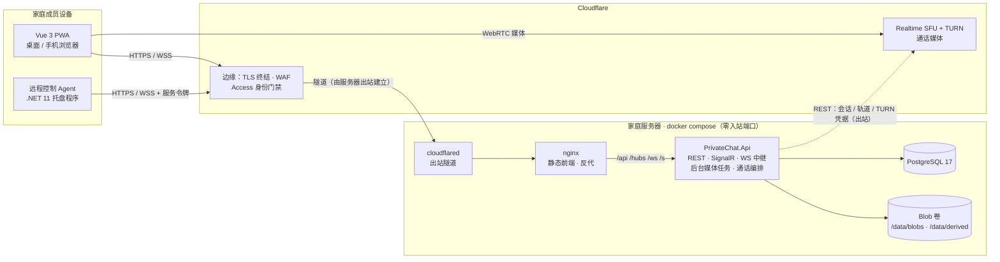

# PrivateChat · 家庭私有通讯平台设计稿

| | |
|---|---|
| 版本 | v0.4 |
| 日期 | 2026-11-11 |
| 状态 | M0–M5 已实现，M6 进行中（搜索已完成）；文档随代码更新 |
| 技术栈 | .NET 11 · ASP.NET Core · SignalR · PostgreSQL 17 · Cloudflare Realtime · Vue 3 · TypeScript · Element Plus · Docker Compose |

---

## 0. 结论先行

1. **后端做成模块化单体**：一个 ASP.NET Core 11 进程承载 REST、SignalR、WebSocket 中继和后台媒体任务；前端静态文件由 nginx 托管。家庭规模不需要微服务，但代码按功能"垂直切片"组织，将来拆得开。
2. **音视频通话/会议用 Cloudflare Realtime SFU + TURN**：媒体 100% 走 Cloudflare，家里不跑媒体服务器、不开任何 UDP 端口；.NET 负责房间编排（调用会话 / 轨道 API）和通话记录。
3. **远程控制必须有原生 Agent**：浏览器只能共享屏幕，无法注入键鼠。用 .NET 写 Windows 被控端 Agent（被控电脑都是 Windows）；传输先走服务器 WebSocket 中继（443 一个端口通吃、不怕 NAT），浏览器用 WebCodecs 解码。v1 Agent 进程内用 GDI 截屏、Windows 自带的 Media Foundation H.264 编码器编码，单个 exe，不带外部程序。
4. **存储用本地磁盘卷 + 内容寻址 Blob 表**：聊天附件、网盘文件、动态图片三处引用同一份数据，按 SHA-256 去重；通过 `IBlobStore` 抽象，日后可换 S3。
5. **前端一套 Vue 3 + TS 代码**覆盖桌面浏览器和手机 PWA（可安装、可推送），后期如需后台来电再用 Capacitor 套壳。
6. **入口走 Cloudflare Zero Trust**：服务器不开任何入站端口，cloudflared 建出站隧道，TLS 在 Cloudflare 边缘终结，Cloudflare Access 做身份门禁，应用直接信任 Access 签发的身份、不再维护密码。nginx 托管前端静态文件并反代 API。必需容器 4 个（cloudflared、web、api、postgres），`docker compose up -d` 一键。

---

## 1. 目标与范围

### 1.1 使用场景

- 一个家庭 5–20 人，可能跨城市 / 跨国；设备混杂：iPhone、安卓、Windows、Mac、长辈的平板。
- 多数成员非技术用户，"安装"门槛要尽量低：浏览器打开即用、添加到主屏幕即可。
- 部署在自家 NAS / 小主机 / 一台云服务器上，由家里的"技术担当"维护。

### 1.2 功能范围与优先级

| 优先级 | 功能 | 说明 |
|---|---|---|
| P0 | 账号、家庭、邀请码、角色 | 关闭公开注册 |
| P0 | 文字 / 图片 / 语音 / 视频 / 文件消息，群聊，已读，撤回，表情回应，引用回复 | 核心 |
| P0 | 离线推送（Web Push）、PWA | 收不到消息就没人用 |
| P1 | 云盘：断点续传上传、目录、共享、回收站、相册时间线 | 与聊天共用存储 |
| P1 | 1:1 音视频通话、多人会议、屏幕共享、常驻"客厅"会议室 | Cloudflare Realtime |
| P2 | 动态（SNS）：发动态、评论、点赞、相册、那年今天 | 家庭朋友圈 |
| P2 | 远程控制（被控端为 Windows） | 帮爸妈修电脑 |
| P3 | WebDAV 挂载、搜索、长辈模式、原生 App 壳 | 打磨 |

### 1.3 明确不做

- **端到端加密**：服务器是自家的，且缩略图、转码、搜索都需要明文。后期可为 1:1 对话单独加 MLS，架构不排斥。
- 公开注册、多租户、商业化。
- 自研 SFU、自研 TURN、自研视频编解码。
- 横向扩展：单机即可。SignalR 若将来多实例只需加 Redis backplane，协议不变。

---

## 2. 技术选型

### 2.1 总表

| 层 | 选择 | 理由 | 备选 |
|---|---|---|---|
| 运行时 | .NET 11（STS，支持到 2028-11） | 本机已装 SDK 11.0.100 | .NET 10（LTS） |
| Web 框架 | ASP.NET Core MVC Controller（`[ApiController]` + 特性路由）+ SignalR | 按资源分组清晰，自动模型校验、过滤器做统一异常与审计；实时推送内置 | Minimal API |
| ORM / 数据库 | EF Core 10 + PostgreSQL 17 | JSONB 存消息载荷；`pg_trgm` 做中文子串搜索；只要一个容器 | SQLite（并发写弱）、MySQL |
| 对象存储 | 本地磁盘卷 + 内容寻址 + `IBlobStore` 抽象 | 零额外组件，ffmpeg 直接读，备份就是拷目录 | S3 兼容（Garage / RustFS / 云 OSS） |
| 大文件上传 | tus 协议（`tusdotnet` + `tus-js-client`） | 断点续传，手机弱网必需 | 自研分片 |
| 媒体处理 | ffmpeg（容器内）+ Magick.NET | 视频转码 / 封面；HEIC → JPEG、EXIF 方向 | ImageSharp（商用授权限制） |
| 音视频 | Cloudflare Realtime（SFU + TURN，REST API 编排） | 媒体 100% 走 Cloudflare，家里零媒体端口、零媒体带宽；每月前 1 TB 免费 | LiveKit 自建（需公网端口或 WARP）、RealtimeKit 托管 SDK |
| 远程控制 | 自研 .NET Agent + WebSocket 中继 + 浏览器 WebCodecs 解码 | 全程走 443，无 NAT 问题 | RustDesk 自托管（兜底）、WebRTC P2P（v3） |
| 推送 | Web Push（VAPID） | iOS 16.4+ / Android / 桌面全覆盖，无需厂商通道 | Capacitor 原生推送（后期） |
| 认证 | Cloudflare Access 签发的身份（JWT 头）→ 应用按邮箱自动建号；Agent 用 Access 服务令牌 + 应用设备令牌 | 身份、验证码、多因素都交给 Cloudflare，应用不存密码 | 应用内密码登录（局域网直连备用） |
| API 契约 | 内置 OpenAPI + Scalar → `openapi-typescript` / `openapi-fetch` | 端到端类型安全 | 手写 DTO |
| 前端 | Vue 3.5 + TypeScript 5 + Vite 7 + Pinia + Vue Router + VueUse | 用户指定 | — |
| UI 库 | Element Plus + Tailwind CSS 4 | 组件全、中文文档与社区成熟、unplugin 按需自动导入 | Naive UI |
| 本地缓存 | Dexie（IndexedDB） | 消息离线缓存、冷启动秒开 | — |
| PWA | vite-plugin-pwa | 手机"安装"、推送、Share Target | Capacitor（后期套壳） |
| 入口 | Cloudflare Tunnel（cloudflared）+ Cloudflare Access | 零入站端口、零证书管理、自带 WAF 与身份门禁 | Caddy / Traefik 自签证书直连 |
| 前端托管 / 反代 | nginx | 静态文件 + 反代 API / SignalR；内网明文 HTTP，TLS 在 Cloudflare 边缘 | Caddy |
| 部署 | Docker Compose（4 个必需容器） | 一键 | k3s（过度） |

### 2.2 三个关键决策

#### 决策 A：音视频用 Cloudflare Realtime SFU，不自建

| 方案 | 优点 | 缺点 | 结论 |
|---|---|---|---|
| 浏览器 P2P mesh | 零服务端 | N 人会议每人要上传 N−1 路，手机 4 人就卡；无法录制 | 仅适合 1:1，不选 |
| **Cloudflare Realtime**（SFU + TURN） | 媒体 100% 走 Cloudflare 任播网络，家里零媒体端口、零媒体带宽；与 Tunnel / Access 同一个账号；每月前 1 TB 免费 | 没有"房间"概念，要自己编排会话与轨道；无服务端录制；产品较新 | **选** |
| LiveKit 自建 | 功能最全、SDK 成熟 | 媒体 UDP 过不了 Cloudflare 隧道，必须开公网端口或让家人装 WARP，与"全走 Cloudflare"冲突 | 不选 |
| Jitsi Meet | 功能全 | 5+ 容器，同样要开媒体端口 | 不选 |
| RealtimeKit（Cloudflare 托管 SDK） | 几乎不用写通话代码 | 按分钟计费、UI 难深度定制 | 备选 |

.NET 侧做的事：按参与者创建 Cloudflare 会话、转发 SDP、增删轨道、签发 TURN 凭据、维护房间与参与者状态并经 SignalR 广播。浏览器只用原生 `RTCPeerConnection`，App Secret 永远不下发。

#### 决策 B：存储用本地磁盘 + 内容寻址，不上对象存储

- MinIO 社区版 2025 年起转为仅提供源码、不再发布预编译二进制与镜像，已不是"随手拉一个"的组件；Garage / RustFS / SeaweedFS 可用，但对家庭场景是多余的一层。
- 家庭规模（几百 GB 到几 TB 照片视频）一块盘或 NAS 卷足够，备份就是 rsync / restic 一个目录。
- 代码里定义 `IBlobStore`（Put / OpenRead / Delete / Exists），v1 实现 `FileSystemBlobStore`，路径为 `/data/blobs/{sha256 前 2 位}/{次 2 位}/{sha256}`；将来 `S3BlobStore` 可无痛替换。
- 所有媒体按 SHA-256 去重，形成"**一份存储，三处引用**"：同一张照片在聊天里发过、又放进网盘、又发了动态，磁盘上只有一份。

#### 决策 C：远程控制用"Agent + 服务器中继"，不用 P2P，也不可能纯浏览器

- 浏览器只能 `getDisplayMedia` 共享屏幕，**无法注入键鼠**，所以被控端必须装原生程序。
- WebRTC P2P 需要 STUN / TURN；国内手机网络多为对称 NAT / CGNAT，大概率还是要走 TURN 中继。既然都要中继，不如直接用自家服务器做 WebSocket 中继：**443 一个端口通吃**，穿墙无忧，实现最简单。
- 视频流：Agent 产出 H.264 Annex-B 裸流 → WebSocket → 浏览器 `VideoDecoder`（WebCodecs）→ canvas。局域网延迟 <100 ms，公网 150–300 ms，足够"帮爸妈点鼠标、装软件"。
- 分三步走：v1 进程内 GDI 截屏 + Media Foundation 软件 H.264 编码（Windows 自带，关键帧可按需，单文件 exe），以当前用户运行；v2 桌面复制 + 硬件编码、SYSTEM 服务解决 UAC / 锁屏；v3 可选 WebRTC P2P 再降延迟。
  （原计划 v1 用 ffmpeg 子进程；实测 Media Foundation 编码 1080p 每帧 2–3 ms，省掉随包分发 100 MB 的 ffmpeg 和 GPL 的 libx264，就直接做了进程内。）
- RustDesk 自托管作为过渡与兜底（compose 里一个可选 profile），网页里记录成员的 RustDesk ID 一键唤起。
- 入口换成 Cloudflare Tunnel 后这个选择更顺：隧道只代理 HTTP / WebSocket，中继方案原样可用；WebRTC P2P 反而要另开端口。

---

## 3. 总体架构

### 3.1 组件图



### 3.2 运行时组件

| 组件 | 容器 | 职责 |
|---|---|---|
| Cloudflare 边缘 | 无（云端） | TLS 终结、证书、WAF、Access 身份门禁；服务器不需要任何证书 |
| Cloudflare Realtime | 无（云端） | SFU + TURN，通话媒体不进家庭网络；api 通过 REST 创建会话、增删轨道、签发 TURN 凭据 |
| cloudflared | `cloudflared` | 向 Cloudflare 建出站隧道，把 `chat.example.com` 的流量送到 nginx |
| nginx | `web` | 托管 Vue 静态文件；反代 `/api` `/hubs` `/ws` `/s` 到 api |
| PrivateChat.Api | `api` | REST（Controller）、SignalR、远程控制 WebSocket 中继、通话编排、后台媒体任务（同进程 HostedService） |
| PostgreSQL | `postgres` | 全部结构化数据 |
| 数据卷 | `data` | `/data/blobs` 原件、`/data/derived` 缩略图与转码产物、`/data/keys` 自动生成的密钥、`/data/tus` 上传临时区 |
| Agent | 不在容器内 | 安装在家庭成员电脑上的托盘程序，带 Access 服务令牌经隧道连回服务器 |

### 3.3 三条核心数据流

**发一张照片**

1. 前端用 Web Crypto 流式算出 SHA-256，`POST /api/blobs/precheck`；已存在则秒传拿到 blobId。
2. 否则走 tus 协议分片上传到 `/api/uploads`（断网可续），完成后服务端校验哈希、落盘、写 `blobs` 行。
3. 前端通过 SignalR `SendMessage` 发送消息（带 clientMessageId + blobId）；服务端在事务里给会话 seq +1、写 `messages`，向会话成员广播 `MessageReceived`，离线成员入队 Web Push。
4. 后台任务生成 320 / 1280 缩略图（HEIC 转 WebP），完成后广播 `MessageUpdated` 补齐缩略图字段。

**发起视频通话**

1. A 点"视频" → `POST /api/calls` → 创建 `call_sessions`，SignalR `IncomingCall` + Web Push 让其他成员响铃，60 s 无人接听记为未接。
2. 每个加入者先拿到麦克风 / 摄像头，再 `POST /api/calls/{id}/join`：api 登记参与者并返回 ICE 服务器（含 24 h 有效的 TURN 凭据）；第二个人加入的那一刻算接通。媒体直接到 Cloudflare 的任播节点，不经过家里。
3. 发布：浏览器在"发布连接"上生成 offer → `POST /api/calls/{id}/publish` → api（第一次时先 `sessions/new`）调 `tracks/new` 拿到 answer 回传，写 `call_tracks`，广播 `TrackPublished`。
4. 订阅：其他端收到 `TrackPublished` → `POST /api/calls/{id}/pull`（只给参与者 Id + 轨道名）→ api 换成对方的 Cloudflare 会话去 `tracks/new` → 返回带新轨道的 offer → 浏览器在"订阅连接"上回 answer → `POST /api/calls/{id}/renegotiate`。
5. 挂断、关页面（sendBeacon）或 35 s 没有心跳 → api 强制关闭该参与者的轨道、广播 `ParticipantLeft`；单聊里一方离开即结束，群聊等最后一人离开，结束时在会话里插入一条"通话"消息。

**远程控制爸爸的电脑**

1. 爸爸电脑上的 Agent 带 Cloudflare Access 服务令牌穿过门禁，再用设备令牌连接 `/hubs/agent`（与网页的 `/hubs/chat` 分开：Agent 连着不算爸爸"在线"），上报版本、系统、显示器。
2. 我在"设备"页点"远程控制" → `POST /api/remote/sessions`；服务端校验角色与设备策略，经 SignalR 通知 Agent。
3. Agent 弹窗"XX 请求远程控制（30 s）"，爸爸点同意；或者我输入该设备的无人值守 PIN。
4. 双方各自连接 `/ws/remote/{sessionId}/agent` 与 `/controller`，服务端按消息原样转发（只看模式下丢掉控制端发来的输入帧）；Agent 推 H.264 帧，我这边每解出一帧回一个确认、把鼠标 / 键盘事件发回去。
5. 被控端屏幕顶部有红色常驻条"正在被 XX 远程控制 [断开]"；任一方点结束、或断开超过 30 秒即结束，服务端写审计记录（谁、何时、多久、流量、结束原因）。

---

## 4. 后端设计

### 4.1 代码结构

```
PrivateChat/
├─ PrivateChat.slnx
├─ Directory.Build.props / Directory.Packages.props   # 统一包版本（Central Package Management）
├─ src/
│  ├─ PrivateChat.Api/                 # 唯一的服务进程（模块化单体）
│  │  ├─ Program.cs                    # 组装：AddControllers / MapControllers、Access 认证、SignalR、OpenAPI、tus、HostedService
│  │  ├─ Features/                     # 垂直切片：每个功能自带 Controllers / Hub / Service / Dto
│  │  │  ├─ Auth/            Cloudflare Access 身份映射、局域网密码登录、设备码登录
│  │  │  ├─ Family/          家庭、成员、邀请码、角色
│  │  │  ├─ Chat/            会话、消息、ChatHub、已读、撤回、表情回应
│  │  │  ├─ Calls/           Cloudflare Realtime 会话 / 轨道编排、TURN 凭据、通话记录、"客厅"常驻房间
│  │  │  ├─ Drive/           节点、共享、tus 上传、流式下载、回收站、WebDAV（后期）
│  │  │  ├─ Moments/         动态、评论、点赞、相册、那年今天
│  │  │  ├─ Remote/          设备注册、会话协商、同意流程、WebSocket 中继
│  │  │  ├─ Notifications/   Web Push 订阅与发送、站内通知
│  │  │  └─ Search/          pg_trgm 搜索
│  │  ├─ Domain/             实体与值对象（无框架依赖）
│  │  └─ Infrastructure/     AppDbContext、FileSystemBlobStore、FfmpegMediaProcessor、
│  │                         DbJobQueue、WebPushSender、CloudflareRealtimeClient、CloudflareAccessAuthHandler
│  ├─ PrivateChat.Contracts/           # Api 与 Agent 共享的协议（远程控制帧格式等）
│  └─ PrivateChat.Agent/               # 远程控制 Agent（net11.0-windows，仅 Windows；托盘 + 后台 Worker）
├─ web/                                 # Vue 3 + TS
├─ deploy/                              # docker-compose.yml、nginx.conf、Dockerfile.api / .web、init-env.sh
├─ docs/
└─ tests/
   ├─ PrivateChat.Api.Tests/            # xUnit + Testcontainers（真 Postgres）
   └─ web：vitest + playwright
```

约定：

- 一个 Feature 目录 = 按资源划分的若干 `[ApiController]` 控制器（`[Route("api/[controller]")]`，如 `ConversationsController`、`MessagesController`）+ 服务类。控制器只做参数绑定、鉴权特性和调用服务，业务逻辑全在服务类里；统一异常、审计日志用全局过滤器。跨 Feature 只通过服务接口或领域事件调用，不互相翻对方的表。
- 所有主键用 `Guid.CreateVersion7()`：时间有序，B-Tree 索引友好。
- 时间统一 UTC `timestamptz`，前端按用户时区显示。
- 配置走 Options 模式，环境变量用 `App__PublicUrl` 这种双下划线映射，方便 compose 注入。
- 首次启动自动生成设备令牌签名密钥与 VAPID 密钥对，存到 `/data/keys`，`.env` 里不用填。

### 4.2 数据模型

**身份与家庭**

| 表 | 关键字段 |
|---|---|
| `users` | id, email（Access 身份映射键）, username, display_name, avatar_blob_id, password_hash（仅局域网备用登录）, role（Admin / Member / Child）, elder_mode, created_at, disabled_at |
| `families` | id, name。v1 单家庭，表保留给未来 |
| `invites` | email（允许自动建号的家人邮箱）, code（局域网模式用）, created_by, role, expires_at, used_by |
| `devices` | id, user_id, kind（Browser / Agent）, name, platform, push_subscription jsonb, token_hash, last_seen_at, remote_capable, unattended_pin_hash, pin_failures, pin_locked_until, allowed_controllers jsonb, agent_version, os, revoked_at |
| `refresh_tokens` | id, user_id, device_id, hash, expires_at, revoked_at |

**聊天**

| 表 | 关键字段 |
|---|---|
| `conversations` | id, type（Direct / Group / Family）, title, avatar_blob_id, last_seq, created_at |
| `conversation_members` | conversation_id, user_id, role, last_read_seq, muted_until, joined_at |
| `messages` | id, conversation_id, **seq**, sender_id, client_message_id, type（Text / Image / Video / Audio / File / Sticker / Call / System）, body, payload jsonb, reply_to_id, forwarded_from_id, created_at, edited_at, deleted_at |
| `message_attachments` | message_id, blob_id, kind, meta jsonb（width, height, duration, name, size, thumb / poster 变体） |
| `message_reactions` | message_id, user_id, emoji, created_at |

唯一约束：`(conversation_id, seq)`、`(sender_id, client_message_id)`。索引：`(conversation_id, seq desc)`，`body` 上 `gin_trgm_ops`。

**存储**

| 表 | 关键字段 |
|---|---|
| `blobs` | id, sha256（唯一）, size, mime, storage_key, created_by, created_at |
| `derived_blobs` | blob_id, variant（thumb-320 / thumb-1280 / poster / play-720p / audio-m4a）, storage_key, meta jsonb, status |

**网盘**

| 表 | 关键字段 |
|---|---|
| `spaces` | id, type（Personal / Family）, owner_user_id, quota_bytes |
| `drive_nodes` | id, space_id, parent_id, name, is_folder, blob_id, size, mime, created_by, created_at, updated_at, deleted_at |
| `node_shares` | id, node_id, grantee_user_id（可空）, link_token（可空）, permission（Read / Write）, password_hash, expires_at |

同一目录下文件名唯一（排除已删除）。

**动态**

| 表 | 关键字段 |
|---|---|
| `posts` | id, author_id, text, visibility（Family / Private）, created_at, deleted_at |
| `post_media` | post_id, blob_id, sort, meta jsonb |
| `comments` | id, post_id, author_id, reply_to_comment_id, text, created_at, deleted_at |
| `reactions` | target_type（Post / Comment）, target_id, user_id, emoji |
| `albums` / `album_items` | 相册标题、封面；条目引用 blob，带 taken_at |

**通话与远程**

| 表 | 关键字段 |
|---|---|
| `call_sessions` | id, conversation_id, type（Audio / Video / Meeting）, room_slug（常驻会议室）, started_by, started_at, answered_at, ended_at, end_reason（Completed / Missed / Declined / Cancelled）, scheduled_at, egress_bytes_estimate。同一会话只允许一条未结束的记录（部分唯一索引） |
| `call_participants` | id, call_id, user_id, cf_session_id（发布用的 Cloudflare 会话）, cf_pull_session_id（订阅用的）, mic_on, cam_on, joined_at, last_seen_at（心跳）, left_at |
| `call_tracks` | id, participant_id, track_name, kind（Audio / Video / Screen）, mid（发布会话里的 mid，强制关闭用）, published_at, unpublished_at |
| `remote_sessions` | id, controller_user_id, target_device_id, mode（View / Control）, consent（Prompt / Unattended）, state（Pending / Active / Ended）, started_at, expires_at（等同意的截止）, accepted_at, ended_at, end_reason（declined / timeout / controller / agent / stopped / revoked / disconnected / replaced）, bytes_relayed。一台设备只允许一条未结束的记录（部分唯一索引） |

**通知与任务**

| 表 | 关键字段 |
|---|---|
| `notifications` | id, user_id, type, payload jsonb, created_at, read_at |
| `jobs` | id, type, payload jsonb, status, attempts, run_after, locked_until, last_error |

### 4.3 实时通信（SignalR）

Hub 路径 `/hubs/chat`，浏览器走 Cookie 认证，Agent 走 Bearer。

- 连接建立时服务端把连接加入 `user:{id}` 组和该用户所有 `conv:{id}` 组，并标记在线；客户端随后调用 `Sync` 补拉缺失消息。
- 客户端 → 服务端：`SendMessage(dto)`、`Typing(conversationId)`、`MarkRead(conversationId, seq)`、`Sync(Dictionary<convId, lastSeq>)`。
- 服务端 → 客户端：`MessageReceived`、`MessageUpdated`、`MessageDeleted`、`ReactionChanged`、`ReadReceipt`、`Typing`、`Presence`、`ConversationUpdated`、`IncomingCall`、`CallUpdated`、`CallDeclined`、`ParticipantJoined`、`ParticipantLeft`、`ParticipantUpdated`、`TrackPublished`、`TrackUnpublished`、`DriveChanged`、`PostChanged`、`AlbumChanged`、`Notification`、`RemoteSessionChanged`。

可靠性约定：

- **幂等**：客户端为每条消息生成 `clientMessageId`（GUID v7），重发不会重复入库。
- **顺序**：`conversations.last_seq` 在同一事务里 `UPDATE … RETURNING` 自增，`messages.seq` 严格递增；客户端按 seq 排序、按 seq 补洞。
- **重连**：`withAutomaticReconnect` 后调用 `Sync`，服务端返回每个会话 `since seq` 之后的消息（上限 500 条 / 会话，超过提示整页刷新）。
- **离线推送**：收件人没有活跃连接时入队 Web Push，去抖 3 s，静音会话不推。
- 单实例不需要 Redis backplane。
- Cloudflare 对空闲连接约 100 s 超时，SignalR 默认 15 s 一次 keep-alive 已覆盖；远程控制中继的 WebSocket 也要每 15 s 发一次心跳帧。

### 4.4 文件与媒体管道

上传：

1. 客户端先算 SHA-256 → `POST /api/blobs/precheck {sha256, size}`：已存在则秒传返回 blobId。
2. 否则 tus 上传到 `/api/uploads`（`tusdotnet`，分片 8 MB，元数据带 sha256 / 文件名 / mime / 用途）。Cloudflare 免费版单个请求体上限 100 MB，分片保持 8 MB 即可，大文件靠多次 PATCH。
3. 上传完成回调里校验哈希、移入 `/data/blobs/{ab}/{cd}/{sha256}`、写 `blobs` 行、入队派生任务。

派生产物（后台任务）：

- **图片**：Magick.NET 读取（含 HEIC / HEIF、EXIF 方向；是否去除 GPS 可配置）→ WebP 320 / 1280 两档缩略图，原图保留。
- **视频**：ffprobe 取元数据（宽高按旋转纠正、时长、拍摄时间优先用 `com.apple.quicktime.creationdate`）；ffmpeg 在 1 秒处抽帧生成与图片相同的 320 / 1280 封面缩略图；若不是"MP4 / MOV 容器 + H.264 + 8 bit 4:2:0 + 长边 ≤ 1920"，生成 `play-720p`（长边 1280）H.264 / AAC MP4（`-movflags +faststart`），否则删掉这条登记、直接播原件。iPhone 的 HEVC / HDR 视频靠这一步才能在安卓和桌面浏览器播放。
- **两条队列**：快队列（探测、缩略图、视频封面、音频转码，秒级）与转码队列（视频转 720p），各自串行。快的部分做完先保存并广播（封面、时长马上可见），转码完成再广播一次；一段长视频在转码时，后面的照片和语音消息不用等。ffmpeg 超时按失败记下，不会每次重启重试。只补做了媒体信息（消息里看不到变化）时不广播 MessageUpdated；前端收到 MessageUpdated 只更新本地已有的消息，不插入。
- **媒体信息**：图片读 EXIF 的 DateTimeOriginal（有 OffsetTimeOriginal 就用，否则按家庭时区 `App:TimeZone`，默认 Asia/Shanghai），宽高按 EXIF 方向纠正；写入 `blobs.taken_at / width / height / duration_seconds`。启动时补做存量。
- **语音**：浏览器 MediaRecorder 的产物在 Chrome 是 webm / opus，在 Safari 是 mp4 / aac，统一转为 m4a（AAC）并生成波形峰值 JSON。
- 超大视频可选 HLS 切片（后期）。

下载与访问控制：

- `GET /api/blobs/{id}?v=thumb-320`：同源 Cookie 鉴权，`` / `<video>` 标签直接可用，前端不用管 token。产物未就绪时：图片缩略图、`play-720p`、`audio-m4a` 回退原件（`no-store`，生成后经 MessageUpdated / DriveChanged 让前端重取）；视频缩略图返回 404（不能拿原视频当图片）。已确定不会有这一档时（视频探测过、不需要转码；本来就是 m4a 的音频），回退原件照常长期缓存。
- 权限判定：用户对任意引用该 blob 的消息 / 网盘节点 / 动态有读权限即可读。
- 支持 Range、ETag，`Cache-Control: private, max-age=31536000, immutable`（内容寻址，永不变）。
- 外部分享链接 `/s/{token}` 走 `node_shares` 校验，可带密码与过期时间。

配额与回收：每用户配额可选；回收站保留 30 天；夜间 GC 删除引用数为 0 且创建超过 24 h 的 blob。

限制：nginx `client_max_body_size 64m`，Kestrel `MaxRequestBodySize` 同样放宽到 64 MB，两者都大于分片大小、小于 Cloudflare 的 100 MB 上限。

### 4.5 通话与会议（Cloudflare Realtime）

**模型**：Cloudflare Realtime SFU 没有"房间"概念，只有会话（session，对应一个 PeerConnection）和轨道（track）。房间、成员、谁该拉谁的轨道全部由 api 维护，这正是 `call_sessions` / `call_participants` / `call_tracks` 三张表的用途；状态变化通过 SignalR 广播。

**接入方式**：浏览器永远不拿 App Secret，也不知道任何 Cloudflare 会话 Id；所有 Cloudflare REST 调用由 api（`CallsController` → `CallService` → `CloudflareRealtimeClient`）转发。接口形状按官方 OpenAPI（`realtime-api-2024-05-21.yaml`）核对过（2026-11）：

| api 接口 | Cloudflare 调用 | 说明 |
|---|---|---|
| `POST /api/calls/{id}/join` | `POST turn/keys/{keyId}/credentials/generate-ice-servers` | 登记参与者；返回 ICE 服务器数组（去掉浏览器会拦的 53 端口地址）。没配 TURN 或签发失败时退回公共 STUN。此时**不建** SFU 会话：没用过的会话会过期 |
| `POST /api/calls/{id}/publish` | `POST sessions/new`（首次）+ `POST sessions/{sid}/tracks/new`（location = local，带 offer、mid、trackName） | 轨道名由服务端生成；HTTP 200 里可能带单条轨道的错误，逐条检查，成功的才登记并广播 `TrackPublished`，answer 无论如何交回浏览器 |
| `POST /api/calls/{id}/pull` | `POST sessions/new`（首次）+ `tracks/new`（location = remote，带发布者的 sessionId + trackName） | 客户端只给"参与者 Id + 轨道名"，服务端校验是同一通通话里还在发布的轨道后换成对方的会话；返回 offer + 每条轨道在订阅连接上的 mid；源还没出媒体的那条带错误码，客户端稍后重试 |
| `POST /api/calls/{id}/renegotiate` | `PUT sessions/{sid}/renegotiate` | 订阅连接的 answer；Cloudflare 收下才算这次订阅完成 |
| `POST /api/calls/{id}/unpublish` | `PUT sessions/{sid}/tracks/close`（带 offer，force = false） | 停止共享屏幕等；返回 answer，广播 `TrackUnpublished` |
| `POST /api/calls/{id}/pull/close`、离开 / 结束 / 超时清理 | `PUT sessions/{sid}/tracks/close`（force = true） | 不需要协商；失败无妨，连接关闭 30 s 后 Cloudflare 自行回收 |

**每个参与者两条连接**：一条只发布（浏览器出 offer），一条只订阅（Cloudflare 出 offer），各自一条串行队列——官方 video-room 示例的做法。Cloudflare 要求同一会话上的变更严格串行（上一个 offer 没回 answer 就发新的变更会被 406 拒绝），而"有人加入""有人发布"这些事件随时并发到达；两个方向分开后互不打架。6 人会议每人发布 2–3 条、拉取 5 人的轨道。

**呼叫与状态**：

- `POST /api/calls` 在会话里发起（新建返回 201；会话里已有进行中的通话则返回它，200，部分唯一索引兜底；发起人自己没能进去——没有麦克风、加入失败——时客户端用 `end?ifUnanswered=true` 把这次新建的通话取消，对方不会空响；服务器在通话锁里判断，已经有人接通（群聊里别人先接起来聊上了）或发起人在别的设备上进去了就不结束；拨号按钮在建会话、建通话期间就置灰，防连点）→ 其他成员收到 SignalR `IncomingCall`，并向他们的**所有设备**发 Web Push（不看在线状态：在线只说明某一台设备开着页面，手机照样要响；页面正在前台的那台由 Service Worker 判断，不重复弹通知）。响铃推送 TTL 45 s；Chrome / 安卓带接听 / 拒绝按钮，iOS 点通知打开应用后在页面里接。静音的会话不推送、不响铃。
- 第二个人加入的那一刻记 `answered_at`（接通）。接听者的其它设备收到一条 `call-answered` 推送，把还挂着的响铃通知收掉（只在真的响过铃时：没静音、还在响铃时间内）。
- **响铃通知一定收得掉**：通话以任何原因结束时，响过铃却没进来的人都会收到同 tag 的推送——未接 / 取消换成"未接来电"，接通后结束 / 被拒接则是一条短 TTL 的收尾推送，原地替换后自动关闭；群聊里拒接的人自己其它设备上的响铃也这样收掉。页面里收到通话结束、被接走、拒接时，同时关掉这台设备上的系统通知。
- **每条推送都显示通知**：iOS 上推送事件里没显示过通知会被记为"静默推送"，几次之后整个订阅被收回（之后消息、来电都收不到）；Chrome 则在推送事件结束时数还显示着的通知，没有又没有可见页面就自己弹"网站已在后台更新"。所以页面在前台时显示一下马上关掉；否则显示一条安静的说明（同一个 tag，顺带替换掉响铃），推送事件结束后过几秒再关。判断"应用窗口"时不算同源的 PDF 标签页、外链分享页。
- 点开消息、未接来电、动态的通知时应用已经开着：Service Worker 把地址交给页面用路由跳转，不整页重新加载，正在进行的通话不会断。
- 结束原因：接通后挂断 `Completed`；60 s 无人接听 `Missed`；单聊里对方拒接 `Declined`（群聊里拒接只广播 `CallDeclined`，通话继续）；接通前发起人挂断 `Cancelled`。单聊里一方离开即结束，群聊等最后一人离开；发起人或管理员可以 `end` 整通通话。
- 结束时在会话里插入一条 `Call` 类型消息（幂等键 = 通话 Id，载荷含类型、原因、时长、参加者），按用户组广播；参加了的人不算未读。`Missed` / `Cancelled` 时给没接的人补一条"未接来电"推送，与响铃推送同一个 tag / Topic，原地替换。
- **在场以心跳为准**：客户端每 10 s `POST heartbeat`，35 s 没有心跳按离开处理（`CallMaintenanceWorker` 每 5 s 扫一次，同时负责响铃超时）；关页面时用 `sendBeacon` 立即离开（网盘还有没传完的文件、会弹"确定离开？"时只靠 pagehide，免得点了"留下"通话却已挂断）。没有用 SignalR 连接状态判断在场：手机切后台时 SignalR 常断而通话还在。api 刚启动、刚从数据库故障或主机休眠里恢复时，停机期间心跳本来就送不进来：恢复满 35 s 之后才按心跳判掉线，免得把媒体其实一直好好的通话挂断。
- **按设备，不按人**：加入返回的参与者 Id 是这台设备的身份，之后的心跳、发布、订阅、协商、离开、状态都带上它（查询参数 `participantId`，sendBeacon 也能带），服务器只对这一份操作——同一个人换了设备后，旧设备迟到的请求不会落到新设备的 Cloudflare 会话上，关掉旧设备页面也不会把新设备上的通话挂断。
- **同一个人只有一份在场**：再次 `join`（换设备接听、断线重进）会把旧的那份顶掉（`ParticipantLeft` reason = replaced），旧设备本地收场。旧设备如果睡着了没收到这个事件：醒来后心跳返回 410 且 detail = `replaced`，或者对账时发现自己不在、别的设备上的自己在，就地收场；重连时 `join` 带上原来的参与者 Id（`replacing`）：这个人别的设备还在通话里、或在这一份掉线之后进来过（换到那台设备上、又在那边挂了），就返回 410 replaced，而不是反过来把那台设备顶掉、或者带着麦克风自己回到通话里；这台设备上一次重连响应丢了留下的那一份（记着它顶替的是谁）不算别的设备。只有一台设备、被按掉线清理的，410 不带 replaced，客户端重新加入。
- 离开（含被顶掉、超时、结束）时，除了强制关闭这份发布的轨道，也关闭它订阅会话里正在接收的轨道（服务器记下每次拉到的 mid）：Cloudflare 不会因为应用状态里删了就停止转发，被顶掉的设备如果还连着，会一直收到大家的音视频。
- 这些强制关闭不在通话锁里、也不在 HTTP 请求里等：入队后由后台任务执行（4 路并发、每条 5 s 超时，慢的记 Information 日志）。实测 Cloudflare 关闭"浏览器刚关掉的连接上的轨道"时一直不返回，同步等会把同一通通话里别人的加入、离开拖住十秒；连接已经没了的轨道 Cloudflare 本来也会自己回收。浏览器自己要求不再接收的那几条仍同步关（订阅会话还在用，要和之后的订阅变更保持先后），但不在锁里。
- 客厅永不结束，每次进出都留一行参与者：离开超过一小时的由清理任务删掉，免得每次进出都加载几个月的历史。
- **重连**：ICE 失败、对端关闭传输、协商结果不明（Cloudflare 报错 / 超时）时，客户端重新 `join` 换一对新会话，本地采集的轨道接着用，重新发布、重新订阅；别人看到的是短暂离开又回来。切到后台超过 25 s 回来、而且确实被暂停过（采集被系统静音，或页面被冻结——心跳定时器停过，占位画面也跟着停），发布的轨道多半已被 Cloudflare 回收，也走一次重连重新发布；桌面切到别的标签页时采集和心跳都照常，只对账不重连。麦克风换新的失败后再点开麦，会重新拿麦克风并重新发布。加入 / 重连的快照可能比这期间经 SignalR 收到的事件旧，进入后再对一次账；对账也负责补上漏掉的"已接通"。
- **设备变化**：麦克风被拔掉（AirPods 收进盒子、USB 耳机拔了）时轨道会 ended，客户端换一个麦克风接着发，拿不到就标记为静音并提示；摄像头被拔掉则换成黑画面占位、标记为关闭。开关 / 切换摄像头期间按钮置灰，连点不会多开一个摄像头；换源排在发布队列里，首次发布没完成时点了关摄像头也不会落空。拉不到的轨道（对方还没开始发媒体）先快速重试 8 次，之后每 10 s 再试，不放弃。
- 流量估算：一条轨道下线时，同一次操作里一起离开的人也算接收方（一方挂断导致通话结束时，另一方的轨道不再被记成零接收）。
- 常驻会议室"客厅"是一条 `room_slug = living-room`、永不结束的 `call_sessions` 记录，第一次访问时创建；全家可进，不响铃、不产生通话记录，进出事件广播给全家（通话页实时显示谁在里面）。管理员可以清场。
- 同一通通话的状态变更（加入、离开、结束、清理）用进程内分段锁串行化（单实例部署）。孩子账号也可以打电话（因此允许孩子发起单聊，但不能建群）。

**媒体细节**：

- 静音 = `track.enabled = false`（仍在发静音帧，轨道不会被回收）；关摄像头 = 真的停掉摄像头（指示灯熄灭），把发布的轨道 `replaceTrack` 成每秒两帧的黑画面占位——不能换成 null，Cloudflare 30 s 收不到包会回收这条轨道。开关都不重新协商；别人看到的图标来自 `POST state` → `ParticipantUpdated`。
- 屏幕共享是同一条发布连接上的第三条轨道，停止时协商式关闭。iOS Safari 没有 `getDisplayMedia`，按钮不显示。
- 上行：摄像头 720p / 24 帧、最高 1.2 Mbps；屏幕 2.5 Mbps、`contentHint = detail`。**simulcast 暂未启用**：需要在真实 Cloudflare 上验证各浏览器的分层行为后再开（发布端 `sendEncodings` + 订阅端 `simulcast.preferredRid`），留到 M6。
- 通话需要安全上下文：局域网 8080 明文直连时没有通话（界面有说明）。

**没有的东西**：服务端录制（Realtime SFU 不提供，RealtimeKit 才有）、webhook（参与者状态靠 api 自己维护）。

**成本**：媒体出站每月前 1 TB 免费，之后 0.05 美元 / GB。6 人 720p 会议约 13 GB / 小时，1 TB 够每月 70 多小时。api 在每条轨道下线时按"时长 × 码率 × 当时在场的其他人数"累加估算值（`egress_bytes_estimate`），`GET /api/calls/usage` 给管理员看当月合计（通话页底部），实际以 Cloudflare 控制台为准。

**测试**：后端集成测试用一个按官方形状应答的假 Cloudflare（HttpMessageHandler）+ 真实 SignalR 连接；端到端测试用 `web/e2e/fake-sfu.cjs`——一个 headless Chromium 页面充当 SFU、真实转发媒体，接口与约束（串行、406）同官方。真实 Cloudflare 上的通话需要填好凭据后实测。

`web/e2e/calls.cjs` 支持 `E2E_REAL_CF=1`：使用本地 compose api 已加载的真实 SFU / TURN 配置，不启动假 SFU、不重建 api；保留双向音视频、共享屏幕、来电和客厅等流程，只将七项依赖假 SFU 观测 / 强制断线的断言明确计为跳过。两种模式均限本地测试库，有活动通话时退出；真实模式缺配置时在产生测试数据前退出。CLI 配置检查用 `npm run test:e2e-cli` 验证并纳入 CI；运行步骤见 README。真实 Cloudflare 和手机真机仍须实测。

### 4.6 网盘与共享

- 两类空间：个人空间（每人一个）与家庭共享空间（全员可写，Child 可配置为只读）。首次访问网盘时自动创建。
- 节点树用 `parent_id` 邻接表，路径由服务端拼；移动 / 重命名只改一行（跨空间移动时整棵子树换 `space_id`）。同一目录（含空间根目录）下名称唯一，新建 / 上传重名自动编号"照片 (1).jpg"，改名重名返回 409。
- **权限**：空间级——个人空间主人 Owner、家庭空间成员 Write（孩子在只读设置下 Read）；节点级——共享给某人的节点及其整棵子树 Read / Write。修改一个文件夹的内容要对**这个文件夹**有写权限，所以被共享的人能改共享文件夹里面的东西，但不能删除 / 改名 / 移走共享文件夹本身；管理共享、跨空间移动需要空间级写权限（被共享的人不能转共享）。
- 共享三种方式：对成员共享（Read / Write）、生成链接（256 bit token，可密码 / 1–365 天过期，只读，孩子不能建）、"发送到聊天"（创建引用同一 blob 的消息，零拷贝）；反过来聊天里的附件也能"保存到网盘"。
- 外链页 `/s/{token}` 由 api 直接渲染极简 HTML，不依赖前端应用：密码解锁后发 12 小时、路径限定的加密 Cookie，密码错误 15 分钟超过 10 次锁定；只能访问共享节点及其子树；严格 CSP、noindex、no-referrer。
- 回收站：删除时整棵子树标记 `deleted_at` 与 `trash_root_id`（这次删除的根），回收站只列根；还原回原位置（原文件夹已不在则回到空间根目录，重名自动编号）；30 天后整批彻底删除。同名覆盖（Replace）时旧文件进回收站。管理回收站项目要对所在空间有空间级写权限；自己删的，也要现在对原来所在的文件夹仍有写权限（共享收回后就不能再还原 / 清除）。跨空间移动文件夹时，里面已经删进回收站的东西留在原空间。
- **并发**：同一空间的目录树修改（新建、上传登记、改名移动、删除、还原、彻底删除）在事务里先拿该空间的 advisory lock，再做存在性、权限、配额检查；跨空间移动按 id 顺序拿两把锁。不会出现挂在已删除文件夹下的活节点，配额也不会被并发上传绕过。
- 配额：空间可设 `quota_bytes`（管理员），回收站里的也计入，超出返回 413。
- **内容持有凭证**（`blob_claims`）：内容去重后 blob 只有一个创建者；后来上传同一文件（或秒传命中）的人登记凭证，才能在消息 / 网盘里引用它。凭证也是垃圾回收"7 天内还有人要"的依据。
- 垃圾回收：每小时一次，删除没有任何消息 / 网盘节点（含回收站）/ 动态 / 相册 / 头像引用、创建超过 7 天且 7 天内无人登记凭证的 blob 及其派生产物（宽限期留给离线发件箱里传完还没发出的消息）；删除语句内再判断一次引用，避免与并发引用竞争。
- **相册时间线**：按拍摄时间（EXIF / 视频元数据）聚合所有图片与视频 blob，不区分来源。聊天里发的照片也出现在时间线上，这是家庭用户最想要的功能。
- WebDAV（后期，`NWebDav`）：Windows 资源管理器 / Finder / 手机文件 App 直接挂载。
- 聊天文件传输统一走"上传到服务器 → 消息引用"，不做 P2P。局域网大文件直传可后期用 WebRTC DataChannel 实现。

### 4.7 动态（SNS）

- 动态 = 文本（≤ 5000 字）+ 至多 9 张照片 / 视频 + 可见范围："家人"（全家可见、可评论点赞，孩子也一样）或"仅自己"（私密日记，只有作者能看到它和里面的照片）。照片 / 视频必须是发布人本来就持有或能看到的（不能借动态转发自己看不到的文件）。
- 评论支持回复（显示"X 回复 Y"，被回复的评论删了也保留是谁）；动态和评论都能表情点赞（同一表情再点取消，规则与消息表情回应相同）。
- 删除：动态由作者或管理员删，媒体引用一并去掉（别处没人用的内容由垃圾回收清理）；评论由评论者、动态作者或管理员删。
- 时间线按 (created_at, id) 游标分页；每次评论 / 点赞 / 删除后接口直接返回整条动态，前端替换。实时：SignalR `PostChanged`（家人可见的发给所有人，私密的只发给作者），前端 300 ms 内合并后重新取那一条；重连后合并最新一页。
- 那年今天：往年同月同日（家庭时区）的照片 / 视频（复用相册时间线的"我能看到的"集合，每年最多 9 张另给总数）和动态，按年从近到远。家庭规模的数据量实时计算即可，没有做凌晨预计算。
- 相册：手动相册全家共享——每个人都能看、都能往里加自己能看到的照片（加进来就等于分享给了全家）；改名、设封面、删相册由创建人或管理员，移出某一项由加它的人、创建人或管理员。没指定封面时用最近加入的一项。删相册不删照片。自动按月相册不落库，就是时间线按月份（家庭时区）分组。
- 相册时间线的来源加上了动态（家人可见的 + 自己私密的）和相册。
- 推送：有人评论、回复、点赞你的动态或评论时推给当事人；只推给当前不在线的人（在线的页面会实时刷新），同一条动态的通知互相替换。
- 不做算法推荐流、公开页、关注关系，家庭不需要。

### 4.8 远程控制

**组成**

- Agent（被控端）：.NET 11 WinForms 托盘程序（`net11.0-windows`），Windows 10 / 11，随用户登录自启（`HKCU\…\Run`，不需要管理员权限）。被控电脑全部是 Windows，不做 Linux / macOS。
- 控制端：浏览器页面（Vue，`/remote/:id`），无需安装；手机上也能用（触摸当鼠标，中文用"输入文字"框）。
- 服务端 `Remote` 模块：设备与策略、会话状态机、Agent 的 SignalR 通道 `/hubs/agent`、数据面中继（原生 WebSocket `/ws/remote/{sessionId}/{agent|controller}`）。

**设备注册（设备码登录）**

1. 在网页"设备 → 添加电脑"里下载 Agent（web 镜像构建时交叉编译的单文件 exe，`/downloads/PrivateChat.Agent.exe`），复制"配置串"（`PCA1.` + base64url JSON：服务器地址，以及 .env 里配了的话 Access 服务令牌）。
2. Agent 第一次运行要配置串，然后带上计算机名申请 8 位设备码（`POST /api/auth/device/code`，10 分钟有效，过期自动换新），每 2 秒轮询 `/poll`。匿名接口防刷：同一来源最多同时 5 个码，全局 200 个，满了挤掉最早的未确认码（被挤掉的 Agent 轮询拿到 404 自动换新码）。
3. 网页输入设备码，先查到电脑名核对（`/lookup`），再确认（`/confirm`）；管理员可以替家人添加（设备归家人）。默认远程名单是除主人外的所有管理员。
4. Agent 拿到长期设备令牌，与 Access 服务令牌密钥一起用 DPAPI（当前用户）加密保存在 `%LOCALAPPDATA%\PrivateChat\Agent`。
5. 设备令牌只能用于远程相关的接口（`/hubs/agent`、`/ws/remote`、`/api/remote/sessions`）：被控电脑上的令牌万一泄露，也拿不到主人的聊天和网盘。请求同时带 Access 头和 Bearer 时优先认设备令牌（Access 服务令牌的 JWT 没有邮箱）。

**会话建立**

1. 控制端 `POST /api/remote/sessions {targetDeviceId, mode, pin?}`。服务端校验：请求者是 Admin / Member（孩子不行），是设备主人或在白名单里，设备在线；锁住设备行后检查没有别人的未结束会话（同一个人再点一次就顶掉自己之前那次）。
2. 没带 PIN：会话 Pending（30 秒），经 `/hubs/agent` 通知 Agent 弹窗"XX 想远程控制这台电脑"（默认焦点在"拒绝"上，回车不会误同意）；Agent 回 `/consent`。带了 PIN（设备主人设置的无人值守 PIN，6–12 位数字，PBKDF2 哈希）：在设备行锁里校验，直接 Active；连错 5 次锁 15 分钟。
3. Active 后双方各自连接 `/ws/remote/{sessionId}/agent` 与 `/controller`；控制的人和设备主人都收到 SignalR `RemoteSessionChanged`（主人的网页会弹提醒）。
4. 被控端顶部常驻红色条"正在被 XX 远程控制 [断开]"，本地按 Ctrl+Alt+Shift+Q 立即断开；托盘图标变红。
5. 状态迁移都是带条件的 UPDATE（WHERE 还在等同意 / 还没结束），同意、超时、挂断同时发生也只有一个生效。维护任务每 5 秒：等同意超时的结束（timeout），进行中但任一端断开超过 30 秒的结束（disconnected）。服务重启后两端各自重连，会话照常继续。
6. 主人或管理员可以在网页上替电脑挂断（stopped）、移除电脑（吊销令牌，先通知 Agent 再作废，在设备行锁里改，Agent 回到设备码登记）。
7. 权限一变就生效：把人移出名单、改 / 清 PIN（凭旧 PIN 进来的无人值守会话）、成员被降为孩子或停用，正在进行的会话立即结束（stopped）；中继每次接受连接都按当时的权限再查一遍。
8. Agent 每次连上 `/hubs/agent` 都补发这台设备未结束的会话（等同意的再弹窗，进行中的直接连数据面），请求恰好发到旧连接上也不会丢；倒计时用服务器给的相对秒数，被控电脑的时钟不准也不影响。

**数据面**（帧格式定义在 `PrivateChat.Contracts`，浏览器那份在 `web/src/features/remote/protocol.ts`，详见附录 C）

- WebSocket 二进制消息，一条一帧：1 字节类型 + 载荷。中继按消息转发、不解码不落盘，只看第一个字节：只看模式下丢掉控制端的输入帧（Agent 也再丢一遍）。对端连上 / 断开时中继给另一端发一条文本消息 `{"type":"peer","connected":…}`，Agent 据此开始 / 暂停采集。服务端 15 秒发一次 ping、30 秒收不到 pong 就断开（手机掉线、笔记本合盖没有 FIN，不设超时的话会话会一直挂着）。
- 流控：每个视频帧带 Agent 的毫秒时间戳，控制端解码出来后回 `FrameAck`；未确认的超过 4 帧 Agent 就先不采，网络慢时自动降帧，延迟不累积（确认往返时间显示在控制端工具栏上）。中继"收一条发一条"，对端发不动时不再收，TCP 背压一路传回。
- 控制端用 `VideoDecoder`（H.264，Annex B，codec 字符串取自关键帧里的 SPS，`optimizeForLatency`）解码到 canvas（object-fit: contain）；解码出错就丢掉解码器、请求关键帧。键盘按物理键位（`e.code` → 扫描码集合 1，0xE0xx 为扩展键；SendInput 按扫描码注入时 NumLock 是不带扩展的 0x45，Pause 发不了）发送，与两边的输入法、布局无关；中文等文字用"输入文字"框发 `Text` 帧（Agent 用 `KEYEVENTF_UNICODE`）。Mac 的 ⌘ 当 Ctrl 发。
- 剪贴板：只在控制模式下同步，单次最多 1 MB（浏览器发送前截断在字符边界上）。控制端 Ctrl+V 时先把本机剪贴板的文字发过去再发按键，Agent 写好剪贴板之后才处理后面的键鼠（不然会粘出旧内容）；被控端会话开始后新复制的文字发回控制端（会话前剪贴板里已有的不发，可能是密码）。
- 失焦、切到后台时控制端发 `ReleaseAll`；Agent 记住按下没松开的键和鼠标键，控制端断开、会话结束时全部松开。鼠标键按 `PointerEvent.buttons` 位图同步（同时按两个键也不会卡住一个）；点在画面外的黑边上不发点击；Mac 上按住 ⌘ 时的键浏览器不发 keyup，按下后立刻补松开。
- 同一个人在别的窗口 / 设备上打开同一次远程会顶掉这边的连接（4000）：这边显示"已在别处打开"，可以点"在这里继续"抢回来，离开页面时不结束会话。
- 解码器报错后等关键帧期间丢掉的帧也回确认，Agent 收到请求关键帧时清空在途窗口，画面恢复只要一个往返。

**Agent v1 实现**

- 采集：GDI `BitBlt` / `StretchBlt`（HALFTONE 缩放）屏幕 DC 到 32 位 DIB，再把鼠标指针画进去；进程是 Per-Monitor V2 DPI 感知，全部物理像素。静止画面逐字节比较后不编码，变化停止后再补 8 帧让码率控制把画质补上来。
- 编码：Media Foundation 软件 H.264 编码器（CLSID_CMSH264EncoderMFT，同步 MFT），NV12 输入（BT.709），Main profile、低延迟、无 B 帧、CBR、GOP 很长，关键帧在控制端连上、请求、切换显示器 / 画质时按需（`CODECAPI_AVEncVideoForceKeyFrame`），关键帧前总带 SPS / PPS。本机实测 1080p 每帧编码 2–3 ms，GDI 截屏（含缩放）约 30 ms。
- 画质档位：流畅 = 最大 1280×800、20 fps、1.5 Mbps；清晰 = 最大 1920×1200、15 fps、4 Mbps。可选显示器（`SelectMonitor`），每块按虚拟桌面坐标换算输入。
- 注入：`SendInput`（鼠标绝对坐标按虚拟桌面 0..65535 归一化，键盘用扫描码 + 扩展键标志，滚轮 120 一格）。
- 锁屏 / UAC 提示在安全桌面上：每秒检查输入桌面，不是普通桌面就发 `Status(SecureDesktop)`，控制端显示原因，不推黑屏。
- 自动化测试：`--headless --source pattern --dry-input FILE --consent accept`（测试画面、键鼠写日志，accept 需要 `PRIVATECHAT_AGENT_TEST=1`）；`--selftest` 编 60 帧写出 Annex B 供 ffprobe 检查。
- v1 明确接受的限制：无法操作 UAC 提示和锁屏、发不了 Ctrl+Alt+Del（需要 SYSTEM 服务 + 桌面切换）、注入不到管理员权限的窗口（UIPI）、无音频、Windows N 版要装媒体功能包。
- v2：桌面复制（DXGI Desktop Duplication）+ 硬件编码（异步 MFT），SYSTEM 服务 + 用户会话助手进程解决 UAC / 锁屏 / Ctrl+Alt+Del。
- v3（可选）：WebRTC P2P（SIPSorcery）+ Cloudflare TURN，公网延迟再降 50–100 ms。

**安全**

- 仅 Admin / Member 可控，Child 不可；设备主人（或管理员）维护白名单与 PIN；每次会话审计（谁、何时、多久、流量、结束原因），网页"设备"页可查。
- 默认每次都要电脑前的人点同意；无人值守 PIN 要主人主动设置。
- 设备令牌可在网页一键吊销，且只能用于远程接口；中继只接受已同意会话的控制人与目标设备。Agent 本地配置里的设备令牌和 Access 密钥只存 DPAPI 加密后的值（明文属性不序列化）。

**RustDesk 兜底**：`docker compose --profile rustdesk up -d` 启动 hbbs / hbbr；网页"设备"页可记录成员的 RustDesk ID，一键复制或深链 `rustdesk://`。

### 4.9 认证、授权与安全

**两道门**

1. **Cloudflare Access（外门）**：在 Zero Trust 里给 `chat.example.com` 建一个 Access 应用，策略 = 允许家庭成员邮箱列表，登录方式用一次性邮箱验证码（One-time PIN），有条件再加 Google / GitHub 等。会话时长设为最长的 30 天，家人一个月只需验证一次。非家庭成员连应用的登录页都看不到。
2. **应用身份（内门）**：Access 放行的每个请求都带 `Cf-Access-Jwt-Assertion` 头。api 用 Access 的 JWKS（`https://<team>.cloudflareaccess.com/cdn-cgi/access/certs`）校验签名、`aud`（应用的 AUD Tag）和过期时间，取出邮箱；邮箱在成员表里则直接登录，在 `invites` 表里则自动建号，`ADMIN_EMAIL` 对应的邮箱自动成为 Admin。应用不存密码、不做登录页，SignalR、tus、媒体标签全部靠同源 Cookie（`CF_Authorization`）通过门禁。

**Agent 与非浏览器客户端**

- Access 里创建一个服务令牌（Service Token），并在同一个 Access 应用上加一条 Service Auth 策略。Agent 每个请求带 `CF-Access-Client-Id` / `CF-Access-Client-Secret` 两个头，令牌在安装向导里与设备码一起填入。
- 过了 Access 之后，Agent 再用应用自己的设备令牌认证（Bearer），服务端据此知道"这是爸爸的电脑"。两层都可独立吊销。

**局域网直连备用模式**

- Cloudflare 故障或家里断外网时，可通过 `http://服务器IP:8080` 直连 nginx。此时没有 Access 头，api 回退到应用内密码登录：管理员密码由 `.env` 的 `ADMIN_PASSWORD` 在启动时引导写入，成员密码由管理员在设置页设置。纯 HTTP 下 PWA、推送、摄像头这些"安全上下文"功能不可用，只保证能收发消息和看文件。
- nginx 的 8080 监听会清空 `Cf-Access-Jwt-Assertion` 头；api 侧无论如何都校验 JWT 签名与 `aud`，局域网里伪造不了身份。

**角色与防护**

- 角色：Admin（家长：成员管理、存储、远程策略）、Member、Child（不可远程、不可发外链、可见范围受限）。
- 分享链接 `/s/{token}` 默认只对家庭成员有效。若要分享给家庭外的人，在 Access 里为 `chat.example.com/s` 单独建一个 Bypass 应用，由 ≥128 bit 的随机 token + 可选密码 + 过期时间兜底。
- 其余：CSP、`X-Frame-Options`、上传 MIME 嗅探校验、文件路径只用 id 不用原名；WAF、速率限制、Bot 过滤由 Cloudflare 边缘托管，api 读 `CF-Connecting-IP` 作为真实来源 IP。
- 磁盘加密交给宿主（BitLocker / LUKS），备份用 restic 加密。

### 4.10 通知

- 站内通知表 + SignalR 即时推送；离线 Web Push；每会话免打扰；夜间勿扰按用户时区。
- iOS 只有"添加到主屏幕"的 PWA 才能收推送（16.4+），首次使用时引导。

### 4.11 搜索

- 一个接口 `GET /api/search?q=&type=All|Messages|Files|Moments&cursor=&limit=`，搜四类：聊天消息（文字正文、附件文件名）、网盘文件 / 文件夹名、动态正文与评论、相册名；家人按名字在前端名单里过滤。
- 可见性与各模块完全一致：我所在会话里没撤回的消息（通话记录这类服务端生成的消息不算）；我的个人空间、家庭空间、共享给我的节点及其子孙（共享没过期、不在回收站）；家人可见的动态和我自己的私密动态，评论跟着它所在的动态走（删动态不会标删评论，所以要连上动态判断）；相册全家共享。
- 匹配：按空白（含全角空格）和控制字符分词（不做 Unicode 规范化，和库里存的原样对得上），每个词都要出现，不区分大小写，`% _ \` 按字面。SQL 是 `ILIKE 最长的词 AND ILIKE ALL (全部词)`，前一个条件能用上 `pg_trgm` GIN 索引（部分索引的条件与查询一致；附件文件名是 `(meta ->> 'name')` 表达式索引）。三个字以上的词走索引，一两个字（中文常见）退化为扫描，家庭规模（十万条消息量级）仍然够快。数据库区域设置是 en_US.utf8，中文字符会被切成三元组。
- 结果新的在前（网盘按创建时间：改名、移动会改修改时间，用它翻页会漏项），每类各自按 (时间, Id) 游标翻页；相册不翻页，"全部"给 5 个、"时光"给 50 个并告诉前端还有没有更多；"全部"每类给 5 条，"查看全部"再按类型翻页。服务端给命中附近的一段摘要（前后约 30 字），前端用 `<mark>` 高亮（不用 v-html）。
- 入口：消息页的搜索框（按会话名过滤的同时给出"在聊天、文件、动态里搜索"）、桌面左栏的搜索图标；地址里的 q / type 就是状态，刷新、返回都还在。
- 点结果：消息跳到聊天里那一条（`/messages/{id}?seq=N`），滚过去闪一下。离已加载的最早一条 400 条以内就往前翻页；更远就直接取它附近一段（前后各约 25 条）。会话里的 seq 是连续的，相邻两条不连号就是空档，列表里在那儿显示"加载中间的消息"，点一下从较早那一侧接着往后取 200 条（`afterSeq`），往下读不会断（登录同步只拿最近 500 条、离线期间漏掉的也一样补）。没找到时区分"已经没有了"和"网络不通"；图片 / 视频直接预览，文件可以打开所在文件夹（直接共享给我的那一项看不到上一级）；评论跳到动态并闪那条评论（`?comment=`）。
- 离线时只在这台设备保存过的聊天记录里搜（打开过的会话、登录后同步下来的、实时收到的），页面上会说明。
- 以后要模糊匹配 / 相关度排序，再上 Meilisearch（compose profile）。

### 4.12 后台任务

- `jobs` 表 + HostedService 轮询（`FOR UPDATE SKIP LOCKED`）。任务类型：缩略图、转码、语音转码、推送、GC、那年今天预计算。
- 失败重试 3 次指数退避，重启不丢；并发度 2（ffmpeg 吃 CPU），大转码低优先级。

### 4.13 可观测性

- Serilog 输出 stdout（`docker logs`）；`/healthz` 检查数据库、磁盘剩余空间、Cloudflare Realtime API 可达。
- 管理页展示存储用量、任务队列、在线设备；OpenTelemetry + Prometheus 可选。

---

## 5. 前端设计

### 5.1 工程

Vite 7 + Vue 3.5 + TypeScript 5 + Pinia + Vue Router + VueUse + Element Plus（unplugin-vue-components 按需自动导入）+ Tailwind CSS 4 + vue-i18n（zh-CN 默认）。
`openapi-typescript` 从 `/openapi/v1.json` 生成类型，`openapi-fetch` 调用；`@microsoft/signalr`、`tus-js-client`、`dexie`、`photoswipe`；通话直接用浏览器原生 `RTCPeerConnection`，不引入第三方 SDK；vitest 单测，playwright 端到端；eslint + prettier；vite-plugin-pwa。

### 5.2 目录

```
web/src/
├─ api/            openapi-fetch 客户端与生成的类型
├─ realtime/       SignalR 连接管理（单例、重连、Sync）
├─ stores/         session, family, conversations, messages, calls, drive, moments, devices, ui
├─ db/             Dexie：messages、conversations、blob 元数据缓存
├─ features/
│  ├─ chat/        ConversationList、MessageList（虚拟滚动）、Composer、MessageBubble/*、VoiceRecorder
│  ├─ calls/       RealtimeSession（RTCPeerConnection 封装）、CallPage、IncomingCallDialog、ParticipantGrid、Controls、ScreenShare
│  ├─ drive/       Explorer、Uploader（tus）、Previewer、ShareDialog、Gallery
│  ├─ moments/     Feed、PostComposer、PostCard、OnThisDay、Albums
│  ├─ remote/      DeviceList、RemoteViewer（canvas + WebCodecs）、InputCapture
│  ├─ family/      Members、Invites、Roles
│  └─ settings/    Profile、Notifications、ElderMode、Devices
├─ layouts/        DesktopLayout（三栏）、MobileLayout（底部 Tab）
├─ components/     Avatar、MediaViewer、FileIcon、EmojiPicker 等通用组件
└─ router/
```

### 5.3 关键机制

- **消息列表**：以 seq 为 key 的虚拟滚动；先从 IndexedDB 渲染再增量同步，冷启动秒开。
- **发送**：乐观插入（pending 状态）→ 服务端回执替换；失败可重发。
- **媒体**：缩略图懒加载，点开 PhotoSwipe；视频默认播 `play-720p`，长按下载原件。
- **上传**：tus 队列，可暂停、断网自动续传，进度显示在消息气泡里。
- **语音**：MediaRecorder + 波形；移动端按住说话，桌面点按录制。
- **通话**：`RealtimeSession` 封装一对 `RTCPeerConnection`（发布 / 订阅各一条，各自串行队列），信令都经 api 转发给 Cloudflare；`calls` store 维护进行中的通话、来电、当前通话的参与者与轨道，并负责采集、心跳、断线重连；来电全局弹窗（`CallHost` 挂在应用根上，任何页面都能接），通话界面可最小化为悬浮条；铃声用 Web Audio 现合成。从来电通知进入有两条路：页面开着时 Service Worker 用 `postMessage` 把动作转给页面，没开时带 `?call=…&action=answer` 打开。
- **远程**：`RemoteViewer` 把 NAL 喂进 `VideoDecoder`，`requestAnimationFrame` 画到 canvas；键盘捕获时阻止浏览器快捷键；可选指针锁定。
- **离线**：Service Worker 预缓存应用壳（含全部路由分片），缩略图运行时缓存优先；上次确认的身份存本地，断网冷启动直接进应用，会话列表与消息读 IndexedDB。发出的消息先写 IndexedDB 发件箱再显示，连上后按入队顺序补发（服务器按 clientMessageId 幂等），≤ 50 MB 的附件原文件一并保存以便刷新后续传；连接断开时先探测 `/api/auth/me` 区分"离线 / 服务器不可达 / 登录态丢失"再决定重试还是重新验证。
- **会话过期**：Cloudflare Access 的 Cookie 到期后，请求会被 302 到 Cloudflare 登录页。API 客户端不跟随重定向，看到 opaqueredirect 即判定过期，整页导航到 `/api/auth/reauth?returnUrl=…`：页面本身由 Service Worker 从缓存返回、整页刷新到不了 Cloudflare 边缘，只有 `/api` 路径绕过 Service Worker，Access 才有机会拦下去登录，登录后跳回原页面。
- **更新**：Service Worker 用 prompt 模式，新版本下载后提示"立即更新"，不在录音、上传途中自动刷新。
- **退出 / 换人**：退出登录时退订本机推送并清空 IndexedDB、缩略图缓存与续传指纹；检测到另一个账号登录同一浏览器时同样先清空。

### 5.4 信息架构

- 桌面（≥1024 px）三栏：左侧 72 px 图标栏（消息 / 通话 / 网盘 / 时光 / 设备 / 设置），中栏 320 px 列表，右栏内容。
- 手机：底部 5 个 Tab：消息、通话、网盘、时光、我的。设备与远程控制放在"我的"里。
- 长辈模式：底部只剩 消息 / 通话 / 时光 三项。

### 5.5 线框图

**消息（桌面）**

```
┌────┬────────────────────┬───────────────────────────────────────────────┐
│ 🏠 │ 🔍 搜索消息 / 文件  │  全家群 · 6 人                   📞  🎥  👥  ⋯ │
│    ├────────────────────┼───────────────────────────────────────────────┤
│ 💬 │ ● 全家群     12:30 │                ── 今天 ──                     │
│ 📞 │   妈：晚上吃饺子    │ (妈) 晚上回来吃饺子🥟                   12:28 │
│ 📁 │ ○ 爸         昨天  │ (爸) 好  👍2                            12:29 │
│ 🖼 │   [图片]           │                     收到，6 点到 ✓✓ 12:30 (我) │
│ 💻 │ ○ 妹妹       周一  │ (妹妹) ┌──────────┐                           │
│    │   [语音 0:12]      │        │  缩略图   │ IMG_2031.heic             │
│    │ ○ 客厅(会议室) 常驻 │        └──────────┘                           │
│    │                    │ (系统) 爸 发起了视频通话 · 12:03 · 未接听       │
│ ⚙️ │                    ├───────────────────────────────────────────────┤
│ 👤 │ ＋ 新建群聊         │ 😊  📎  🎤  │ 输入消息…                │ 发送 │
└────┴────────────────────┴───────────────────────────────────────────────┘
```

**通话 / 会议**

```
┌───────────────────────────────────────────────────────────────┐
│ 客厅 · 4 人 · 00:12:35                              ⛶  💬  ⋯  │
│ ┌───────────────┐ ┌───────────────┐ ┌───────────────┐          │
│ │     爸        │ │     妈 🔇     │ │  妹妹（屏幕）  │          │
│ │  [视频画面]    │ │  [视频画面]    │ │  [共享画面]    │          │
│ └───────────────┘ └───────────────┘ └───────────────┘          │
│                    ┌───────────────┐                           │
│                    │  我（预览）    │                           │
│                    └───────────────┘                           │
│      🎤 静音   📷 摄像头   🖥 共享屏幕   💬 聊天   📞 挂断         │
└───────────────────────────────────────────────────────────────┘
```

**网盘**

```
┌────┬────────────────┬──────────────────────────────────────────────┐
│    │ 我的文件        │ 家庭共享 / 2026 / 国庆旅行        ⬆ 上传  ＋ 新建 │
│    │ 家庭共享  ●     │ ──────────────────────────────── ▦ 网格  ☰ 列表 │
│    │ 相册（时间线）  │ 📁 照片       📁 视频       📄 行程.pdf  3.2 MB │
│    │ 与我共享        │ 🖼 IMG_1.jpg  🖼 IMG_2.jpg  🎞 VID_1.mp4 1.1 GB │
│    │ 回收站          │                                              │
│    │                │ 右键 / 长按：下载 · 分享给… · 发送到聊天 · 移动 · 删除 │
│    │ 已用 412 GB/2 TB│ ──────────────────────────────────────────── │
│    │ ▓▓▓▓▓░░░░░      │ 上传队列：VID_2.mp4 46% ⏸ （断网自动续传）      │
└────┴────────────────┴──────────────────────────────────────────────┘
```

**时光（动态）**

```
┌───────────────────────────────────────┐
│ 时光                        📷 发动态 │
│ ┌───────────────────────────────────┐ │
│ │ 🕰 那年今天 · 2019 · 外婆生日 [3 张]│ │
│ └───────────────────────────────────┘ │
│ ┌───────────────────────────────────┐ │
│ │ (妈) 2 小时前                      │ │
│ │ 饺子包好了！                       │ │
│ │ [图][图][图]                        │ │
│ │ ❤️ 爸、妹妹    💬 2                │ │
│ │   爸：我六点到                     │ │
│ └───────────────────────────────────┘ │
│ 相册 ▸ 2026-10 国庆旅行 · 2026-09 …   │
└───────────────────────────────────────┘
```

**设备 / 远程控制**

```
┌────────────────────────────────────────────────────────────┐
│ 设备                                                       │
│ ● 爸的电脑（Windows 11）· 在线 · 1920×1080 · 2 块显示器      │
│      [👁 查看] [🖱 远程控制] [⚙ 策略：需同意]                 │
│ ○ 妈的笔记本（Windows 10）· 离线 · 3 天前                    │
│ ● 我的 iPhone（浏览器）· 本机                                 │
├────────────────────────────────────────────────────────────┤
│ 远程控制 · 爸的电脑 · 1080p / 20 fps · 2.1 Mbps · 延迟 85 ms │
│ ┌────────────────────────────────────────────────────────┐ │
│ │                                                        │ │
│ │                 [远端桌面画面 canvas]                    │ │
│ │                                                        │ │
│ └────────────────────────────────────────────────────────┘ │
│ 显示器 [1][2]  画质 [流畅|清晰]  ⌨ Ctrl+Alt+Del  📋 剪贴板  ✖ 断开 │
└────────────────────────────────────────────────────────────┘
```

**手机 · 长辈模式**

```
┌──────────────┐
│  家           │
│ ┌──────────┐ │
│ │ ● 全家群  │ │
│ │ 妈：晚上… │ │
│ └──────────┘ │
│ ┌──────────┐ │
│ │ ○ 儿子    │ │
│ └──────────┘ │
│              │
│ [ 📞 打给儿子 ]│  ← 一键常用联系人，按钮 ≥56 px
│              │
├──────────────┤
│ 消息 通话 时光 │
└──────────────┘
```

### 5.6 视觉与交互原则

- 温暖低饱和的家庭感配色：主色暖橙、底色奶油白；暗色模式用深棕灰。圆角 12 px，大头像。
- 长辈模式：字号 +25%，隐藏网盘与设备，按钮 ≥56 px，来电全屏大按钮，常用联系人一键拨打。
- 触控目标 ≥44 px；全部交互可键盘操作；中文优先。
- 空状态有引导（"邀请家人"）；错误可重试，不向用户暴露技术细节。

### 5.7 PWA 与移动端

- manifest：standalone、主题色、图标；Service Worker 缓存应用壳与静态资源。
- Web Push 首次使用时引导开启；iOS 需先添加到主屏幕。
- Share Target：安卓系统分享照片可直接进入"发给谁"。
- 后期 Capacitor 套壳（同一套 Vue 代码）获得原生推送、CallKit 后台来电、相册自动备份。

---

## 6. 部署

### 6.1 容器清单

| 服务 | 镜像 | 必需 | 说明 |
|---|---|---|---|
| cloudflared | `cloudflare/cloudflared` | 是 | 出站隧道，把 `chat.example.com` 指到 `http://web:80`，服务器不开入站端口 |
| web | 本地构建（node 构建 → `nginx:alpine`） | 是 | 托管 Vue 静态文件；反代 `/api` `/hubs` `/ws` `/s` 到 api |
| api | 本地构建（.NET 11，含 ffmpeg） | 是 | 纯 API，不托管前端 |
| postgres | `postgres:17-alpine` | 是 | |
| hbbs / hbbr | `rustdesk/rustdesk-server` | 否（profile `rustdesk`） | 远程控制兜底，需要自己开端口 |

通话媒体由 Cloudflare Realtime 承担，家里没有媒体服务器。草案文件在 [deploy/](../deploy/)：`docker-compose.yml`、`nginx.conf`、`Dockerfile.api`、`Dockerfile.web`、`.env.example`、`init-env.sh` / `init-env.ps1`。

### 6.2 网络：全部出站

| 流量 | 路径 | 说明 |
|---|---|---|
| 网页、REST、SignalR、远程控制中继、分享链接 | 浏览器 → Cloudflare 边缘 → 隧道 → nginx | 全部 HTTPS / WSS |
| 通话媒体 | 浏览器 ⇄ Cloudflare Realtime SFU（任播），严格网络下经 Cloudflare TURN | 不进家庭网络 |
| 通话编排 | api → Cloudflare Realtime REST（出站 HTTPS） | 会话 / 轨道 / TURN 凭据 |
| Web Push | api → 推送服务（出站） | |

端口一览：

| 端口 | 协议 | 服务 | 路由器开放 | 说明 |
|---|---|---|---|---|
| 无 | — | cloudflared / web / api / postgres | 否 | 全部出站 |
| 8080 | TCP | web（nginx） | 否，仅局域网 | 可选：断外网时局域网直连 |
| 21115–21119 | TCP / UDP | rustdesk | profile `rustdesk` 需要 | |

Cloudflare 的几个硬限制：单个请求体 100 MB（免费 / Pro 套餐），所以上传用 8 MB 分片；代理空闲连接约 100 s 超时，所以 WebSocket 要有心跳；WebSocket 流量与下载响应不限大小；Realtime 媒体出站每月前 1 TB 免费。

### 6.3 Cloudflare 配置（一次性，约 30 分钟）

1. **隧道**：Zero Trust → Networks → Tunnels → 创建 Cloudflared 隧道，拿到 token 填入 `.env` 的 `TUNNEL_TOKEN`。
2. **公共主机名**：在隧道里添加 `chat.example.com` → 服务 `http://web:80`。cloudflared 与 web 在同一个 compose 网络里，直接用服务名。
3. **Access 应用**：Access → Applications → Self-hosted，域名 `chat.example.com`，会话时长 30 天。
   - 策略「家人」：Allow，Include = Emails（列出家人邮箱）；登录方式启用 One-time PIN，有条件再加 Google / GitHub。
   - 策略「Agent」：Service Auth，Include = 下一步创建的服务令牌。
   - （可选）另建应用 `chat.example.com/s`，Bypass，Include = Everyone，用于对外分享链接。
4. **服务令牌**：Access → Service Auth → 创建，Client ID / Secret 在安装 Agent 的设备上填入。
5. **AUD**：复制 Access 应用的 Application Audience（AUD）Tag 与团队名，填入 `.env` 的 `CF_ACCESS_AUD`、`CF_ACCESS_TEAM`，api 用它们校验 JWT。
6. **Realtime SFU**：Cloudflare 控制台 → Realtime → SFU → 创建应用，拿到 App ID 与 App Secret，填入 `CF_REALTIME_APP_ID`、`CF_REALTIME_APP_SECRET`。
7. **Realtime TURN**：Realtime → TURN → 创建密钥，拿到 Key ID 与 API Token，填入 `CF_TURN_KEY_ID`、`CF_TURN_KEY_API_TOKEN`；api 用它为每次通话签发短期凭据。

### 6.4 Dockerfile

前端 `deploy/Dockerfile.web`：

```dockerfile
FROM node:24-alpine AS build
WORKDIR /src
COPY web/package*.json ./
RUN npm ci
COPY web/ .
RUN npm run build

FROM nginx:1.27-alpine
COPY deploy/nginx.conf /etc/nginx/conf.d/default.conf
COPY --from=build /src/dist /usr/share/nginx/html
```

后端 `deploy/Dockerfile.api`：

```dockerfile
FROM mcr.microsoft.com/dotnet/sdk:11.0 AS build
WORKDIR /src
COPY . .
RUN dotnet publish src/PrivateChat.Api -c Release -o /app

FROM mcr.microsoft.com/dotnet/aspnet:11.0
RUN apt-get update && apt-get install -y --no-install-recommends ffmpeg \
 && rm -rf /var/lib/apt/lists/*
WORKDIR /app
COPY --from=build /app .
ENV ASPNETCORE_URLS=http://0.0.0.0:8080
EXPOSE 8080
ENTRYPOINT ["dotnet", "PrivateChat.Api.dll"]
```

### 6.5 一键部署

```bash
git clone <仓库> && cd PrivateChat/deploy
./init-env.sh            # 交互输入域名、管理员邮箱、隧道 token、Access 团队名与 AUD、Realtime 的 App 与 TURN 密钥，自动生成数据库密码
docker compose up -d     # 首次会构建 web 与 api 镜像
```

打开 `https://chat.example.com` → Cloudflare 邮箱验证码登录 → `ADMIN_EMAIL` 对应的账号自动成为管理员 → 在"家庭"页填入家人邮箱（同时也要加进 Access 策略）。

### 6.6 备份与升级

- 备份：`pg_dump` 每日 + `data` 卷用 restic 增量备份到另一块盘 / 云存储；提供 `scripts/backup.sh`。
- 升级：`git pull && docker compose build && docker compose up -d`；数据库迁移在 api 启动时自动执行。
- 回滚：镜像打 tag；EF 迁移保持向后兼容（先加列后删列）。
- cloudflared、postgres 镜像随 `docker compose pull` 更新。

### 6.7 资源估算

| 项 | 估算 |
|---|---|
| 内存 | api 300–500 MB（转码峰值 1 GB）、postgres 256 MB、nginx + cloudflared 50 MB → 2 GB 起步，4 GB 从容 |
| CPU | 4 核；视频转码是主要消耗 |
| 磁盘 | 系统盘 SSD；数据盘按照片视频量 |
| 带宽 | 通话媒体不经过家里，服务器上行只剩文件下载与远程控制中继（单路 2–8 Mbps） |
| Cloudflare 用量 | Realtime 媒体出站每月前 1 TB 免费；6 人 720p 会议约 13 GB / 小时，相当于每月 70 多小时 |

---

## 7. 实施路线图

| 里程碑 | 业余投入 | 交付 |
|---|---|---|
| M0 骨架（已完成） | 1 周 | 仓库结构、compose、Cloudflare 隧道与 Access 接入、邮箱自动建号 / 邀请、空壳前端、CI 构建镜像 |
| M1 聊天（已完成） | 3 周 | 文字 / 图片 / 语音 / 视频 / 文件消息、群、已读、撤回、表情回应、推送、PWA |
| M2 网盘（已完成） | 2 周 | tus 上传、目录、共享、相册时间线、发送到聊天、回收站 |
| M3 通话（已完成） | 3 周 | Cloudflare Realtime 会话 / 轨道编排、1:1 / 会议、屏幕共享、客厅、通话记录、来电推送；真实 Cloudflare 上尚未实测 |
| M4 时光（已完成） | 2 周 | 动态 / 评论 / 点赞 / 那年今天 / 相册 |
| M5 远程（已完成） | 3–4 周 | Agent v1（Windows 托盘，GDI + Media Foundation H.264，SendInput）+ 设备码 + 同意 / 无人值守 PIN + 中继（按帧确认流控）+ 浏览器控制端（WebCodecs）+ 审计；经 Cloudflare 隧道、实体机上尚未实测 |
| M6 打磨 | 持续 | 搜索（已完成）、长辈模式、WebDAV、备份脚本、Capacitor、通话 simulcast / 网络自适应 |

一个人业余做，M0–M5 约 4–5 个月。建议 M1 完成就让家人用起来，后面按反馈排序。

---

## 8. 风险与待决问题

**风险**

| 风险 | 对策 |
|---|---|
| 家庭宽带无公网入站 | 全部流量走隧道和 Cloudflare Realtime，不需要任何入站端口 |
| iOS 浏览器限制：后台来电不可靠（通知没有接听按钮、不能常驻）、不能共享屏幕、切到后台采集会停 | 来电靠推送，点通知进应用后在页面里接；后期 Capacitor（CallKit） |
| iPhone HEIC / HEVC 兼容 | 服务端统一转码，原件保留 |
| 远程控制 UAC / 锁屏 / Ctrl+Alt+Del | v1 明确不支持（Agent 发 Status，控制端显示原因），v2 用 SYSTEM 服务 |
| 转码吃 CPU | 并发度 2、夜间低优先级、可选跳过 1080p 以下 |
| 单点故障 | 每日备份；家庭场景可接受停机 |
| 家人在中国大陆访问 Cloudflare 节点延迟高、不稳定 | 实测为准；通话质量同样取决于到 Cloudflare 的链路 |
| Access 会话过期打断使用 | 会话设 30 天；前端检测到重定向后自动引导重新验证 |
| 依赖 Cloudflare 可用性 | 局域网 8080 直连 + 密码登录作备用（此时无通话） |
| Cloudflare Realtime 产品较新、API 可能演进 | 所有调用收在 CloudflareRealtimeClient 一处；管理页监控用量别超 1 TB |

**已确认**：入口走 Cloudflare Zero Trust（隧道 + Access）；通话媒体用 Cloudflare Realtime SFU + TURN；数据库保持 PostgreSQL；API 用 Controller 风格；UI 库用 Element Plus；被控电脑全部是 Windows，Agent 只做 Windows。

**需要你拍板的问题**

1. 成员规模与存储量级（几百 GB 还是几 TB）？决定是否一开始就接 S3。
2. 是否需要原生 App（后台来电、相册自动备份）？决定何时上 Capacitor。

---

## 附录 A · REST API 草案

```
Auth      GET  /api/auth/me（凭 Cf-Access-Jwt-Assertion 自动登录 / 建号） ; POST /api/auth/local/login（局域网备用）
          GET  /api/auth/reauth?returnUrl=（Access 过期后的重新验证跳板，只接受站内地址）
          POST /api/auth/device/code · /device/poll · /device/confirm      设备码登录
Family    GET/PUT /api/family ; GET /api/family/members ; PATCH /api/family/members/{id}
          POST /api/family/invites ; POST /api/family/join
Chat      GET/POST /api/conversations ; GET /api/conversations/{id}/messages?beforeSeq=&afterSeq=&limit=
          PUT/DELETE /api/messages/{id} ; POST /api/messages/{id}/reactions
          POST /api/conversations/{id}/read                                  （发送走 SignalR）
Blobs     POST /api/blobs/precheck ; /api/uploads（tus） ; GET /api/blobs/{id}?v= ; GET /s/{token}
Drive     GET /api/drive（空间与用量） ; PATCH /api/drive/spaces/{id}（管理员：配额、孩子只读）
          GET /api/drive/list?spaceId=&folderId= ; GET /api/drive/spaces/{id}/folders（移动对话框）
          POST /api/drive/folders ; POST /api/drive/files（上传 / 秒传后登记，重名 Rename / Replace）
          PATCH /api/drive/nodes/{id}（重命名 / 移动，可跨空间） ; DELETE /api/drive/nodes/{id}（进回收站）
          GET /api/drive/trash ; POST /api/drive/trash/{id}/restore ; DELETE /api/drive/trash/{id} ; DELETE /api/drive/trash
          GET /api/drive/shared-with-me ; GET/POST /api/drive/nodes/{id}/shares ; DELETE /api/drive/shares/{id}
          POST /api/drive/nodes/{id}/send（发送到聊天） ; GET /api/drive/gallery?before=&beforeId=&limit=
Share     GET /s/{token}[?folder=] ; POST /s/{token}（密码） ; GET /s/{token}/f/{nodeId}?v=&download=
Calls     GET /api/calls/config（是否已配置、响铃 / 心跳秒数） ; GET /api/calls?conversationId=（记录）
          GET /api/calls/active（进行中 / 响铃中） ; GET /api/calls/rooms（客厅） ; GET /api/calls/usage（管理员）
          POST /api/calls（发起；新建 201，已有 200） ; GET /api/calls/{id} ; POST /api/calls/{id}/join?replacing=（接听 / 加入，返回参与者 Id 与 ICE 服务器）
          POST /api/calls/{id}/decline · /end
          以下按设备，带 ?participantId=（410 + detail replaced = 已在别的设备上）：
          POST /api/calls/{id}/leave · /heartbeat · /state（麦克风 / 摄像头开关）
          POST /api/calls/{id}/publish（SDP offer → answer） ; POST /api/calls/{id}/unpublish
          POST /api/calls/{id}/pull（订阅，返回 offer） ; POST /api/calls/{id}/renegotiate ; POST /api/calls/{id}/pull/close
Moments   GET /api/posts?before=&beforeId=&authorId=&limit= ; GET /api/posts/{id} ; POST /api/posts ; DELETE /api/posts/{id}
          POST /api/posts/{id}/comments ; DELETE /api/comments/{id}
          POST /api/posts/{id}/reactions ; POST /api/comments/{id}/reactions（同一表情再点取消）
          GET /api/posts/on-this-day?date=
Albums    GET /api/albums（手动相册 + 按月相册） ; POST /api/albums ; PATCH/DELETE /api/albums/{id}
          GET /api/albums/{id}/items?before=&beforeId= ; POST /api/albums/{id}/items ; DELETE /api/albums/{id}/items/{blobId}
          GET /api/drive/gallery?since=（按月相册：限定时间下界）
Remote    GET /api/devices ; PATCH /api/devices/{id}（名称 / 白名单 / PIN） ; DELETE /api/devices/{id}（吊销） ; GET /api/devices/agent-setup
          POST /api/auth/device/code（匿名） ; GET /api/auth/device/poll（匿名） ; GET /api/auth/device/lookup ; POST /api/auth/device/confirm
          POST /api/remote/sessions ; GET /api/remote/sessions/{id} ; POST /api/remote/sessions/{id}/consent（Agent） · /end
          GET /api/remote/sessions（审计） ; WS /ws/remote/{sessionId}/{agent|controller} ; SignalR /hubs/agent（设备令牌）
Notify    GET /api/notifications ; POST /api/notifications/read ; POST/DELETE /api/push/subscribe
Search    GET /api/search?q=&type=All|Messages|Files|Moments&cursor=&limit=
Admin     GET /api/admin/stats ; GET /api/admin/jobs ; GET /healthz ; GET /openapi/v1.json
```

## 附录 B · SignalR 事件

| 方向 | 名称 | 载荷 |
|---|---|---|
| C→S | SendMessage | conversationId, clientMessageId, type, body, attachments[], replyToId |
| C→S | Typing | conversationId |
| C→S | MarkRead | conversationId, seq |
| C→S | Sync | { conversationId: lastSeq } |
| S→C | MessageReceived / MessageUpdated / MessageDeleted | MessageDto |
| S→C | ReactionChanged | messageId, reactions[] |
| S→C | ReadReceipt | conversationId, userId, seq |
| S→C | Typing | conversationId, userId |
| S→C | Presence | userId, online, lastSeenAt |
| S→C | ConversationUpdated | ConversationDto |
| S→C | IncomingCall / CallUpdated | CallDto（participants 为在场的人；answeredAt 为空 = 响铃中；endedAt 非空 = 已结束，带 endReason） |
| S→C | CallDeclined | callId, userId |
| S→C | ParticipantJoined / ParticipantUpdated | callId, participant（id, userId, micOn, camOn, tracks[]） |
| S→C | ParticipantLeft | callId, participantId, userId, reason（left / replaced / timeout / ended） |
| S→C | TrackPublished / TrackUnpublished | callId, participantId, trackName, kind |
| S→C | DriveChanged | spaceId, parentId |
| S→C | PostChanged | postId, authorId, change（created / updated / deleted） |
| S→C | AlbumChanged | albumId, deleted |
| S→C | Notification | NotificationDto |
| S→C | RemoteSessionChanged | RemoteSessionDto（发给控制的人和设备主人） |
| S→C | DeviceChanged | deviceId（上下线、改名、改策略、吊销；客户端重新拉列表） |

Agent 的通道 `/hubs/agent`（只认设备令牌）：

| 方向 | 名称 | 载荷 |
|---|---|---|
| S→A | SessionRequested | sessionId, controllerName, mode, consent, expiresAt, active（无人值守时为 true，直接连数据面） |
| S→A | SessionEnded | sessionId, reason |
| S→A | Revoked | 无（删本地令牌、回到设备码登记） |
| A→S | Report | version, os, screens[]（连上后、显示器变化时） |

## 附录 C · 远程控制数据面帧格式

二进制帧，第 1 字节为类型，其余为载荷；数值小端。中继另发文本消息 `{"type":"peer","connected":bool}`；会话结束时两端以关闭码 4001 关闭，同一角色被新连接顶掉时为 4000。

| 类型 | 方向 | 载荷 |
|---|---|---|
| 0x01 VideoConfig | A→C | codec(u8：1 = H.264), width(u16), height(u16), fps(u8), monitor(u8) |
| 0x02 VideoFrame | A→C | timestampMs(u32), isKey(u8), Annex B 字节（关键帧带 SPS / PPS） |
| 0x03 Cursor | A→C | 预留（v1 指针直接画进画面） |
| 0x04 Monitors | A→C | count(u8), [index(u8), width(u16), height(u16), isPrimary(u8)]… |
| 0x05 Clipboard | 双向 | UTF-8 文本（≤ 1 MB） |
| 0x06 Stats | A→C | fps(u8), kbps(u16), cpu(u8), rttMs(u16)，每秒一次 |
| 0x07 Status | A→C | code(u8：0 正常 / 1 安全桌面 / 2 截屏失败 / 3 不支持), UTF-8 说明 |
| 0x10 MouseMove | C→A | x(f32 0..1), y(f32 0..1)（相对当前显示器） |
| 0x11 MouseButton | C→A | button(u8：0 左 / 1 中 / 2 右 / 3 后退 / 4 前进), down(u8) |
| 0x12 Wheel | C→A | dx(i16), dy(i16)（120 = 一格，向上 / 向右为正） |
| 0x13 Key | C→A | scanCode(u16，0xE0xx 为扩展键), down(u8), modifiers(u8) |
| 0x14 SelectMonitor | C→A | index(u8) |
| 0x15 SetQuality | C→A | preset(u8：0 流畅 / 1 清晰) |
| 0x16 RequestKeyFrame | C→A | 无 |
| 0x17 SpecialKey | C→A | id(u8：1 Ctrl+Alt+Del（v1 不支持）/ 2 Win / 3 PrintScreen / 4 任务管理器 / 5 Alt+Tab) |
| 0x18 Text | C→A | UTF-8 文字（输入法打好的字，Agent 用 Unicode 键输入） |
| 0x19 FrameAck | C→A | timestampMs(u32)，解码出该帧后回 |
| 0x1A ReleaseAll | C→A | 无（松开所有按着的键和鼠标键） |

只看模式下中继和 Agent 都丢弃控制端的 0x10–0x13、0x17、0x18、0x05、0x1A。
